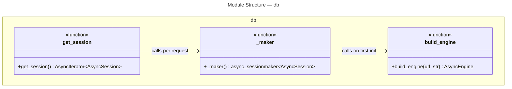
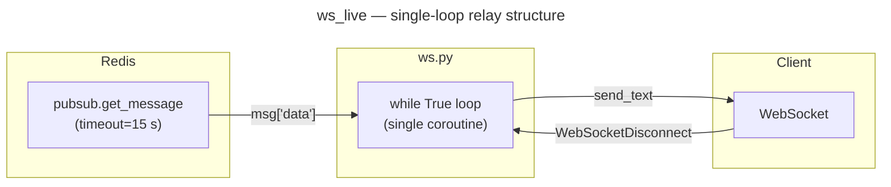
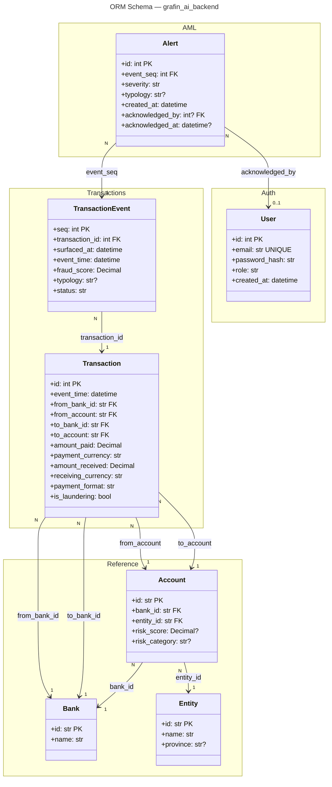

# C4 Code Level: grafin_ai_backend

## Overview

- **Name**: Grafin AI Backend — Python Package
- **Description**: Core application package for the Grafin AI real-time AML detection platform. Implements the FastAPI service, async database and Redis layers, argon2id authentication with JWT token rotation, RBAC, Prometheus observability, all SQLAlchemy 2.0 ORM models, a full view-endpoint layer (metrics, analytics, geo, transactions, user-risk, alerts, system health), and — as of Phase 2 — a token-gated ingest write-path (`POST /api/v1/ingest`) that scores batches via the outbound grafin-ai-scoring service, persists them idempotently, and publishes new events to `grafin:events:live`.
- **Location**: [`grafin_ai_backend/`](../../grafin_ai_backend/)
- **Language**: Python 3.12+
- **Purpose**: Serves the API surface for the AML dashboard, persists transaction and alert data, authenticates users via JWT access/refresh token pairs, enforces role-based access control, exposes read aggregates bounded by the data clock (`max(transaction_events.event_time)`) and backed by Redis caching, applies PII masking for non-admin roles, and provides health/metrics endpoints for platform observability.
- **Version**: `0.1.0` (declared in `grafin_ai_backend/__init__.py`)

---

## Module Index

| Module | File | Responsibility |
|---|---|---|
| `config` | `config.py` | Application settings via pydantic-settings; JWT and Redis fields; fail-closed secret validator |
| `db` | `db.py` | Async SQLAlchemy engine and session factory |
| `redis_client` | `redis_client.py` | Async Redis singleton factory |
| `observability` | `observability.py` | Prometheus registry, counters, structured logging |
| `main` | `main.py` | FastAPI application, lifecycle, HTTP routes |
| `security.passwords` | `security/passwords.py` | Argon2id hashing; dummy_verify for timing equalization |
| `security.tokens` | `security/tokens.py` | JWT access/refresh token creation and decode; `InvalidToken` |
| `security.refresh_store` | `security/refresh_store.py` | Redis-backed refresh JTI store with atomic consume |
| `repositories.users` | `repositories/users.py` | `UserRepository` — DB access for `User` rows |
| `repositories.metrics` | `repositories/metrics.py` | `MetricsRepository` — overview, volume, heatmap aggregates |
| `repositories.analytics` | `repositories/analytics.py` | `AnalyticsRepository` — typology distribution and confusion counts |
| `repositories.geo` | `repositories/geo.py` | `GeoRepository` — province-level fraud counts |
| `repositories.transactions` | `repositories/transactions.py` | `TransactionsRepository` — live window and detail queries |
| `repositories.users_view` | `repositories/users_view.py` | `UserRiskRepository` — entity risk-profile aggregates |
| `repositories.alerts` | `repositories/alerts.py` | `AlertsRepository` — alert list and acknowledge |
| `repositories.ingest` *(Phase 2)* | `repositories/ingest.py` | `IngestRepository` — enrich lookups + idempotent batch persist; `InsertedEvent` |
| `services.auth` | `services/auth.py` | `AuthService` — authenticate, token rotation, logout; `TokenPair`, `AuthError` |
| `services.scoring_client` *(Phase 2)* | `services/scoring_client.py` | `ScoringClient` — resilient httpx client for grafin-ai-scoring `POST /v1/score`; `ScoringUnavailable` |
| `api.schemas` | `api/schemas.py` | Pydantic request/response models for the auth API |
| `api.view_schemas` | `api/view_schemas.py` | Pydantic response models for all view endpoints |
| `api.deps` | `api/deps.py` | FastAPI dependency functions; `CurrentUser`; `NowDep` (data clock); `require_role` factory |
| `api.masking` | `api/masking.py` | PII masking helpers: names and account/payment IDs |
| `api.cache` | `api/cache.py` | `cached_json` — Redis aggregate cache with data-clock-keyed TTL |
| `api.ratelimit` | `api/ratelimit.py` | `RateLimiter` — Redis fixed-window rate limiting |
| `api.auth` | `api/auth.py` | Auth router: login / refresh / logout / me |
| `api.metrics` | `api/metrics.py` | Metrics router: overview / volume / heatmap (cached) |
| `api.analytics` | `api/analytics.py` | Analytics router: fraud distribution + precision/recall/F1 (cached) |
| `api.geo` | `api/geo.py` | Geo router: province fraud counts (cached) |
| `api.transactions` | `api/transactions.py` | Transactions router: live window / detail (NOT cached) |
| `api.users_view` | `api/users_view.py` | Users router: risk list / entity profile (role-masked) |
| `api.alerts` | `api/alerts.py` | Alerts router: list / acknowledge |
| `api.system` | `api/system.py` | System router: health check |
| `api.ws_auth` | `api/ws_auth.py` | `authenticate_ws_token` — validates WS query-param access token; reuses `decode_token` |
| `api.ws` | `api/ws.py` | WebSocket router: `ws_live` handler at `WS /api/v1/ws/live` |
| `api.ingest_auth` *(Phase 2)* | `api/ingest_auth.py` | `require_ingest_token` — bearer `GRAFIN_INGEST_TOKEN` dependency (settings-only, constant-time) |
| `api.ingest_schemas` *(Phase 2)* | `api/ingest_schemas.py` | Pydantic request/response models for the ingest write-path |
| `api.ingest` *(Phase 2)* | `api/ingest.py` | Ingest router: `POST /api/v1/ingest` — enrich → score → persist → publish |
| `realtime.channels` | `realtime/channels.py` | `LIVE_EVENTS_CHANNEL` constant — shared Redis pub/sub channel name (cross-repo coupling) |
| `seed` | `seed.py` | `ensure_admin` — idempotent DB seed |
| `schema.base` | `schema/base.py` | Declarative ORM base |
| `schema.reference` | `schema/reference.py` | Reference tables: Bank, Entity, Account |
| `schema.transactions` | `schema/transactions.py` | Core event tables: Transaction, TransactionEvent |
| `schema.alerts` | `schema/alerts.py` | Alert table |
| `schema.users` | `schema/users.py` | User table |
| `schema` | `schema/__init__.py` | Package re-exports for all ORM models |

---

## Module: `config`

- **File**: [`grafin_ai_backend/config.py`](../../grafin_ai_backend/config.py)
- **External dependencies**: `pydantic-settings`, `pydantic.model_validator`, `functools.lru_cache`

### Class: `Settings`

```
class Settings(BaseSettings)
```

| Attribute | Type | Default | Description |
|---|---|---|---|
| `database_url` | `str` | required | Async-compatible SQLAlchemy connection URL |
| `env` | `str` | `"development"` | Deployment environment name |
| `log_level` | `str` | `"INFO"` | Python logging level string |
| `redis_url` | `str` | `"redis://localhost:6379/0"` | Redis connection URL used by `redis_client` and `RefreshTokenStore` |
| `jwt_secret` | `str` | `"change-me-in-prod"` | HMAC secret for JWT signing; validated by `_require_strong_jwt_secret_outside_dev` |
| `jwt_algorithm` | `str` | `"HS256"` | JWT signature algorithm |
| `jwt_access_ttl_min` | `int` | `15` | Access token lifetime in minutes |
| `jwt_refresh_ttl_days` | `int` | `7` | Refresh token lifetime in days |
| `scoring_url` | `str` | required | Base URL of the grafin-ai-scoring service *(Phase 2)* |
| `scoring_token` | `str` | required (`min_length=1`) | Bearer token for the scoring service *(Phase 2)* |
| `ingest_token` | `str` | required (`min_length=16`) | Shared bearer token gating `POST /api/v1/ingest` *(Phase 2)* |
| `scoring_timeout_s` | `float` | `5.0` | Per-call timeout for the scoring client *(Phase 2)* |
| `scoring_retries` | `int` | `2` | Bounded retry count for transient scoring failures *(Phase 2)* |

**Configuration**: reads environment variables with prefix `GRAFIN_`; optionally from `.env`. Extra variables are silently ignored (`extra="ignore"`).

**Inherits from**: `pydantic_settings.BaseSettings`

#### Validator: `_require_strong_jwt_secret_outside_dev`

```python
@model_validator(mode="after")
def _require_strong_jwt_secret_outside_dev(self) -> "Settings"
```

- **Description**: Fail-closed guard. Raises `ValueError` at startup if `env != "development"` and `jwt_secret` is either the default placeholder or fewer than 32 characters. RFC 7518 requires >= 32 bytes for HS256. This prevents accidentally deploying production with the default secret.
- **Returns**: `Settings` (self) if valid
- **Raises**: `ValueError` on misconfiguration

### Function: `get_settings`

```python
@lru_cache(maxsize=1)
def get_settings() -> Settings
```

- **Description**: Returns the singleton `Settings` instance. `lru_cache(maxsize=1)` ensures construction happens exactly once per process.
- **Returns**: `Settings`
- **Dependencies**: `Settings`, `functools.lru_cache`

---

## Module: `db`

- **File**: [`grafin_ai_backend/db.py`](../../grafin_ai_backend/db.py)
- **External dependencies**: `sqlalchemy.ext.asyncio` (AsyncEngine, AsyncSession, async_sessionmaker, create_async_engine)
- **Internal dependencies**: `grafin_ai_backend.config.get_settings`

### Module-level state

| Name | Type | Description |
|---|---|---|
| `_engine` | `AsyncEngine \| None` | Module-level singleton engine; `None` until first call to `_maker()` |
| `_sessionmaker` | `async_sessionmaker[AsyncSession] \| None` | Module-level singleton session factory; `None` until first call to `_maker()` |

### Function: `build_engine`

```python
def build_engine(url: str) -> AsyncEngine
```

- **Description**: Creates and configures an async SQLAlchemy engine from a connection URL. Enables `pool_pre_ping`, sets pool size to 10 with overflow of 5.
- **Parameters**: `url: str` — fully-qualified async database URL
- **Returns**: `AsyncEngine`

### Function: `_maker`

```python
def _maker() -> async_sessionmaker[AsyncSession]
```

- **Description**: Returns the module-level session factory, constructing it on first call. Not intended to be called from outside this module.
- **Returns**: `async_sessionmaker[AsyncSession]`
- **Side effects**: Sets module globals `_engine` and `_sessionmaker` on first call.

### Function: `get_session`

```python
async def get_session() -> AsyncIterator[AsyncSession]
```

- **Description**: FastAPI dependency that yields a single `AsyncSession` for the lifetime of one HTTP request. Note: `api/deps.py` defines its own `get_session` wrapper around `_maker()` — both patterns are in use.
- **Returns**: `AsyncIterator[AsyncSession]`



---

## Module: `redis_client`

- **File**: [`grafin_ai_backend/redis_client.py`](../../grafin_ai_backend/redis_client.py)
- **External dependencies**: `redis.asyncio.Redis`
- **Internal dependencies**: `grafin_ai_backend.config.get_settings`

### Module-level state

| Name | Type | Description |
|---|---|---|
| `_redis` | `Redis \| None` | Module-level singleton; `None` until first call to `get_redis()` |

### Function: `build_redis`

```python
def build_redis(url: str) -> Redis
```

- **Description**: Constructs a `redis.asyncio.Redis` client from a URL string. Sets `decode_responses=True` so all values returned from Redis are `str`, not `bytes`.
- **Parameters**: `url: str` — Redis connection URL (e.g. `redis://localhost:6379/0`)
- **Returns**: `redis.asyncio.Redis`

### Function: `get_redis`

```python
def get_redis() -> Redis
```

- **Description**: Lazy singleton accessor. Returns the existing `_redis` instance or calls `build_redis(get_settings().redis_url)` on first invocation. Used as the source of the `RedisDep` FastAPI dependency.
- **Returns**: `redis.asyncio.Redis`
- **Dependencies**: `build_redis`, `get_settings`

---

## Module: `observability`

- **File**: [`grafin_ai_backend/observability.py`](../../grafin_ai_backend/observability.py)
- **External dependencies**: `prometheus_client` (CollectorRegistry, Counter, Histogram), `structlog`, `logging`

### Module-level objects

| Name | Type | Description |
|---|---|---|
| `REGISTRY` | `prometheus_client.CollectorRegistry` | Isolated Prometheus registry; avoids polluting the global default registry |
| `REQUEST_COUNT` | `prometheus_client.Counter` | Counter `grafin_http_requests_total` with labels `method`, `path`, `status` |
| `INGEST_TRANSACTIONS` *(Phase 2)* | `prometheus_client.Counter` | Counter `grafin_ingest_transactions_total` with label `result` (bounded cardinality: `inserted` \| `duplicate`) |
| `INGEST_SCORING_LATENCY` *(Phase 2)* | `prometheus_client.Histogram` | Histogram `grafin_ingest_scoring_latency_seconds` — latency of the outbound scoring call from `/ingest`; buckets `0.005 … 1.0` s |

### Function: `configure_logging`

```python
def configure_logging(level: str = "INFO") -> None
```

- **Description**: Configures Python's `logging` module and `structlog` for structured JSON output with `add_log_level`, `TimeStamper(fmt="iso")`, and `JSONRenderer` processors.
- **Parameters**: `level: str` — Python logging level name (default `"INFO"`)
- **Returns**: `None`

---

## Module: `main`

- **File**: [`grafin_ai_backend/main.py`](../../grafin_ai_backend/main.py)
- **External dependencies**: `fastapi`, `httpx`, `prometheus_client`, `sqlalchemy.text`, `contextlib.asynccontextmanager`
- **Internal dependencies**: `config.get_settings`, `db._maker`, `observability.REGISTRY`, `observability.configure_logging`, all API routers (including `api.ingest.router` *(Phase 2)*)

### Object: `app`

```python
app = FastAPI(title="Grafin AI Backend", version="0.1.0", lifespan=lifespan)
```

The root ASGI application instance. On import, calls `get_settings()` and `configure_logging(settings.log_level)` as side effects. Mounts all routers via `include_router`, including the Phase 2 `ingest_router`.

### Lifespan: `lifespan` *(Phase 2)*

```python
@asynccontextmanager
async def lifespan(app: FastAPI)
```

- **Description**: Opens one pooled `httpx.AsyncClient` at startup and stores it on `app.state.http_client` (shared by the `ScoringClient`), closing it on shutdown. This is the connection pool behind the backend's outbound scoring calls.

### Route: `GET /healthz`

```python
@app.get("/healthz")
async def healthz() -> dict[str, str]
```

- **Description**: Liveness probe. Returns `{"status": "ok"}` unconditionally.

### Route: `GET /readyz`

```python
@app.get("/readyz")
async def readyz() -> Response
```

- **Description**: Readiness probe. Executes `SELECT 1` via a temporary DB session; returns HTTP 503 on failure.
- **Dependencies**: `db._maker`, `sqlalchemy.text`

### Route: `GET /metrics`

```python
@app.get("/metrics")
async def metrics() -> Response
```

- **Description**: Prometheus scrape endpoint. Serialises all metrics in `REGISTRY`.
- **Dependencies**: `observability.REGISTRY`, `prometheus_client.generate_latest`

---

## Module: `security.passwords`

- **File**: [`grafin_ai_backend/security/passwords.py`](../../grafin_ai_backend/security/passwords.py)
- **External dependencies**: `argon2` (`PasswordHasher`, `VerifyMismatchError`)

### Module-level state

| Name | Type | Description |
|---|---|---|
| `_ph` | `argon2.PasswordHasher` | Shared Argon2id hasher instance |
| `_DUMMY_HASH` | `str` | Pre-computed Argon2id hash of a fixed placeholder string used by `dummy_verify` |

### Function: `hash_password`

```python
def hash_password(plain: str) -> str
```

- **Description**: Hashes a plaintext password using Argon2id via `_ph.hash()`.
- **Parameters**: `plain: str` — cleartext password
- **Returns**: `str` — Argon2id encoded hash string
- **Dependencies**: `_ph`

### Function: `verify_password`

```python
def verify_password(plain: str, hashed: str) -> bool
```

- **Description**: Verifies a plaintext password against an Argon2id hash. Returns `False` on `VerifyMismatchError`; propagates other exceptions.
- **Parameters**:
  - `plain: str` — cleartext password to verify
  - `hashed: str` — stored Argon2id hash
- **Returns**: `bool`
- **Dependencies**: `_ph`, `argon2.exceptions.VerifyMismatchError`

### Function: `dummy_verify`

```python
def dummy_verify() -> None
```

- **Description**: Runs `verify_password("x", _DUMMY_HASH)` to consume an Argon2id verification's worth of CPU time. Called by `AuthService.authenticate` when a user is not found, so that an attacker cannot distinguish unknown email addresses from wrong passwords by measuring response latency.
- **Returns**: `None`
- **Dependencies**: `verify_password`, `_DUMMY_HASH`

---

## Module: `security.tokens`

- **File**: [`grafin_ai_backend/security/tokens.py`](../../grafin_ai_backend/security/tokens.py)
- **External dependencies**: `PyJWT` (`jwt`), `datetime`, `uuid`

### Class: `InvalidToken`

```python
class InvalidToken(Exception)
```

- **Description**: Raised by `decode_token` when a JWT fails signature verification, is expired, or is missing required claims. Callers should treat this as a terminal auth failure.

### Function: `create_access_token`

```python
def create_access_token(
    subject: str, role: str, secret: str, ttl_min: int, algorithm: str = "HS256"
) -> str
```

- **Description**: Creates a short-lived access JWT with claims `sub`, `role`, `type="access"`, `iat`, `exp`.
- **Parameters**:
  - `subject: str` — user ID (string form)
  - `role: str` — RBAC role embedded in the token
  - `secret: str` — HMAC signing key
  - `ttl_min: int` — token lifetime in minutes
  - `algorithm: str` — JWT algorithm (default `"HS256"`)
- **Returns**: `str` — encoded JWT

### Function: `create_refresh_token`

```python
def create_refresh_token(
    subject: str, secret: str, ttl_days: int, algorithm: str = "HS256"
) -> str
```

- **Description**: Creates a long-lived refresh JWT with claims `sub`, `type="refresh"`, `jti` (UUID hex, used as the Redis store key), `iat`, `exp`.
- **Parameters**:
  - `subject: str` — user ID
  - `secret: str` — HMAC signing key
  - `ttl_days: int` — token lifetime in days
  - `algorithm: str` — JWT algorithm (default `"HS256"`)
- **Returns**: `str` — encoded JWT

### Function: `decode_token`

```python
def decode_token(token: str, secret: str, algorithm: str = "HS256") -> dict
```

- **Description**: Decodes and validates a JWT. Requires `exp`, `iat`, and `sub` claims. Applies a 10-second leeway on expiry. Wraps any `jwt.PyJWTError` as `InvalidToken`.
- **Parameters**:
  - `token: str` — encoded JWT string
  - `secret: str` — HMAC signing key
  - `algorithm: str` — JWT algorithm (default `"HS256"`)
- **Returns**: `dict` — decoded payload
- **Raises**: `InvalidToken` on any JWT validation failure

---

## Module: `security.refresh_store`

- **File**: [`grafin_ai_backend/security/refresh_store.py`](../../grafin_ai_backend/security/refresh_store.py)
- **External dependencies**: `redis.asyncio.Redis`

### Class: `RefreshTokenStore`

```python
class RefreshTokenStore
```

- **Description**: Stores valid refresh-token JTIs in Redis, keyed as `refresh:{jti}`, with the value being the owning `user_id` string. Provides save, validation, atomic single-use consumption, and explicit revocation. Backed by TTL expiry so tokens auto-expire from Redis when they expire from the JWT.

#### Method: `__init__`

```python
def __init__(self, redis: Redis) -> None
```

- **Parameters**: `redis: Redis` — async Redis client

#### Static Method: `_key`

```python
@staticmethod
def _key(jti: str) -> str
```

- **Description**: Returns `f"refresh:{jti}"` — the Redis key namespace for refresh JTIs.

#### Method: `save`

```python
async def save(self, jti: str, user_id: str, ttl_seconds: int) -> None
```

- **Description**: Stores `user_id` at `refresh:{jti}` with TTL `ttl_seconds`. Called immediately after a refresh token is issued.
- **Parameters**:
  - `jti: str` — UUID hex from the token's `jti` claim
  - `user_id: str` — string user ID
  - `ttl_seconds: int` — Redis TTL matching the token's JWT expiry

#### Method: `is_valid`

```python
async def is_valid(self, jti: str, user_id: str) -> bool
```

- **Description**: Checks that the JTI exists in Redis and belongs to the given user. Does not consume the token.
- **Returns**: `bool`

#### Method: `consume`

```python
async def consume(self, jti: str, user_id: str) -> bool
```

- **Description**: Atomically fetches and deletes the JTI entry using Redis `GETDEL`. Returns `True` only if the entry existed and matched `user_id`. The atomicity closes the validate-then-revoke race that would allow two concurrent refresh requests to both spend the same token (refresh token rotation replay attack).
- **Returns**: `bool`

#### Method: `revoke`

```python
async def revoke(self, jti: str) -> None
```

- **Description**: Deletes the JTI entry from Redis unconditionally. Used during logout.

---

## Module: `repositories.users`

- **File**: [`grafin_ai_backend/repositories/users.py`](../../grafin_ai_backend/repositories/users.py)
- **External dependencies**: `sqlalchemy.ext.asyncio.AsyncSession`, `sqlalchemy.select`
- **Internal dependencies**: `grafin_ai_backend.schema.User`

### Class: `UserRepository`

```python
class UserRepository
```

- **Description**: Data-access object for the `users` table. Wraps an `AsyncSession` and provides typed async queries. Does not commit — callers own the transaction boundary.

#### Method: `__init__`

```python
def __init__(self, session: AsyncSession) -> None
```

- **Parameters**: `session: AsyncSession` — active SQLAlchemy async session

#### Method: `get_by_email`

```python
async def get_by_email(self, email: str) -> User | None
```

- **Description**: Executes `SELECT * FROM users WHERE email = ?`. Returns the matching `User` or `None`.
- **Parameters**: `email: str`
- **Returns**: `User | None`

#### Method: `get_by_id`

```python
async def get_by_id(self, user_id: int) -> User | None
```

- **Description**: Fetches a `User` by primary key using `session.get()` (uses identity map before hitting the DB).
- **Parameters**: `user_id: int`
- **Returns**: `User | None`

#### Method: `create`

```python
async def create(
    self, email: str, password_hash: str, role: str, created_at: datetime
) -> User
```

- **Description**: Constructs a `User` ORM object, adds it to the session, and calls `flush()` to assign the surrogate `id` without committing. The caller is responsible for `commit()`.
- **Parameters**:
  - `email: str`
  - `password_hash: str` — pre-hashed credential (Argon2id)
  - `role: str` — RBAC role (`"admin"` or `"analyst"`)
  - `created_at: datetime` — timezone-aware creation timestamp
- **Returns**: `User` (with `id` populated after flush)

---

## Module: `repositories.metrics`

- **File**: [`grafin_ai_backend/repositories/metrics.py`](../../grafin_ai_backend/repositories/metrics.py)
- **External dependencies**: `sqlalchemy` (case, cast, func, select, Integer)
- **Internal dependencies**: `grafin_ai_backend.schema.Transaction`, `grafin_ai_backend.schema.TransactionEvent`
- **Cache note**: All three methods are called exclusively through `cached_json` in `api/metrics.py`. Cache keys carry the data clock (`overview:{now}`, `volume:{range}:{now}`, `heatmap:{now}`), TTL = 5 s.

### Class: `MetricsRepository`

```python
class MetricsRepository
```

- **Description**: SQL aggregate repository for the metrics dashboard panel. All queries apply the `event_time <= now` filter, so results are bounded by business time on the replayed dataset's timeline rather than by ingestion time or the wall clock.

#### Method: `__init__`

```python
def __init__(self, session: AsyncSession) -> None
```

#### Method: `overview`

```python
async def overview(self, now: datetime) -> dict
```

- **Description**: Returns a single-row aggregate over all `TransactionEvent` rows with `event_time <= now`, joined to `Transaction` for `amount_paid`. Computes total count, flagged count (status=`"flagged"`), blocked count (status=`"blocked"`), total amount, and fraud rate (flagged+blocked / total).
- **Parameters**: `now: datetime` — data clock; upper bound on `event_time`
- **Returns**: `dict` with keys `total_transactions`, `flagged`, `blocked`, `total_amount`, `fraud_rate`

#### Method: `volume`

```python
async def volume(self, lower: datetime, now: datetime, trunc: str) -> list[dict]
```

- **Description**: Time-bucketed event volume. Groups `TransactionEvent` rows within `[lower, now]` by `date_trunc(trunc, TransactionEvent.event_time)`, counting total events and flagged/blocked events per bucket. Bucketing on business time keeps the series aligned with the dataset's own timeline rather than with whenever the backfill happened to run.
- **Parameters**:
  - `lower: datetime` — window start (derived from range selection in the router)
  - `now: datetime` — window end / data clock upper bound
  - `trunc: str` — PostgreSQL `date_trunc` granularity (`"hour"`, `"day"`, or `"month"`)
- **Returns**: `list[dict]` with keys `bucket` (ISO string), `count`, `flagged`

#### Method: `heatmap`

```python
async def heatmap(self, now: datetime) -> list[list[int]]
```

- **Description**: Builds a 7×24 activity heatmap (day-of-week × hour-of-day) counting all events with `event_time <= now`. Day-of-week and hour are `extract`ed from `TransactionEvent.event_time`, so the cells describe when the transactions actually happened. Returns a 2D list `grid[dow][hour]` where each cell is the event count. Unobserved cells are 0.
- **Parameters**: `now: datetime`
- **Returns**: `list[list[int]]` — shape `[7][24]`

---

## Module: `repositories.analytics`

- **File**: [`grafin_ai_backend/repositories/analytics.py`](../../grafin_ai_backend/repositories/analytics.py)
- **External dependencies**: `sqlalchemy` (case, func, select)
- **Internal dependencies**: `grafin_ai_backend.schema.Transaction`, `grafin_ai_backend.schema.TransactionEvent`
- **Cache note**: Both methods are called through `cached_json` in `api/analytics.py`. Cache key `fraud:{now}`, TTL = 5 s.

### Class: `AnalyticsRepository`

```python
class AnalyticsRepository
```

- **Description**: SQL aggregate repository for the fraud analytics panel. Provides typology distribution and confusion matrix counts for precision/recall/F1 calculation. Confusion matrix joins `TransactionEvent.status` (model prediction) against `Transaction.is_laundering` (AMLSim ground-truth label).

#### Method: `__init__`

```python
def __init__(self, session: AsyncSession) -> None
```

#### Method: `typology_distribution`

```python
async def typology_distribution(self, now: datetime) -> list[dict]
```

- **Description**: Aggregates flagged `TransactionEvent` rows by `typology`, counting occurrences and summing `Transaction.amount_paid`. Filters to rows where `event_time <= now` and `typology IS NOT NULL`. Ordered by count descending.
- **Parameters**: `now: datetime` — data clock; upper bound on `event_time`
- **Returns**: `list[dict]` with keys `typology`, `count`, `total_amount`

#### Method: `confusion_counts`

```python
async def confusion_counts(self, now: datetime) -> dict
```

- **Description**: Computes true-positive (TP), false-positive (FP), and false-negative (FN) counts by joining `TransactionEvent` (model predictions) to `Transaction.is_laundering` (ground-truth labels). Predicted positive = status in (`"flagged"`, `"blocked"`); actual positive = `is_laundering IS TRUE`. Filters `event_time <= now`.
- **Parameters**: `now: datetime` — data clock; upper bound on `event_time`
- **Returns**: `dict` with integer keys `tp`, `fp`, `fn`. Used by `api/analytics.py._metrics()` to derive precision, recall, and F1.

---

## Module: `repositories.geo`

- **File**: [`grafin_ai_backend/repositories/geo.py`](../../grafin_ai_backend/repositories/geo.py)
- **External dependencies**: `sqlalchemy` (func, select)
- **Internal dependencies**: `grafin_ai_backend.schema.Account`, `grafin_ai_backend.schema.Entity`, `grafin_ai_backend.schema.Transaction`, `grafin_ai_backend.schema.TransactionEvent`
- **Cache note**: Called through `cached_json` in `api/geo.py`. Cache key `geo:{now}`, TTL = 10 s.

### Class: `GeoRepository`

```python
class GeoRepository
```

- **Description**: SQL aggregate repository for the geographic fraud distribution panel. Joins transaction events through the account-entity chain to resolve sender province.

#### Method: `__init__`

```python
def __init__(self, session: AsyncSession) -> None
```

#### Method: `province_fraud_counts`

```python
async def province_fraud_counts(self, now: datetime) -> list[dict]
```

- **Description**: Counts flagged/blocked events per sender province by joining `TransactionEvent → Transaction → Account → Entity`. Applies `event_time <= now`, filters to status in (`"flagged"`, `"blocked"`), excludes rows where `Entity.province IS NULL`. Groups by province, orders by count descending.
- **Parameters**: `now: datetime` — data clock; upper bound on `event_time`
- **Returns**: `list[dict]` with keys `province`, `fraud_count`

---

## Module: `repositories.transactions`

- **File**: [`grafin_ai_backend/repositories/transactions.py`](../../grafin_ai_backend/repositories/transactions.py)
- **External dependencies**: `sqlalchemy.select`
- **Internal dependencies**: `grafin_ai_backend.schema.Bank`, `grafin_ai_backend.schema.Transaction`, `grafin_ai_backend.schema.TransactionEvent`
- **Cache note**: NOT cached. The live feed must reflect the most recent events in real time; caching would delay the resync source used by the dashboard.

### Class: `TransactionsRepository`

```python
class TransactionsRepository
```

- **Description**: SQL query repository for the live transaction feed and per-transaction detail view. Not cached — results are read directly from the database on every request.

#### Method: `__init__`

```python
def __init__(self, session: AsyncSession) -> None
```

#### Method: `live_window`

```python
async def live_window(
    self, now: datetime, after_seq: int | None, limit: int
) -> list[dict]
```

- **Description**: Returns a paginated window of `TransactionEvent` rows with `event_time <= now`, joined to `Transaction` and `Bank`. If `after_seq` is provided, returns events with `seq > after_seq` in ascending order (forward-streaming mode for the live feed). If `after_seq` is `None`, returns the most recent events in descending order (initial load). Respects `limit` (max 200 per call).
- **Parameters**:
  - `now: datetime` — data clock; upper bound on `event_time`
  - `after_seq: int | None` — cursor for incremental polling; `None` for initial fetch
  - `limit: int` — maximum number of rows to return
- **Returns**: `list[dict]` with keys `seq`, `transaction_id`, `bank`, `type`, `amount`, `fraud_score`, `typology`, `status`, `surfaced_at`, `event_time`. This is exactly the key set the WebSocket relay pushes (see `api/ingest.py`), so the live list and its `after_seq=` reconnect-backfill agree field-for-field.

#### Method: `detail`

```python
async def detail(self, transaction_id: int) -> dict | None
```

- **Description**: Fetches full detail for a single transaction by joining `Transaction → Bank` and `Transaction → TransactionEvent`. Returns `None` if the transaction does not exist or has no associated event.
- **Parameters**: `transaction_id: int`
- **Returns**: `dict | None` with keys `id`, `bank`, `amount`, `currency`, `type`, `fraud_score`, `typology`, `status`, `is_laundering`, `event_time`

---

## Module: `repositories.users_view`

- **File**: [`grafin_ai_backend/repositories/users_view.py`](../../grafin_ai_backend/repositories/users_view.py)
- **External dependencies**: `sqlalchemy` (func, select)
- **Internal dependencies**: `grafin_ai_backend.schema.Account`, `grafin_ai_backend.schema.Entity`, `grafin_ai_backend.schema.Transaction`, `grafin_ai_backend.schema.TransactionEvent`
- **Cache note**: NOT cached directly. The router applies role-aware masking post-fetch so the cached form would leak PII; masking must happen in the request context.

### Class: `UserRiskRepository`

```python
class UserRiskRepository
```

- **Description**: SQL aggregate repository for the entity risk-profile panel. Joins entities through accounts to transactions and events to compute per-entity risk metrics. The `event_time <= now` filter is applied as an outer-join condition so entities with no visible events are still returned (with zero counts).

#### Method: `__init__`

```python
def __init__(self, session: AsyncSession) -> None
```

#### Method: `risk_list`

```python
async def risk_list(self, now: datetime, risk: str | None, limit: int) -> list[dict]
```

- **Description**: Aggregates entity-level risk metrics by joining `Entity → Account → Transaction → TransactionEvent` (with `event_time <= now` as an outer-join predicate). Groups by entity + account. Optionally filters by `Account.risk_category`. Orders by `risk_score DESC NULLS LAST`. Returned names are unmasked — the router applies `mask_name` for non-admin callers.
- **Parameters**:
  - `now: datetime` — data clock upper bound (applied on the join condition, not as a `WHERE`, so entities without visible events survive the join)
  - `risk: str | None` — optional filter on `Account.risk_category`
  - `limit: int` — maximum rows to return
- **Returns**: `list[dict]` with keys `entity_id`, `name`, `province`, `risk_level`, `risk_score`, `total_transactions`, `flagged_transactions`, `total_amount`

#### Method: `profile`

```python
async def profile(self, now: datetime, entity_id: str) -> dict | None
```

- **Description**: Fetches the risk profile for a single entity by calling `risk_list` with `limit=1000` and filtering the result by `entity_id`. Returns `None` if not found.
- **Parameters**:
  - `now: datetime`
  - `entity_id: str`
- **Returns**: `dict | None` (same shape as `risk_list` rows)

---

## Module: `repositories.alerts`

- **File**: [`grafin_ai_backend/repositories/alerts.py`](../../grafin_ai_backend/repositories/alerts.py)
- **External dependencies**: `sqlalchemy.select`
- **Internal dependencies**: `grafin_ai_backend.schema.Alert`

### Class: `AlertsRepository`

```python
class AlertsRepository
```

- **Description**: Data-access object for the `alerts` table. Provides listing (with optional active-only filter) and acknowledgement write operations.

#### Method: `__init__`

```python
def __init__(self, session: AsyncSession) -> None
```

#### Method: `list_alerts`

```python
async def list_alerts(self, active_only: bool) -> list[Alert]
```

- **Description**: Returns `Alert` ORM objects ordered by `created_at DESC`. If `active_only=True`, adds a `WHERE acknowledged_at IS NULL` predicate to exclude already-acknowledged alerts.
- **Parameters**: `active_only: bool`
- **Returns**: `list[Alert]`

#### Method: `acknowledge`

```python
async def acknowledge(self, alert_id: int, user_id: int) -> Alert | None
```

- **Description**: Sets `acknowledged_by` and `acknowledged_at` (UTC now) on the given alert. Calls `flush()` without committing — the router owns the commit. Returns `None` if the alert does not exist.
- **Parameters**:
  - `alert_id: int`
  - `user_id: int` — the reviewing analyst's user ID
- **Returns**: `Alert | None`

---

## Module: `services.auth`

- **File**: [`grafin_ai_backend/services/auth.py`](../../grafin_ai_backend/services/auth.py)
- **External dependencies**: `dataclasses`
- **Internal dependencies**: `repositories.users.UserRepository`, `security.passwords.{dummy_verify, verify_password}`, `security.refresh_store.RefreshTokenStore`, `security.tokens.{InvalidToken, create_access_token, create_refresh_token, decode_token}`

### Class: `AuthError`

```python
class AuthError(Exception)
```

- **Description**: Raised by `AuthService` methods on any authentication or token-refresh failure. Callers (HTTP handlers) translate this to HTTP 401.

### Dataclass: `TokenPair`

```python
@dataclass(frozen=True)
class TokenPair:
    access_token: str
    refresh_token: str
```

- **Description**: Immutable value object returned from `AuthService._issue`. Holds both tokens of a freshly issued pair.

### Class: `AuthService`

```python
class AuthService
```

- **Description**: Orchestrates the full authentication lifecycle: credential verification, token issuance, refresh rotation, and logout. Depends on `UserRepository` (DB) and `RefreshTokenStore` (Redis).

#### Method: `__init__`

```python
def __init__(
    self,
    users: UserRepository,
    refresh_store: RefreshTokenStore,
    secret: str,
    access_ttl_min: int,
    refresh_ttl_days: int,
) -> None
```

#### Private Method: `_issue`

```python
async def _issue(self, user_id: str, role: str) -> TokenPair
```

- **Description**: Creates an access token, a refresh token, decodes the refresh token to extract its `jti`, saves the JTI in `RefreshTokenStore`, and returns a `TokenPair`. Called by both `authenticate` and `refresh`.

#### Method: `authenticate`

```python
async def authenticate(self, email: str, password: str) -> TokenPair
```

- **Description**: Looks up the user by email. If not found, calls `dummy_verify()` to equalize Argon2id timing before raising `AuthError("invalid credentials")`. If found, verifies the password and issues a fresh `TokenPair`.
- **Raises**: `AuthError` on invalid credentials

#### Method: `refresh`

```python
async def refresh(self, refresh_token: str) -> TokenPair
```

- **Description**: Implements single-use refresh token rotation. Decodes the token, asserts `type == "refresh"`, atomically consumes the JTI from `RefreshTokenStore` (GETDEL), fetches the user, and issues a new `TokenPair` (new access + new refresh). If the JTI was already consumed or revoked, raises `AuthError`.
- **Raises**: `AuthError` on any failure
- **Security note**: The atomic `consume` step prevents replay attacks where two concurrent requests both try to use the same refresh token.

#### Method: `logout`

```python
async def logout(self, refresh_token: str) -> None
```

- **Description**: Decodes the refresh token (silently ignores `InvalidToken`), and if it is a valid refresh token with a `jti`, revokes the JTI from `RefreshTokenStore`. Logout is best-effort — an already-expired or invalid token does not raise.

---

## Module: `api.schemas`

- **File**: [`grafin_ai_backend/api/schemas.py`](../../grafin_ai_backend/api/schemas.py)
- **External dependencies**: `pydantic` (BaseModel)

### Class: `LoginRequest`

```python
class LoginRequest(BaseModel):
    email: str
    password: str
```

- **Description**: Request body for `POST /api/v1/auth/login`. `email` is plain `str` (not `EmailStr`) because login performs an exact database lookup; using `EmailStr` caused Pydantic to reject the seeded `admin@grafin.ai` address with a 422 due to the reserved `.local` TLD.

### Class: `RefreshRequest`

```python
class RefreshRequest(BaseModel):
    refresh_token: str
```

- **Description**: Request body for `POST /api/v1/auth/refresh` and `POST /api/v1/auth/logout`.

### Class: `TokenResponse`

```python
class TokenResponse(BaseModel):
    access_token: str
    refresh_token: str
    token_type: str = "bearer"
```

- **Description**: Response body for login and refresh endpoints. Follows OAuth2 Bearer token convention.

### Class: `MeResponse`

```python
class MeResponse(BaseModel):
    id: int
    email: str
    role: str
```

- **Description**: Response body for `GET /api/v1/auth/me`. Returns non-sensitive user identity fields. `email` is plain `str` for the same reason as `LoginRequest.email`.

---

## Module: `api.view_schemas`

- **File**: [`grafin_ai_backend/api/view_schemas.py`](../../grafin_ai_backend/api/view_schemas.py)
- **External dependencies**: `pydantic` (BaseModel), `datetime`

Pydantic response models for all view endpoints. Every class is a pure `BaseModel` with no custom validators.

### Metrics models

| Class | Fields | Used by |
|---|---|---|
| `MetricsOverviewResponse` | `total_transactions: int`, `flagged: int`, `blocked: int`, `total_amount: float`, `fraud_rate: float` | `GET /api/v1/metrics/overview` |
| `VolumePoint` | `bucket: str`, `count: int`, `flagged: int` | element of `VolumeResponse.series` |
| `VolumeResponse` | `series: list[VolumePoint]` | `GET /api/v1/metrics/volume` |
| `HeatmapResponse` | `cells: list[list[int]]` | `GET /api/v1/metrics/heatmap` |

### Analytics models

| Class | Fields | Used by |
|---|---|---|
| `TypologyCount` | `typology: str`, `count: int`, `total_amount: float` | element of `FraudAnalyticsResponse.distribution` |
| `DetectionMetrics` | `precision: float`, `recall: float`, `f1: float` | `FraudAnalyticsResponse.detection` |
| `FraudAnalyticsResponse` | `distribution: list[TypologyCount]`, `detection: DetectionMetrics` | `GET /api/v1/analytics/fraud` |

### Geo model

| Class | Fields | Used by |
|---|---|---|
| `ProvinceFraud` | `name: str`, `fraud_count: int`, `change_pct: float`, `risk_level: str` | element of `GeoResponse.provinces` |
| `GeoResponse` | `provinces: list[ProvinceFraud]` | `GET /api/v1/geo/provinces` |

### Transaction models

| Class | Fields | Used by |
|---|---|---|
| `LiveItem` | `seq: int`, `transaction_id: int`, `bank: str`, `type: str`, `amount: float`, `fraud_score: float`, `typology: str \| None`, `status: str`, `surfaced_at: str`, `event_time: str` | element of `LiveResponse.items`; carries both times so the client can show business time and derive detection lag |
| `LiveResponse` | `items: list[LiveItem]` | `GET /api/v1/transactions/live` |
| `TransactionDetail` | `id: int`, `bank: str`, `amount: float`, `currency: str`, `type: str`, `fraud_score: float`, `typology: str \| None`, `status: str`, `event_time: str`, `from_bank: str`, `from_bank_name: str \| None`, `from_account: str`, `from_entity_id: str \| None`, `from_entity_name: str \| None`, `to_bank: str`, `to_bank_name: str \| None`, `to_account: str`, `to_entity_id: str \| None`, `to_entity_name: str \| None` (no `is_laundering`) | `GET /api/v1/transactions/{transaction_id}` |
| `TransactionExplanation` | `transaction_id: int`, `source: "llm" \| "rules"`, `model: str \| None`, `pattern_matching: str`, `behavior_analysis: str`, `network_analysis: str`, `recommendation: str`, `risk_factors: list[RiskFactor{code,label,detail}]`, `evidence: dict[str, bool\|int\|float\|str\|None]`, `generated_at: str` | `GET /api/v1/transactions/{transaction_id}/explanation` |

### User-risk models

| Class | Fields | Used by |
|---|---|---|
| `RiskProfile` | `entity_id: str`, `name: str`, `province: str \| None`, `risk_level: str \| None`, `risk_score: float`, `total_transactions: int`, `flagged_transactions: int`, `total_amount: float` | element of `UserRiskResponse.profiles`; `GET /api/v1/users/{entity_id}/profile` |
| `UserRiskResponse` | `profiles: list[RiskProfile]` | `GET /api/v1/users/risk` |

### Alert model

| Class | Fields | Used by |
|---|---|---|
| `AlertItem` | `id: int`, `event_seq: int`, `severity: str`, `typology: str \| None`, `created_at: str`, `acknowledged: bool` | element of `AlertsResponse.alerts`; `POST /api/v1/alerts/{alert_id}/ack` |
| `AlertsResponse` | `alerts: list[AlertItem]` | `GET /api/v1/alerts` |

### System model

| Class | Fields | Used by |
|---|---|---|
| `SystemHealthResponse` | `db_ok: bool`, `redis_ok: bool`, `events_surfaced: int`, `model_accuracy_simulated: bool`, `model_name: str \| None` | `GET /api/v1/system/health` |

---

## Module: `api.deps`

- **File**: [`grafin_ai_backend/api/deps.py`](../../grafin_ai_backend/api/deps.py)
- **External dependencies**: `fastapi` (Depends, HTTPException, HTTPBearer, HTTPAuthorizationCredentials), `redis.asyncio.Redis`, `sqlalchemy` (func, select), `sqlalchemy.ext.asyncio.AsyncSession`
- **Internal dependencies**: `config.Settings`, `config.get_settings`, `db._maker`, `redis_client.get_redis`, `repositories.users.UserRepository`, `schema.TransactionEvent`, `security.refresh_store.RefreshTokenStore`, `security.tokens.{InvalidToken, decode_token}`, `services.auth.AuthService`

### Dataclass: `CurrentUser`

```python
@dataclass(frozen=True)
class CurrentUser:
    id: int
    role: str
```

- **Description**: Minimal identity object extracted from a validated access JWT. Injected into route handlers via `CurrentUserDep`.

### Function: `get_session`

```python
async def get_session() -> AsyncIterator[AsyncSession]
```

- **Description**: FastAPI dependency that opens a managed `AsyncSession` via `_maker()()`. Session is closed on exit.

### Function: `get_redis_dep`

```python
def get_redis_dep() -> Redis
```

- **Description**: Thin FastAPI dependency wrapper around `get_redis()`.

### Function: `get_settings_dep`

```python
def get_settings_dep() -> Settings
```

- **Description**: Thin FastAPI dependency wrapper around `get_settings()`.

### Function: `get_data_now`

```python
async def get_data_now(session: SessionDep) -> datetime
```

- **Description**: The platform's data clock. Returns `max(TransactionEvent.event_time)` — the newest business time ingested — so "now" is derived from the data itself rather than from a control table or the wall clock. The views replay a historical dataset (IBM HI-Small, spanning `2025-09-01`..`2025-09-10`), so anchoring their windows to the wall clock would leave every window empty. On an empty table there is no data timeline to read, so it falls back to `datetime.now(UTC)`, giving a fresh install an empty dashboard rather than an error. All view aggregate routers (metrics, analytics, geo, transactions, users) inject it via `NowDep` to obtain the consistent `event_time <= now` upper bound without each re-implementing the lookup.
- **Parameters**: `session: SessionDep` — injected DB session
- **Returns**: `datetime`
- **Invariant**: This clock is for read windows only. Token issuance in `security/tokens.py` uses its own `datetime.now(UTC)` for `iat` / `exp`; minting JWTs against the data clock would stamp them with 2025 timestamps and break login.

### Annotated Type Aliases

| Name | Type | Description |
|---|---|---|
| `SessionDep` | `Annotated[AsyncSession, Depends(get_session)]` | Inject a DB session |
| `RedisDep` | `Annotated[Redis, Depends(get_redis_dep)]` | Inject the Redis client |
| `SettingsDep` | `Annotated[Settings, Depends(get_settings_dep)]` | Inject app settings |
| `AuthServiceDep` | `Annotated[AuthService, Depends(get_auth_service)]` | Inject a fully wired `AuthService` |
| `CurrentUserDep` | `Annotated[CurrentUser, Depends(get_current_user)]` | Inject the authenticated user |
| `NowDep` | `Annotated[datetime, Depends(get_data_now)]` | Inject the data clock — the newest ingested `event_time` |

### Function: `get_auth_service`

```python
def get_auth_service(
    session: SessionDep, redis: RedisDep, settings: SettingsDep
) -> AuthService
```

- **Description**: Constructs an `AuthService` by wiring a `UserRepository` (from session) and `RefreshTokenStore` (from redis) with JWT settings from `Settings`.
- **Returns**: `AuthService`

### Function: `get_current_user`

```python
def get_current_user(
    credentials: Annotated[HTTPAuthorizationCredentials, Depends(_bearer)],
    settings: SettingsDep,
) -> CurrentUser
```

- **Description**: FastAPI dependency that extracts the Bearer token from the `Authorization` header, calls `decode_token`, asserts `type == "access"`, and returns a `CurrentUser`. Raises HTTP 401 on any validation failure.
- **Returns**: `CurrentUser`
- **Raises**: `HTTPException(401)` on invalid or missing token

### Function: `require_role`

```python
def require_role(*roles: str) -> Callable[[CurrentUser], CurrentUser]
```

- **Description**: Factory that returns a FastAPI dependency function. The inner `guard` function accepts `CurrentUserDep` and raises HTTP 403 if the user's role is not in `roles`. Usage: `Depends(require_role("admin"))`.
- **Parameters**: `*roles: str` — one or more permitted role strings
- **Returns**: `Callable[[CurrentUser], CurrentUser]` — a dependency that passes or raises

---

## Module: `api.masking`

- **File**: [`grafin_ai_backend/api/masking.py`](../../grafin_ai_backend/api/masking.py)
- **External dependencies**: none
- **Internal dependencies**: none

Pure string-transformation functions for PII masking. Applied by `api/users_view.py` when the caller is not an admin or has not requested `unmasked=True`.

### Function: `mask_name`

```python
def mask_name(name: str) -> str
```

- **Description**: Masks each whitespace-delimited word to its first character followed by four asterisks. Example: `"Ahmad Setiawan"` → `"A**** S****"`. Returns `""` for empty input.
- **Parameters**: `name: str`
- **Returns**: `str`

### Function: `mask_account_id`

```python
def mask_account_id(account_id: str) -> str
```

- **Description**: Keeps the last 4 characters of the account ID and replaces all preceding characters with `*`. IDs of 4 characters or fewer are fully masked. Example: `"ACC123456789"` → `"********6789"`.
- **Parameters**: `account_id: str`
- **Returns**: `str`

### Function: `mask_payment_id`

```python
def mask_payment_id(payment_id: str) -> str
```

- **Description**: Delegates to `mask_account_id`. Provided as a distinct function for semantic clarity in call sites that deal with payment IDs rather than account IDs.
- **Parameters**: `payment_id: str`
- **Returns**: `str`

---

## Module: `api.cache`

- **File**: [`grafin_ai_backend/api/cache.py`](../../grafin_ai_backend/api/cache.py)
- **External dependencies**: `redis.asyncio.Redis`, `json`

### Function: `cached_json`

```python
async def cached_json(
    redis: Redis,
    key: str,
    ttl: int,
    compute: Callable[[], Awaitable[Any]],
) -> Any
```

- **Description**: Generic read-through Redis cache for JSON-serialisable aggregates. Attempts to `GET agg:{key}`; on a cache hit, JSON-deserialises and returns the cached value. On a miss, awaits `compute()` to produce the value, serialises it with `json.dumps(default=str)` (handles `datetime` and `Decimal` via `str` fallback), stores the result at `agg:{key}` with expiry `ttl` seconds, and returns the value.
- **Parameters**:
  - `redis: Redis` — async Redis client
  - `key: str` — logical cache key (prefixed with `"agg:"` internally)
  - `ttl: int` — Redis `EX` value in seconds
  - `compute: Callable[[], Awaitable[Any]]` — zero-argument async factory called on cache miss
- **Returns**: `Any` — the cached or freshly computed value
- **Usage**: All metrics, analytics, and geo router handlers stamp the key with the data clock (e.g. `f"overview:{now.isoformat()}"`), so a distinct cache entry appears whenever the data clock advances — that is, whenever an event with a newer `event_time` is ingested.

---

## Module: `api.ratelimit`

- **File**: [`grafin_ai_backend/api/ratelimit.py`](../../grafin_ai_backend/api/ratelimit.py)
- **External dependencies**: `fastapi` (HTTPException), `redis.asyncio.Redis`

### Class: `RateLimiter`

```python
class RateLimiter
```

- **Description**: Fixed-window per-key rate limiter backed by Redis `INCR` + `EXPIRE`. Each `check()` call increments a counter at `ratelimit:{key}`. On the first increment the TTL is set to `window_seconds`. If the counter exceeds `limit`, raises HTTP 429.

#### Method: `__init__`

```python
def __init__(self, redis: Redis, limit: int, window_seconds: int) -> None
```

- **Parameters**:
  - `redis: Redis` — async Redis client
  - `limit: int` — maximum allowed requests per window
  - `window_seconds: int` — window duration in seconds

#### Method: `check`

```python
async def check(self, key: str) -> None
```

- **Description**: Increments `ratelimit:{key}`, sets TTL on first increment, raises HTTP 429 if `count > limit`.
- **Parameters**: `key: str` — discriminator (e.g. `"login:{client_ip}"`)
- **Raises**: `HTTPException(429)` when the limit is exceeded

---

## Module: `api.auth`

- **File**: [`grafin_ai_backend/api/auth.py`](../../grafin_ai_backend/api/auth.py)
- **External dependencies**: `fastapi` (APIRouter, Depends, HTTPException, Request, Response)
- **Internal dependencies**: `api.deps.{AuthServiceDep, CurrentUserDep, RedisDep, SessionDep}`, `api.ratelimit.RateLimiter`, `api.schemas.{LoginRequest, MeResponse, RefreshRequest, TokenResponse}`, `repositories.users.UserRepository`, `services.auth.AuthError`

### Object: `router`

```python
router = APIRouter(prefix="/api/v1/auth", tags=["auth"])
```

### Constants

| Name | Value | Description |
|---|---|---|
| `_LOGIN_LIMIT` | `10` | Max login attempts per IP per window |
| `_LOGIN_WINDOW_SECONDS` | `60` | Rate-limit window duration (1 minute) |

### Route: `POST /api/v1/auth/login`

```python
@router.post("/login", response_model=TokenResponse, dependencies=[Depends(login_rate_limit)])
async def login(body: LoginRequest, auth: AuthServiceDep) -> TokenResponse
```

- **Rate limited**: 10 requests / 60 s per source IP

### Route: `POST /api/v1/auth/refresh`

```python
@router.post("/refresh", response_model=TokenResponse)
async def refresh(body: RefreshRequest, auth: AuthServiceDep) -> TokenResponse
```

### Route: `POST /api/v1/auth/logout`

```python
@router.post("/logout", status_code=204)
async def logout(body: RefreshRequest, auth: AuthServiceDep) -> Response
```

### Route: `GET /api/v1/auth/me`

```python
@router.get("/me", response_model=MeResponse)
async def me(user: CurrentUserDep, session: SessionDep) -> MeResponse
```

---

## Module: `api.metrics`

- **File**: [`grafin_ai_backend/api/metrics.py`](../../grafin_ai_backend/api/metrics.py)
- **External dependencies**: `fastapi` (APIRouter, Query)
- **Internal dependencies**: `api.cache.cached_json`, `api.deps.{CurrentUserDep, NowDep, RedisDep, SessionDep}`, `api.view_schemas.{HeatmapResponse, MetricsOverviewResponse, VolumeResponse}`, `repositories.metrics.MetricsRepository`
- **Cache**: All three routes use `cached_json` with 5 s TTL. Keys are data-clock-stamped.

### Object: `router`

```python
router = APIRouter(prefix="/api/v1/metrics", tags=["metrics"])
```

### Constants

```python
_RANGE_WINDOWS: dict[str, tuple[timedelta, str]] = {
    "24h": (timedelta(days=1), "hour"),
    "weekly": (timedelta(days=7), "day"),
    "monthly": (timedelta(days=30), "day"),
    "yearly": (timedelta(days=365), "month"),
}
```

Maps the `range` query parameter to `(window_timedelta, date_trunc_granularity)`. Defaults to `"24h"` for unknown values.

### Route: `GET /api/v1/metrics/overview`

```python
@router.get("/overview", response_model=MetricsOverviewResponse)
async def overview(session: SessionDep, redis: RedisDep, now: NowDep, _: CurrentUserDep) -> MetricsOverviewResponse
```

- **Cache key**: `agg:overview:{now.isoformat()}`, TTL 5 s
- **Role gate**: any authenticated user

### Route: `GET /api/v1/metrics/volume`

```python
@router.get("/volume", response_model=VolumeResponse)
async def volume(
    session: SessionDep, redis: RedisDep, now: NowDep, _: CurrentUserDep,
    time_range: str = Query("24h", alias="range"),
) -> VolumeResponse
```

- **Description**: The selected `range` is subtracted from the data clock (`lower = now - window`), so the window walks the dataset's own timeline rather than the last 24 wall-clock hours.
- **Cache key**: `agg:volume:{time_range}:{now.isoformat()}`, TTL 5 s
- **Role gate**: any authenticated user

### Route: `GET /api/v1/metrics/heatmap`

```python
@router.get("/heatmap", response_model=HeatmapResponse)
async def heatmap(session: SessionDep, redis: RedisDep, now: NowDep, _: CurrentUserDep) -> HeatmapResponse
```

- **Cache key**: `agg:heatmap:{now.isoformat()}`, TTL 5 s
- **Role gate**: any authenticated user

---

## Module: `api.analytics`

- **File**: [`grafin_ai_backend/api/analytics.py`](../../grafin_ai_backend/api/analytics.py)
- **External dependencies**: `fastapi.APIRouter`
- **Internal dependencies**: `api.cache.cached_json`, `api.deps.{CurrentUserDep, NowDep, RedisDep, SessionDep}`, `api.view_schemas.{DetectionMetrics, FraudAnalyticsResponse, TypologyCount}`, `repositories.analytics.AnalyticsRepository`
- **Cache**: Single route cached with 5 s TTL.

### Object: `router`

```python
router = APIRouter(prefix="/api/v1/analytics", tags=["analytics"])
```

### Private Function: `_metrics`

```python
def _metrics(c: dict) -> dict
```

- **Description**: Derives precision, recall, and F1 from raw confusion counts `{"tp": int, "fp": int, "fn": int}`. All values are clipped to 0.0 on zero denominators.
- **Parameters**: `c: dict` — dict with integer keys `tp`, `fp`, `fn`
- **Returns**: `dict` with float keys `precision`, `recall`, `f1`

### Route: `GET /api/v1/analytics/fraud`

```python
@router.get("/fraud", response_model=FraudAnalyticsResponse)
async def fraud(session: SessionDep, redis: RedisDep, now: NowDep, _: CurrentUserDep) -> FraudAnalyticsResponse
```

- **Description**: Returns typology distribution and precision/recall/F1 detection metrics. The compute closure calls `AnalyticsRepository.typology_distribution` and `AnalyticsRepository.confusion_counts`, then applies `_metrics()` to derive the detection scores.
- **Cache key**: `agg:fraud:{now.isoformat()}`, TTL 5 s
- **Role gate**: any authenticated user

---

## Module: `api.geo`

- **File**: [`grafin_ai_backend/api/geo.py`](../../grafin_ai_backend/api/geo.py)
- **External dependencies**: `fastapi.APIRouter`
- **Internal dependencies**: `api.cache.cached_json`, `api.deps.{CurrentUserDep, NowDep, RedisDep, SessionDep}`, `api.view_schemas.{GeoResponse, ProvinceFraud}`, `repositories.geo.GeoRepository`
- **Cache**: Single route cached with 10 s TTL.

### Private Function: `_risk_level`

```python
def _risk_level(count: int) -> str
```

- **Description**: Maps a fraud event count to a risk level string. Returns `"high"` for count >= 100, `"medium"` for count >= 20, `"low"` otherwise.
- **Parameters**: `count: int`
- **Returns**: `str`

### Object: `router`

```python
router = APIRouter(prefix="/api/v1/geo", tags=["geo"])
```

### Route: `GET /api/v1/geo/provinces`

```python
@router.get("/provinces", response_model=GeoResponse)
async def provinces(session: SessionDep, redis: RedisDep, now: NowDep, _: CurrentUserDep) -> GeoResponse
```

- **Description**: Returns per-province fraud event counts enriched with a `risk_level` label (derived from `_risk_level`) and a placeholder `change_pct=0.0` (period-over-period change not yet implemented).
- **Cache key**: `agg:geo:{now.isoformat()}`, TTL 10 s
- **Role gate**: any authenticated user

---

## Module: `api.transactions`

- **File**: [`grafin_ai_backend/api/transactions.py`](../../grafin_ai_backend/api/transactions.py)
- **External dependencies**: `fastapi` (APIRouter, HTTPException, Query)
- **Internal dependencies**: `api.deps.{CurrentUserDep, NowDep, SessionDep}`, `api.view_schemas.{LiveItem, LiveResponse, TransactionDetail}`, `repositories.transactions.TransactionsRepository`
- **Cache**: NOT cached. Live feed is a resync source; stale data would break incremental polling.

### Object: `router`

```python
router = APIRouter(prefix="/api/v1/transactions", tags=["transactions"])
```

### Route: `GET /api/v1/transactions/live`

```python
@router.get("/live", response_model=LiveResponse)
async def live(
    session: SessionDep,
    now: NowDep,
    _: CurrentUserDep,
    after_seq: int | None = None,
    limit: int = Query(default=50, le=200),
) -> LiveResponse
```

- **Description**: Streams recent `TransactionEvent` rows with `event_time <= now`. If `after_seq` is supplied, returns events with `seq > after_seq` in ascending order (incremental polling mode). Otherwise returns the most recent `limit` events descending (initial load). Maximum `limit` is 200. Each `LiveItem` carries the same field set as a WebSocket push frame, so a reconnecting client's backfill and its live stream are field-for-field identical.
- **Role gate**: any authenticated user

### Route: `GET /api/v1/transactions/{transaction_id}`

```python
@router.get("/{transaction_id}", response_model=TransactionDetail)
async def detail(
    transaction_id: int, session: SessionDep, user: CurrentUserDep, unmasked: bool = False
) -> TransactionDetail
```

- **Description**: Returns full detail for a single transaction, including sender/receiver bank, account and entity. Entity names use the Users-view masking rule (raw only for `admin` with `?unmasked=true`). The ground-truth `is_laundering` label is never returned. Raises HTTP 404 if not found.
- **Role gate**: any authenticated user

### Route: `GET /api/v1/transactions/{transaction_id}/explanation`

- **Description**: `services.explain.generate_explanation`: stored row in `transaction_explanations` (returned without an LLM call) → `evidence.compute_evidence` (24h window ending at the transaction's `event_time`, inclusive; never reads `is_laundering`; uses the `(from_account, event_time)` / `(to_account, event_time)` indexes) → `rules.risk_factors` → LLM narrative (`GRAFIN_LLM_PROVIDER`; anthropic/gemini/ollama via httpx) or `rules.rules_narrative`. Raises HTTP 404 if not found.
- **Role gate**: any authenticated user

---

## Module: `api.users_view`

- **File**: [`grafin_ai_backend/api/users_view.py`](../../grafin_ai_backend/api/users_view.py)
- **External dependencies**: `fastapi` (APIRouter, HTTPException)
- **Internal dependencies**: `api.deps.{CurrentUserDep, NowDep, SessionDep}`, `api.masking.mask_name`, `api.view_schemas.{RiskProfile, UserRiskResponse}`, `repositories.users_view.UserRiskRepository`
- **Cache**: NOT cached (masking is role-dependent and must execute per-request in the authenticated context).

### Object: `router`

```python
router = APIRouter(prefix="/api/v1/users", tags=["users"])
```

### Private Function: `_shape`

```python
def _shape(row: dict, user: CurrentUser, unmasked: bool) -> RiskProfile
```

- **Description**: Applies role-aware masking to an entity row. `name` is returned in plaintext only when both `unmasked=True` and `user.role == "admin"`. In all other cases `mask_name` is applied.
- **Parameters**:
  - `row: dict` — raw row from `UserRiskRepository`
  - `user: CurrentUser` — authenticated caller
  - `unmasked: bool` — caller-requested flag
- **Returns**: `RiskProfile`

### Route: `GET /api/v1/users/risk`

```python
@router.get("/risk", response_model=UserRiskResponse)
async def risk(
    session: SessionDep,
    user: CurrentUserDep,
    now: NowDep,
    risk: str | None = None,
    unmasked: bool = False,
    limit: int = 100,
) -> UserRiskResponse
```

- **Description**: Returns a ranked list of entity risk profiles. Optionally filters by `risk_category`. Names are masked unless the caller is an admin and `unmasked=True`.
- **Role gate**: any authenticated user

### Route: `GET /api/v1/users/{entity_id}/profile`

```python
@router.get("/{entity_id}/profile", response_model=RiskProfile)
async def profile(
    entity_id: str,
    session: SessionDep,
    user: CurrentUserDep,
    now: NowDep,
    unmasked: bool = False,
) -> RiskProfile
```

- **Description**: Returns the risk profile for a single entity. Raises HTTP 404 if the entity is not found. Name masking rules are the same as for the list endpoint.
- **Role gate**: any authenticated user

---

## Module: `api.alerts`

- **File**: [`grafin_ai_backend/api/alerts.py`](../../grafin_ai_backend/api/alerts.py)
- **External dependencies**: `fastapi` (APIRouter, HTTPException)
- **Internal dependencies**: `api.deps.{CurrentUserDep, SessionDep}`, `api.view_schemas.{AlertItem, AlertsResponse}`, `repositories.alerts.AlertsRepository`

### Object: `router`

```python
router = APIRouter(prefix="/api/v1/alerts", tags=["alerts"])
```

### Private Function: `_item`

```python
def _item(a: Alert) -> AlertItem
```

- **Description**: Projects an `Alert` ORM object to an `AlertItem` response model. The `acknowledged` field is derived as `a.acknowledged_at is not None`.
- **Parameters**: `a: Alert`
- **Returns**: `AlertItem`

### Route: `GET /api/v1/alerts`

```python
@router.get("", response_model=AlertsResponse)
async def list_alerts(session: SessionDep, _: CurrentUserDep, status: str = "all") -> AlertsResponse
```

- **Description**: Returns alerts ordered by creation time descending. If `status="active"`, excludes acknowledged alerts.
- **Role gate**: any authenticated user

### Route: `POST /api/v1/alerts/{alert_id}/ack`

```python
@router.post("/{alert_id}/ack", response_model=AlertItem)
async def ack(alert_id: int, session: SessionDep, user: CurrentUserDep) -> AlertItem
```

- **Description**: Marks an alert as acknowledged by the requesting user (sets `acknowledged_by` and `acknowledged_at`). Commits the change. Raises HTTP 404 if the alert does not exist.
- **Role gate**: any authenticated user

---

## Module: `api.system`

- **File**: [`grafin_ai_backend/api/system.py`](../../grafin_ai_backend/api/system.py)
- **External dependencies**: `fastapi.APIRouter`, `sqlalchemy` (func, select, text)
- **Internal dependencies**: `api.deps.{CurrentUserDep, RedisDep, SessionDep}`, `api.view_schemas.SystemHealthResponse`, `schema.TransactionEvent`

### Object: `router`

```python
router = APIRouter(prefix="/api/v1/system", tags=["system"])
```

### Route: `GET /api/v1/system/health`

```python
@router.get("/health", response_model=SystemHealthResponse)
async def health(session: SessionDep, redis: RedisDep, _: CurrentUserDep) -> SystemHealthResponse
```

- **Description**: Performs live connectivity checks against both PostgreSQL (`SELECT 1`) and Redis (`PING`). Counts **all** `TransactionEvent` rows as `events_surfaced` — `select(func.count()).select_from(TransactionEvent)` with no time filter, because this is an operational "how much is in the database" probe rather than a windowed view. Sets `model_accuracy_simulated=True` unless `GRAFIN_MODEL_NAME` is set, in which case it is `False` and `model_name` is returned. Any probe failure sets the corresponding `*_ok` flag to `False` without raising.
- **Role gate**: any authenticated user

---

## Module: `realtime.channels`

- **File**: [`grafin_ai_backend/realtime/channels.py`](../../grafin_ai_backend/realtime/channels.py)
- **External dependencies**: none
- **Internal dependencies**: none
- **Cross-repo coupling**: This constant's value (`grafin:events:live`) is a wire contract shared between `grafin-ai-backend` (subscriber) and the pipeline worker repo (publisher). The pipeline now keeps its own local copy of this constant and duplicates the value *by contract* — it does NOT import it from this package. Both sides must keep the string identical; any rename must be coordinated across both repositories.

### Constant: `LIVE_EVENTS_CHANNEL`

```python
LIVE_EVENTS_CHANNEL: str = "grafin:events:live"
```

- **Description**: The Redis pub/sub channel name on which the pipeline replay worker publishes JSON-encoded scored `TransactionEvent` payloads and on which the backend WebSocket relay (`api/ws.py`) maintains an active subscription. Defined here for the backend; the pipeline holds a duplicate local copy of this value (kept identical by contract, not imported) to prevent silent divergence.
- **Type**: `str` (module-level constant)
- **Value**: `"grafin:events:live"`

---

## Module: `api.ws_auth`

- **File**: [`grafin_ai_backend/api/ws_auth.py`](../../grafin_ai_backend/api/ws_auth.py)
- **External dependencies**: none beyond the standard library
- **Internal dependencies**: `api.deps.CurrentUser`, `security.tokens.{InvalidToken, decode_token}`

### Function: `authenticate_ws_token`

```python
def authenticate_ws_token(token: str, secret: str) -> CurrentUser | None
```

- **Description**: Validates an access token passed as the `?token=` query parameter on a WebSocket upgrade request. This is a synchronous helper intentionally kept separate from the HTTP `get_current_user` dependency (which reads an `Authorization: Bearer` header) because WebSocket clients cannot send custom headers during the initial HTTP upgrade in browser environments.
- **Parameters**:
  - `token: str` — raw JWT string extracted from the query parameter; may be an empty string
  - `secret: str` — HMAC signing secret (from `Settings.jwt_secret`)
- **Returns**: `CurrentUser` if the token is valid; `None` in all failure cases
- **Rejects** (returns `None`):
  - Empty string token
  - Token that fails `decode_token` signature / expiry validation (`InvalidToken`)
  - Token whose `type` claim is not `"access"` (e.g. a refresh token)
- **Returns** `CurrentUser(id=int(claims["sub"]), role=claims["role"])` on success
- **Dependencies**: `decode_token` (from `security.tokens`), `CurrentUser` (from `api.deps`)
- **Note**: Does not touch the database. All authority comes from the JWT claims alone, consistent with how HTTP Bearer auth is handled in `deps.get_current_user`.

---

## Module: `api.ws`

- **File**: [`grafin_ai_backend/api/ws.py`](../../grafin_ai_backend/api/ws.py)
- **External dependencies**: `fastapi` (APIRouter, WebSocket, WebSocketDisconnect)
- **Internal dependencies**: `api.deps.{RedisDep, SettingsDep}`, `api.ws_auth.authenticate_ws_token`, `realtime.channels.LIVE_EVENTS_CHANNEL`

### Object: `router`

```python
router = APIRouter(tags=["ws"])
```

### Module-level constants

| Name | Value | Description |
|---|---|---|
| `_POLL_TIMEOUT` | `15.0` | Seconds passed to `pubsub.get_message(timeout=...)` before the loop re-polls. Keeps the loop alive on quiet channels while still detecting client disconnects promptly on the next send. |

### Route: `WS /api/v1/ws/live`

```python
@router.websocket("/api/v1/ws/live")
async def ws_live(websocket: WebSocket, redis: RedisDep, settings: SettingsDep) -> None
```

- **Description**: Long-lived WebSocket endpoint that streams scored transaction events from the Redis pub/sub channel to connected dashboard clients in real time.
- **Parameters**:
  - `websocket: WebSocket` — FastAPI WebSocket connection object
  - `redis: RedisDep` — injected async Redis client (from `api.deps.RedisDep`)
  - `settings: SettingsDep` — injected app settings (provides `jwt_secret`)
- **Returns**: `None`

#### Lifecycle

1. **Authentication before accept**: Calls `authenticate_ws_token(websocket.query_params.get("token", ""), settings.jwt_secret)`. If it returns `None`, immediately closes the socket with WebSocket close code `1008` (Policy Violation) and returns. The connection is never accepted.
2. **Accept and subscribe**: Calls `websocket.accept()`, creates a Redis `pubsub` handle, subscribes to `LIVE_EVENTS_CHANNEL`, and sends `{"type": "connected"}` as the first message.
3. **Single relay loop**: Enters `while True`. On each iteration calls `await pubsub.get_message(ignore_subscribe_messages=True, timeout=_POLL_TIMEOUT)`. If the result is non-`None` and `msg["type"] == "message"`, forwards `msg["data"]` directly via `websocket.send_text()`. The `timeout` keeps the coroutine from blocking indefinitely on a quiet channel.
4. **Disconnect handling**: `send_text()` raises `WebSocketDisconnect` when the client goes away; the `except WebSocketDisconnect: pass` block exits the loop cleanly.
5. **Cleanup**: The `finally` block performs best-effort `pubsub.unsubscribe` + `pubsub.aclose`; any exception during cleanup is suppressed because the socket may already be broken.

#### Design rationale — why a single loop instead of reader + writer tasks

The prior implementation ran a concurrent reader task (iterating `pubsub.listen()`), a writer task (draining an `asyncio.Queue`), and a `receive_text()` disconnect detector in the main coroutine. This pattern delivered messages correctly under Starlette's in-process `TestClient` transport but did NOT deliver messages under uvicorn's real WebSocket transport: the concurrent `send_text` call from the writer task while the main coroutine awaited `receive_text` caused frames to be silently dropped. The single-loop `get_message` pattern avoids concurrent send/receive entirely and works correctly under both transports.

#### Error / edge cases

- Close code `1008` is used for unauthenticated upgrades (standard WebSocket policy-violation code).
- `WebSocketDisconnect` is caught and treated as a clean exit.
- Pubsub cleanup is wrapped in a broad `except Exception` (annotated `# noqa: BLE001`) to ensure the finally block never raises on a half-closed socket.
- The published string is already the full event JSON the dashboard expects. Clients backfill gaps via `GET /api/v1/transactions/live?after_seq=` (the consistency contract remains unchanged).



---

## Module: `services.scoring_client` *(Phase 2 — added 2026-06-25)*

- **File**: [`grafin_ai_backend/services/scoring_client.py`](../../grafin_ai_backend/services/scoring_client.py)
- **External dependencies**: `httpx`, `asyncio`
- **Internal dependencies**: none

### Class: `ScoringUnavailable`

```python
class ScoringUnavailable(Exception)
```

- **Description**: Raised when the scoring service cannot be reached, exhausts its retries, returns any 4xx (a non-transient contract/auth error), or returns a malformed body. The ingest route maps this to HTTP 503.

### Class: `ScoringClient`

```python
class ScoringClient
```

- **Description**: Thin resilient client for the separate **grafin-ai-scoring** service's `POST /v1/score`. Wraps a shared pooled `httpx.AsyncClient` (created once and stored on `app.state.http_client` by the `main.py` lifespan). This is the backend's only outbound synchronous HTTP dependency.

#### Method: `__init__`

```python
def __init__(
    self,
    client: httpx.AsyncClient,
    base_url: str,
    token: str,
    *,
    retries: int = 2,
    timeout_s: float = 5.0,
) -> None
```

- **Description**: Stores the shared client, computes the target URL as `base_url.rstrip("/") + "/v1/score"`, and captures the bearer token, retry count, and per-call timeout.
- **Parameters**:
  - `client: httpx.AsyncClient` — pooled client from `app.state.http_client`
  - `base_url: str` — scoring service base URL (`Settings.scoring_url`)
  - `token: str` — bearer token (`Settings.scoring_token`)
  - `retries: int` — bounded retry count (`Settings.scoring_retries`)
  - `timeout_s: float` — per-call timeout (`Settings.scoring_timeout_s`)

#### Method: `score`

```python
async def score(
    self, transactions: list[dict], correlation_id: str | None = None
) -> list[dict]
```

- **Description**: POSTs `{"transactions": transactions}` with `Authorization: Bearer <token>`. If `correlation_id` is supplied, forwards it as `X-Correlation-ID` for cross-service tracing. Retries transient `httpx.TransportError` and 5xx responses up to `retries` times with exponential backoff (`0.1 * 2**attempt`). A 4xx raises `ScoringUnavailable` immediately (no retry). On a `< 400` response, returns `list(resp.json()["results"])`; a malformed body raises `ScoringUnavailable`.
- **Parameters**:
  - `transactions: list[dict]` — enriched scoring payload items
  - `correlation_id: str | None` — request correlation id to propagate
- **Returns**: `list[dict]` — the scoring `results` array
- **Raises**: `ScoringUnavailable` on unreachable service, exhausted retries, any 4xx, or a malformed response

---

## Module: `api.ingest_auth` *(Phase 2 — added 2026-06-25)*

- **File**: [`grafin_ai_backend/api/ingest_auth.py`](../../grafin_ai_backend/api/ingest_auth.py)
- **External dependencies**: `hmac`, `fastapi` (Header, HTTPException, status)
- **Internal dependencies**: `config.get_settings`

### Function: `_verify_ingest`

```python
def _verify_ingest(authorization: str | None, token: str) -> None
```

- **Description**: Pure, unit-testable bearer check. Partitions the `Authorization` header into scheme + value, and raises HTTP 401 (with a `WWW-Authenticate: Bearer` header) unless the scheme is `bearer` and the value matches `token` under `hmac.compare_digest` (constant-time). Kept free of HTTP/env coupling so it can be tested directly.
- **Parameters**: `authorization: str | None`, `token: str`
- **Raises**: `HTTPException(401)` on a missing/malformed/mismatched token

### Function: `require_ingest_token`

```python
def require_ingest_token(authorization: str | None = Header(default=None)) -> None
```

- **Description**: FastAPI dependency mounted on the ingest router. Reads the expected token **only** from `get_settings().ingest_token` (no request-supplied override) and delegates to `_verify_ingest`. Separate from the user JWT auth stack (`deps.get_current_user`).
- **Raises**: `HTTPException(401)` on failure

---

## Module: `api.ingest_schemas` *(Phase 2 — added 2026-06-25)*

- **File**: [`grafin_ai_backend/api/ingest_schemas.py`](../../grafin_ai_backend/api/ingest_schemas.py)
- **External dependencies**: `pydantic` (BaseModel, Field), `datetime`, `decimal.Decimal`, `typing` (Annotated, Literal)

### Type aliases

| Name | Definition | Description |
|---|---|---|
| `RiskStatus` | `Literal["approved", "flagged", "blocked"]` | Allowed per-transaction status values |
| `Amount` | `Annotated[Decimal, Field(max_digits=20, decimal_places=4, ge=0)]` | Non-negative monetary amount with bounded precision |

### Class: `IngestTxn`

```python
class IngestTxn(BaseModel)
```

- **Description**: One inbound transaction. Fields: `transaction_id: int` (producer-provided PK / idempotency key), `from_bank_id` / `from_account` / `to_bank_id` / `to_account` (`str`, `max_length=64`), `amount_paid` / `amount_received` (`Amount`), `payment_currency` / `receiving_currency` (`str`, `max_length=8`), `payment_format` (`str`, `max_length=32`), `is_laundering: bool`, `event_time: datetime`. The length/precision caps bound per-item input size.

### Class: `IngestRequest`

```python
class IngestRequest(BaseModel):
    transactions: Annotated[list[IngestTxn], Field(max_length=1000)]
```

- **Description**: Request body for `POST /api/v1/ingest`. Batch capped at 1000 transactions.

### Class: `IngestResultItem`

```python
class IngestResultItem(BaseModel):
    transaction_id: int
    seq: int | None
    status: RiskStatus | None
    ingested: bool
```

- **Description**: Per-transaction outcome. `ingested=False` (with `seq=None`, `status=None`) marks a duplicate that was skipped by the idempotent insert.

### Class: `IngestResponse`

```python
class IngestResponse(BaseModel):
    results: list[IngestResultItem]
```

- **Description**: Response body — one `IngestResultItem` per submitted transaction, preserving input order.

---

## Module: `repositories.ingest` *(Phase 2 — added 2026-06-25)*

- **File**: [`grafin_ai_backend/repositories/ingest.py`](../../grafin_ai_backend/repositories/ingest.py)
- **External dependencies**: `sqlalchemy.select`, `sqlalchemy.dialects.postgresql.insert as pg_insert`, `sqlalchemy.ext.asyncio.AsyncSession`, `dataclasses`, `datetime`
- **Internal dependencies**: `schema.{Account, Alert, Bank, Transaction, TransactionEvent}`

### Dataclass: `InsertedEvent`

```python
@dataclass(frozen=True)
class InsertedEvent:
    seq: int
    transaction_id: int
    fraud_score: float
    typology: str | None
    status: str
```

- **Description**: Immutable value object for a freshly-inserted `TransactionEvent`, returned from `persist()` so the route can build the live-feed messages (needs `seq`, `status`, etc.).

### Class: `IngestRepository`

```python
class IngestRepository
```

- **Description**: Persistence for the ingest write-path. Producer-provided `transaction_id` is the transaction PK, so `ON CONFLICT (id) DO NOTHING` makes re-ingest a no-op; events/alerts are created only for newly-inserted ids.

#### Method: `__init__`

```python
def __init__(self, session: AsyncSession) -> None
```

#### Method: `risk_categories`

```python
async def risk_categories(self, account_ids: list[str]) -> dict[str, str | None]
```

- **Description**: Enrichment lookup. Returns `account id -> risk_category` for the given ids (missing ids omitted); `{}` for an empty input. Feeds `from_risk_category` into the scoring payload.

#### Method: `bank_names`

```python
async def bank_names(self, bank_ids: list[str]) -> dict[str, str]
```

- **Description**: Enrichment lookup. Returns `bank id -> name` for the given ids (missing ids omitted); `{}` for an empty input. Feeds the `bank` field of the published live-feed message.

#### Method: `persist`

```python
async def persist(
    self,
    transactions: list[dict],
    scores_by_id: dict[int, dict],
    now: datetime,
) -> list[InsertedEvent]
```

- **Description**: Idempotent atomic persist inside a single `async with self._session.begin()`:
  1. `pg_insert(Transaction).values(transactions).on_conflict_do_nothing(index_elements=[Transaction.id]).returning(Transaction.id)` — returns only the genuinely-new ids; short-circuits to `[]` if none are new.
  2. Inserts one `TransactionEvent` per new id (`surfaced_at=now` — the wall-clock ingestion time; `event_time` copied from the producer-supplied value on the parent transaction; `fraud_score` / `typology` / `status` from `scores_by_id`), `RETURNING` `seq` + fields. It iterates `sorted(new_ids)` rather than the returned set directly: a set iterates in hash order, which would assign `seq` out of transaction-id order and make the live feed's Time column jump backwards mid-list.
  3. Inserts one `Alert` (`severity="high"`) per event whose `status == "blocked"`.
- **Parameters**:
  - `transactions: list[dict]` — transaction rows (keyed by ORM column names, `id` = producer id, `event_time` = business time)
  - `scores_by_id: dict[int, dict]` — scoring results keyed by `transaction_id`
  - `now: datetime` — ingestion timestamp; written to `TransactionEvent.surfaced_at` and `Alert.created_at`
- **Returns**: `list[InsertedEvent]` — the newly-inserted events (empty on a full-duplicate batch)

---

## Module: `api.ingest` *(Phase 2 — added 2026-06-25)*

- **File**: [`grafin_ai_backend/api/ingest.py`](../../grafin_ai_backend/api/ingest.py)
- **External dependencies**: `fastapi` (APIRouter, Depends, Header, HTTPException, Request, status), `httpx`, `structlog`, `sqlalchemy.exc.IntegrityError`, `json`, `time`, `uuid`, `datetime`
- **Internal dependencies**: `api.deps.{RedisDep, SessionDep, SettingsDep}`, `api.ingest_auth.require_ingest_token`, `api.ingest_schemas.{IngestRequest, IngestResponse, IngestResultItem}`, `observability.{INGEST_SCORING_LATENCY, INGEST_TRANSACTIONS}`, `realtime.channels.LIVE_EVENTS_CHANNEL`, `repositories.ingest.IngestRepository`, `services.scoring_client.{ScoringClient, ScoringUnavailable}`

### Object: `router`

```python
router = APIRouter(
    prefix="/api/v1", tags=["ingest"], dependencies=[Depends(require_ingest_token)]
)
```

The whole router is gated by `require_ingest_token`, so every route under it requires the ingest bearer token.

### Function: `get_scoring_client`

```python
def get_scoring_client(request: Request, settings: SettingsDep) -> ScoringClient
```

- **Description**: FastAPI dependency that builds a `ScoringClient` around the pooled `request.app.state.http_client`, wiring in `scoring_url`, `scoring_token`, `scoring_retries`, and `scoring_timeout_s` from settings.
- **Returns**: `ScoringClient`

### Route: `POST /api/v1/ingest`

```python
@router.post("/ingest", response_model=IngestResponse)
async def ingest(
    body: IngestRequest,
    session: SessionDep,
    redis: RedisDep,
    scoring: ScoringClient = Depends(get_scoring_client),
    x_correlation_id: str | None = Header(default=None),
) -> IngestResponse
```

- **Description**: The token-gated write-path. Flow:
  1. **Correlation**: use inbound `X-Correlation-ID` or generate one; bind it to the structlog context (cleared in a `finally`).
  2. **Enrich**: `repo.risk_categories([from_account...])`, then `await session.rollback()` to release the read-only autobegun transaction before the network round-trip (don't pin a DB connection across HTTP; leave the session clean for `persist`'s own `begin()`).
  3. **Score**: build the scoring items (including `from_risk_category`) and call `scoring.score(..., correlation_id=cid)` — timed via `perf_counter` and recorded to `INGEST_SCORING_LATENCY` in a `finally` (captures failing calls too). `ScoringUnavailable` → HTTP **503** (nothing persisted).
  4. **Validate**: any id missing from the results, a `status` outside `{approved, flagged, blocked}`, or a non-numeric `fraud_score` → HTTP **502**.
  5. **Persist**: `repo.persist(txn_rows, scores_by_id, now)`; an `IntegrityError` with SQLSTATE `23503` (FK) → HTTP **400** (unknown bank/account — seed reference data first). Increments `INGEST_TRANSACTIONS{inserted}` / `{duplicate}`.
  6. **Publish**: commit-then-notify — for each new event, `redis.publish(LIVE_EVENTS_CHANNEL, json.dumps(message))` using the **same message shape** the WS relay/frontend consume (`seq`, `transaction_id`, `bank`, `type`, `amount`, `fraud_score`, `typology`, `status`, `surfaced_at`, `event_time`) — the identical key set `TransactionsRepository.live_window` returns, so a client's WS stream and its `after_seq=` backfill never disagree on fields. A publish failure after commit leaves events persisted-but-not-published (accepted for Phase 2).
  7. **Respond**: one `IngestResultItem` per submitted transaction; duplicates get `ingested=False`, `seq=None`, `status=None`.
- **Auth**: bearer `GRAFIN_INGEST_TOKEN` (router dependency)
- **Error surface**: `200` / `400` (FK) / `401` (bad token) / `422` (schema) / `502` (invalid scoring results) / `503` (scoring unavailable)

---

## Module: `seed`

- **File**: [`grafin_ai_backend/seed.py`](../../grafin_ai_backend/seed.py)
- **External dependencies**: `asyncio`, `datetime`
- **Internal dependencies**: `db._maker`, `repositories.users.UserRepository`, `security.passwords.hash_password`

### Function: `ensure_admin`

```python
async def ensure_admin(session: AsyncSession, email: str, password: str) -> User
```

- **Description**: Idempotent admin creation. Checks whether a user with `email` already exists in the DB. If not, creates one with role `"admin"` and an Argon2id-hashed password. Returns the existing or new `User`.
- **Dependencies**: `UserRepository`, `hash_password`

### Private Function: `_main`

```python
async def _main() -> None
```

- **Description**: Entry point when `seed.py` is run directly (`python -m grafin_ai_backend.seed`). Seeds the default admin (`admin@grafin.ai` / `admin`) and commits the transaction. There is no clock to seed: "now" is derived from the ingested data, so an empty database simply has no timeline yet.

---

## Module: `schema`

The `schema/` sub-package defines all SQLAlchemy 2.0 ORM models using the **mapped-column** API with Python type annotations (`Mapped[T]`). All models inherit from a single `DeclarativeBase` subclass.

### `schema/base.py` — `Base`

- **File**: [`grafin_ai_backend/schema/base.py`](../../grafin_ai_backend/schema/base.py)
- **External dependencies**: `sqlalchemy.orm.DeclarativeBase`

```python
class Base(DeclarativeBase):
    pass
```

Empty declarative base. All ORM model classes inherit from `Base`, registering their table metadata in `Base.metadata`.

---

### `schema/reference.py` — Reference Tables

- **File**: [`grafin_ai_backend/schema/reference.py`](../../grafin_ai_backend/schema/reference.py)
- **External dependencies**: `sqlalchemy` (ForeignKey, Numeric, String), `sqlalchemy.orm` (Mapped, mapped_column, relationship)
- **Internal dependencies**: `grafin_ai_backend.schema.base.Base`

#### Class: `Bank`

```python
class Bank(Base):
    __tablename__ = "banks"
```

| Column | Python Type | SQL Type | Constraints | Description |
|---|---|---|---|---|
| `id` | `str` | `VARCHAR` | PRIMARY KEY | Bank identifier (e.g. SWIFT/BIC code) |
| `name` | `str` | `VARCHAR` | NOT NULL | Human-readable bank name |

#### Class: `Entity`

```python
class Entity(Base):
    __tablename__ = "entities"
```

| Column | Python Type | SQL Type | Constraints | Description |
|---|---|---|---|---|
| `id` | `str` | `VARCHAR` | PRIMARY KEY | Entity identifier |
| `name` | `str` | `VARCHAR` | NOT NULL | Legal name |
| `province` | `str \| None` | `VARCHAR` | INDEX, nullable | Geographic province |

#### Class: `Account`

```python
class Account(Base):
    __tablename__ = "accounts"
```

| Column | Python Type | SQL Type | Constraints | Description |
|---|---|---|---|---|
| `id` | `str` | `VARCHAR` | PRIMARY KEY | Account identifier |
| `bank_id` | `str` | `VARCHAR` | FK → `banks.id`, INDEX | Owning bank |
| `entity_id` | `str` | `VARCHAR` | FK → `entities.id`, INDEX | Owning entity |
| `risk_score` | `Decimal \| None` | `NUMERIC` | nullable | ML-assigned risk score |
| `risk_category` | `str \| None` | `VARCHAR` | INDEX, nullable | Risk bucket |

**Relationships**: `bank: Mapped["Bank"]`, `entity: Mapped["Entity"]`

---

### `schema/transactions.py` — Transaction Tables

- **File**: [`grafin_ai_backend/schema/transactions.py`](../../grafin_ai_backend/schema/transactions.py)

#### Class: `Transaction`

```python
class Transaction(Base):
    __tablename__ = "transactions"
```

| Column | Python Type | SQL Type | Constraints | Description |
|---|---|---|---|---|
| `id` | `int` | `BIGINT` | PRIMARY KEY, autoincrement | Surrogate key |
| `event_time` | `datetime` | `TIMESTAMPTZ` | INDEX | Timestamp of the financial event |
| `from_bank_id` | `str` | `VARCHAR` | FK → `banks.id` | Sending bank |
| `from_account` | `str` | `VARCHAR` | FK → `accounts.id`, INDEX | Sending account |
| `to_bank_id` | `str` | `VARCHAR` | FK → `banks.id` | Receiving bank |
| `to_account` | `str` | `VARCHAR` | FK → `accounts.id`, INDEX | Receiving account |
| `amount_paid` | `Decimal` | `NUMERIC` | NOT NULL | Sent amount |
| `payment_currency` | `str` | `VARCHAR` | NOT NULL | ISO 4217 sent currency |
| `amount_received` | `Decimal` | `NUMERIC` | NOT NULL | Received amount |
| `receiving_currency` | `str` | `VARCHAR` | NOT NULL | ISO 4217 received currency |
| `payment_format` | `str` | `VARCHAR` | NOT NULL | Transfer method |
| `is_laundering` | `bool` | `BOOLEAN` | INDEX | AMLSim ground-truth label |

#### Class: `TransactionEvent`

```python
class TransactionEvent(Base):
    __tablename__ = "transaction_events"
```

| Column | Python Type | SQL Type | Constraints | Description |
|---|---|---|---|---|
| `seq` | `int` | `BIGINT` | PRIMARY KEY, autoincrement | Monotonic sequence number |
| `transaction_id` | `int` | `BIGINT` | FK → `transactions.id`, INDEX | Parent transaction |
| `surfaced_at` | `datetime` | `TIMESTAMPTZ` | INDEX | **Ingestion time** (wall clock) — when this event was written by the ingest path |
| `event_time` | `datetime` | `TIMESTAMPTZ` | INDEX, NOT NULL | **Business time** — denormalized from `transactions.event_time`; the column every read view windows and buckets on |
| `fraud_score` | `Decimal` | `NUMERIC` | NOT NULL | Model-assigned fraud probability (0–1) |
| `typology` | `str \| None` | `VARCHAR` | INDEX, nullable | Detected AML typology |
| `status` | `str` | `VARCHAR` | INDEX | `approved`, `flagged`, or `blocked` |

Both timestamps are kept on purpose. `event_time` is denormalized onto the event row so the read queries stay single-table (no join back to `transactions` just to filter or bucket), and `surfaced_at` stays the real ingestion time, which makes detection lag (`surfaced_at - event_time`) a directly measurable quantity. Outside of that pairing and the live-feed payload, `surfaced_at` is not a window bound or a bucket key anywhere in the read layer.

`event_time` was added by migration `d3c7e1f5a204_add_event_time_to_events` (revises `b2f1a9c4d7e0`): it adds the column nullable, backfills it from the parent transaction, sets `NOT NULL`, and creates index `ix_transaction_events_event_time` — the add-backfill-constrain order keeps the migration safe on a populated database.

---

### `schema/alerts.py` — Alert Table

- **File**: [`grafin_ai_backend/schema/alerts.py`](../../grafin_ai_backend/schema/alerts.py)

#### Class: `Alert`

```python
class Alert(Base):
    __tablename__ = "alerts"
```

| Column | Python Type | SQL Type | Constraints | Description |
|---|---|---|---|---|
| `id` | `int` | `INTEGER` | PRIMARY KEY, autoincrement | Surrogate key |
| `event_seq` | `int` | `BIGINT` | FK → `transaction_events.seq`, INDEX | Triggering scoring event |
| `severity` | `str` | `VARCHAR` | INDEX | Severity level |
| `typology` | `str \| None` | `VARCHAR` | nullable | AML typology |
| `created_at` | `datetime` | `TIMESTAMPTZ` | INDEX | When alert was raised |
| `acknowledged_by` | `int \| None` | `INTEGER` | FK → `users.id`, nullable | Reviewing analyst |
| `acknowledged_at` | `datetime \| None` | `TIMESTAMPTZ` | nullable | Review timestamp |

---

### `schema/users.py` — User Table

- **File**: [`grafin_ai_backend/schema/users.py`](../../grafin_ai_backend/schema/users.py)

#### Class: `User`

```python
class User(Base):
    __tablename__ = "users"
```

| Column | Python Type | SQL Type | Constraints | Description |
|---|---|---|---|---|
| `id` | `int` | `INTEGER` | PRIMARY KEY, autoincrement | Surrogate key |
| `email` | `str` | `VARCHAR` | UNIQUE, INDEX | Login identifier |
| `password_hash` | `str` | `VARCHAR` | NOT NULL | Argon2id encoded hash |
| `role` | `str` | `VARCHAR` | NOT NULL | RBAC role: `analyst` or `admin` |
| `created_at` | `datetime` | `TIMESTAMPTZ` | NOT NULL | Account creation timestamp |

---

### `schema/__init__.py` — Package Re-exports

- **File**: [`grafin_ai_backend/schema/__init__.py`](../../grafin_ai_backend/schema/__init__.py)

Re-exports all ORM model classes and `Base`:

```python
from grafin_ai_backend.schema import Base, Bank, Entity, Account, Transaction, TransactionEvent, Alert, User
```

---

## Schema: Entity-Relationship Overview



---

## Full Dependency Graph

```mermaid
---
title: Internal Module Dependencies — grafin_ai_backend
---
flowchart TB
    config["config.py\nSettings / get_settings"]
    db["db.py\nbuild_engine / _maker / get_session"]
    redis["redis_client.py\nbuild_redis / get_redis"]
    obs["observability.py\nREGISTRY / configure_logging"]
    main["main.py\nFastAPI app + system routes"]
    seed["seed.py\nensure_admin"]

    subgraph security["security/"]
        passwords["passwords.py\nhash_password / verify_password / dummy_verify"]
        tokens["tokens.py\ncreate_access_token / create_refresh_token / decode_token / InvalidToken"]
        refresh_store["refresh_store.py\nRefreshTokenStore"]
    end

    subgraph repositories["repositories/"]
        users_repo["users.py\nUserRepository"]
        metrics_repo["metrics.py\nMetricsRepository"]
        analytics_repo["analytics.py\nAnalyticsRepository"]
        geo_repo["geo.py\nGeoRepository"]
        txn_repo["transactions.py\nTransactionsRepository"]
        user_risk_repo["users_view.py\nUserRiskRepository"]
        alerts_repo["alerts.py\nAlertsRepository"]
        ingest_repo["ingest.py\nIngestRepository / InsertedEvent (Phase 2)"]
    end

    subgraph services["services/"]
        auth_svc["auth.py\nAuthService / TokenPair / AuthError"]
        scoring_client["scoring_client.py\nScoringClient / ScoringUnavailable (Phase 2)"]
    end

    subgraph api["api/"]
        schemas["schemas.py\nLoginRequest / RefreshRequest / TokenResponse / MeResponse"]
        view_schemas["view_schemas.py\nMetrics / Analytics / Geo / Txn / UserRisk / Alerts / SystemHealth models"]
        deps["deps.py\nCurrentUser / NowDep / get_data_now / get_current_user / require_role / Deps"]
        masking["masking.py\nmask_name / mask_account_id / mask_payment_id"]
        cache_mod["cache.py\ncached_json"]
        ratelimit["ratelimit.py\nRateLimiter"]
        auth_router["auth.py\nrouter — login/refresh/logout/me"]
        metrics_router["metrics.py\nrouter — overview/volume/heatmap"]
        analytics_router["analytics.py\nrouter — fraud"]
        geo_router["geo.py\nrouter — provinces"]
        txn_router["transactions.py\nrouter — live/detail"]
        users_router["users_view.py\nrouter — risk/profile"]
        alerts_router["alerts.py\nrouter — list/ack"]
        system_router["system.py\nrouter — health"]
        ws_auth["ws_auth.py\nauthenticate_ws_token"]
        ws_router["ws.py\nrouter — ws_live"]
        ingest_auth["ingest_auth.py\nrequire_ingest_token (Phase 2)"]
        ingest_schemas["ingest_schemas.py\nIngestTxn / IngestRequest / IngestResponse (Phase 2)"]
        ingest_router["ingest.py\nrouter — ingest (Phase 2)"]
    end

    subgraph realtime["realtime/"]
        channels["channels.py\nLIVE_EVENTS_CHANNEL"]
    end

    subgraph schema_pkg["schema/"]
        base["base.py — Base"]
        ref["reference.py — Bank, Entity, Account"]
        txn["transactions.py — Transaction, TransactionEvent"]
        alerts_s["alerts.py — Alert"]
        users_s["users.py — User"]
        schema_init["__init__.py — re-exports"]
    end

    %% Infrastructure deps
    db --> config
    redis --> config
    main --> config
    main --> db
    main --> obs

    %% Security internal deps
    refresh_store --> redis
    auth_svc --> passwords
    auth_svc --> tokens
    auth_svc --> refresh_store
    auth_svc --> users_repo

    %% Repository deps
    users_repo --> users_s
    metrics_repo --> txn
    analytics_repo --> txn
    geo_repo --> txn
    geo_repo --> ref
    txn_repo --> txn
    txn_repo --> ref
    user_risk_repo --> txn
    user_risk_repo --> ref
    alerts_repo --> alerts_s

    %% API layer deps
    deps --> db
    deps --> redis
    deps --> config
    deps --> tokens
    deps --> users_repo
    deps --> refresh_store
    deps --> auth_svc
    deps --> txn

    %% Cache + masking
    cache_mod --> redis
    masking -.->|pure functions| users_router

    %% Auth router
    auth_router --> deps
    auth_router --> schemas
    auth_router --> ratelimit
    auth_router --> users_repo
    auth_router --> auth_svc
    ratelimit --> redis

    %% View routers → deps + view_schemas
    metrics_router --> deps
    metrics_router --> view_schemas
    metrics_router --> cache_mod
    metrics_router --> metrics_repo

    analytics_router --> deps
    analytics_router --> view_schemas
    analytics_router --> cache_mod
    analytics_router --> analytics_repo

    geo_router --> deps
    geo_router --> view_schemas
    geo_router --> cache_mod
    geo_router --> geo_repo

    txn_router --> deps
    txn_router --> view_schemas
    txn_router --> txn_repo

    users_router --> deps
    users_router --> view_schemas
    users_router --> masking
    users_router --> user_risk_repo

    alerts_router --> deps
    alerts_router --> view_schemas
    alerts_router --> alerts_repo

    system_router --> deps
    system_router --> view_schemas
    system_router --> txn

    %% WebSocket relay deps
    ws_auth --> tokens
    ws_auth --> deps
    ws_router --> ws_auth
    ws_router --> channels
    ws_router --> redis
    ws_router --> config

    %% Ingest write-path deps (Phase 2)
    ingest_auth --> config
    scoring_client --> config
    ingest_repo --> ref
    ingest_repo --> txn
    ingest_repo --> alerts_s
    ingest_router --> ingest_auth
    ingest_router --> ingest_schemas
    ingest_router --> ingest_repo
    ingest_router --> scoring_client
    ingest_router --> deps
    ingest_router --> redis
    ingest_router --> channels
    ingest_router --> obs
    main --> ingest_router

    %% Seed deps
    seed --> db
    seed --> users_repo
    seed --> passwords

    %% Schema internal deps
    ref --> base
    txn --> base
    alerts_s --> base
    users_s --> base
    schema_init --> base
    schema_init --> ref
    schema_init --> txn
    schema_init --> alerts_s
    schema_init --> users_s
```



---

## External Dependencies

| Library | Version Constraint | Usage |
|---|---|---|
| `fastapi` | — | ASGI web framework, route decorators, `Depends`, `HTTPBearer` |
| `pydantic-settings` | — | `BaseSettings` for environment-driven configuration |
| `pydantic` | v2 | `BaseModel`, `model_validator` |
| `sqlalchemy` | 2.0+ | Async ORM (mapped-column API), engine, session, `case`, `func`, `cast` |
| `asyncpg` | — | Async PostgreSQL driver (via `postgresql+asyncpg://` URL) |
| `redis[asyncio]` | — | `redis.asyncio.Redis`; INCR, EXPIRE, GETDEL, SET, GET, DEL, PING, PUBLISH |
| `httpx` | — | Async client for the outbound scoring call (`ScoringClient`); pooled `AsyncClient` on `app.state` *(Phase 2)* |
| `argon2-cffi` | — | `PasswordHasher` (Argon2id); `VerifyMismatchError` |
| `PyJWT` | — | JWT encode/decode; `PyJWTError` |
| `prometheus-client` | — | `CollectorRegistry`, `Counter`, `generate_latest` |
| `structlog` | — | Structured JSON logging processors |

---

## Notes

### Changelog

**Updated 2026-08-12 — Simulation clock removed; read layer re-anchored on the data clock**

- **Simulation-clock subsystem deleted**: its router, repository, ORM model, response/request schemas, and the two control-plane endpoints under `/api/v1/sim` are all gone, and the singleton control table was dropped by migration `b2f1a9c4d7e0`. There is no replacement control plane; the ORM is down to 7 tables (banks, entities, accounts, transactions, transaction_events, alerts, users).
- **`api/deps.py`**: the old clock dependency was replaced by `get_data_now` / `NowDep`, which returns `max(TransactionEvent.event_time)` and falls back to `datetime.now(UTC)` on an empty table. It no longer raises 404 — an uninitialised database is an empty dashboard, not an error.
- **`schema/transactions.py`**: `TransactionEvent.event_time` added (TIMESTAMPTZ, NOT NULL, indexed), denormalized from `transactions.event_time` so read queries stay single-table. Migration `d3c7e1f5a204_add_event_time_to_events` adds it nullable, backfills from the parent transaction, sets NOT NULL, and indexes it. `surfaced_at` keeps its original meaning — ingestion time — leaving `surfaced_at - event_time` as a usable detection-lag signal.
- **All view repositories**: window and bucket on `event_time`, never on `surfaced_at`; the clock parameter is now named `now`. Cache keys are stamped with the data clock.
- **`api/system.py`**: `events_surfaced` counts all `TransactionEvent` rows with no time filter.
- **`api/ingest.py`**: the published live-feed message carries `event_time` alongside `surfaced_at` (and no clock field), matching `TransactionsRepository.live_window` key-for-key. `repositories/ingest.py` writes `surfaced_at=now` and copies `event_time` from the producer payload, iterating `sorted(new_ids)` so `seq` follows transaction-id order.
- **`seed.py`**: the clock-seeding helper was removed; the module now contains only `ensure_admin` and `_main`.

**Updated 2026-06-25 — Ingest write-path (Phase 2, additive)**

- **`services/scoring_client.py` added**: `ScoringClient` (`score()`) + `ScoringUnavailable`. Resilient httpx client for grafin-ai-scoring `POST /v1/score` over a pooled `AsyncClient` (bearer token, `X-Correlation-ID` propagated, bounded retries with backoff, 4xx-no-retry, response validation). First outbound HTTP dependency of the backend.
- **`api/ingest_auth.py` added**: `require_ingest_token` / `_verify_ingest` — bearer `GRAFIN_INGEST_TOKEN`, settings-only, constant-time (`hmac.compare_digest`). Separate from the user JWT stack.
- **`api/ingest_schemas.py` added**: `IngestTxn`, `IngestRequest` (batch cap 1000), `IngestResultItem`, `IngestResponse`; `Amount` / `RiskStatus` aliases with input caps.
- **`repositories/ingest.py` added**: `IngestRepository` (`risk_categories`, `bank_names`, `persist`) + `InsertedEvent`. Idempotent atomic persist via `pg_insert ... ON CONFLICT (id) DO NOTHING RETURNING`; events for new ids only, alerts for blocked; one transaction.
- **`api/ingest.py` added**: `POST /api/v1/ingest` — enrich → score (503 if down, 502 if invalid results) → atomic persist (400 on FK) → publish new events to `grafin:events:live` (commit-then-notify, same message shape as the read/live path). Idempotent on producer `transaction_id`.
- **`config.py`**: added `scoring_url` / `scoring_token` (required) / `ingest_token` (required, min 16) / `scoring_timeout_s` / `scoring_retries`.
- **`observability.py`**: added `INGEST_TRANSACTIONS` (`grafin_ingest_transactions_total{result}`) and `INGEST_SCORING_LATENCY` (`grafin_ingest_scoring_latency_seconds`).
- **`main.py`**: added a `lifespan` that opens/closes the pooled `httpx.AsyncClient` on `app.state.http_client`, and mounts `ingest_router`.
- The replay/read paths are unchanged; re-anchoring the read/aggregate layer onto ingest-produced events is deferred to Phase 5.

**Updated 2026-06-23**

- **`api/ws.py` rewritten**: Replaced the concurrent reader-task / writer-task / `asyncio.Queue` / `receive_text` disconnect-detector pattern with a single `while True: pubsub.get_message(timeout=15)` relay loop. The prior pattern worked under Starlette's in-process `TestClient` transport but silently dropped frames under uvicorn's real WebSocket transport; the single-loop approach works correctly under both. `_QUEUE_MAX` and the `{"type":"resync"}` sentinel are removed.
- **`api/schemas.py`**: `LoginRequest.email` and `MeResponse.email` changed from `EmailStr` to plain `str`. `EmailStr` rejected the seeded `admin@grafin.ai` address (reserved `.local` TLD) with a 422 during login. Since login is an exact lookup, format validation adds no security benefit.
- **`tests/test_ws_uvicorn.py` added**: New real-transport integration test suite. Starts the app under a subprocess uvicorn, connects a real `websockets` client, publishes to Redis, and asserts event delivery. This covers the transport bug that Starlette's in-process `TestClient` masked.

---

- `dummy_verify()` in `security/passwords.py` is a deliberate timing-equalization technique. It ensures `authenticate()` takes the same wall-clock time regardless of whether the email was found, eliminating user enumeration via response latency.
- `RefreshTokenStore.consume()` uses Redis `GETDEL` (atomic fetch-and-delete) to prevent refresh token replay: two concurrent refresh requests cannot both consume the same JTI.
- `Settings._require_strong_jwt_secret_outside_dev` is a fail-closed validator: it prevents the application from starting in any non-development environment without a proper JWT secret (>= 32 characters, not the default placeholder). This is enforced at Pydantic validation time, before the ASGI server begins serving requests.
- `seed.py` seeds a default admin with password `"admin"`. This is intentionally weak for development; production deployments must rotate this before going live.
- The `is_laundering` column on `Transaction` carries the IBM AMLSim ground-truth label used during the label-replay phase; it will be supplanted by `fraud_score` in live operation. It is currently used by `AnalyticsRepository.confusion_counts` to derive precision, recall, and F1.
- `REQUEST_COUNT` in `observability.py` is defined but not yet incremented — route-level instrumentation is expected in a future iteration.
- The `event_time <= now` predicate is the central temporal gate: every view aggregate (metrics, analytics, geo, transactions, user-risk) applies it so the dashboard renders the world as of the newest business time ingested. `NowDep` in `deps.py` is the single typed source for this value, shared across all seven view routers. "Now" is a property of the data — `max(TransactionEvent.event_time)` — not of a control table or the wall clock: the platform replays a historical dataset (IBM HI-Small, `2025-09-01`..`2025-09-10`), so a wall-clock window would select nothing at all.
- The data clock governs read windows *only*. `security/tokens.py` mints `iat` / `exp` from its own `datetime.now(UTC)`; issuing JWTs against the data clock would stamp them with 2025 timestamps and make every freshly issued token look long expired.
- `surfaced_at` and `event_time` on `TransactionEvent` answer different questions and both are retained: `surfaced_at` is when the platform learned about the event (written at ingest), `event_time` is when the transfer actually happened (denormalized from the parent transaction). Every window and bucket in the read layer uses `event_time`; `surfaced_at` survives only as a value written at ingest and a field in the live-feed payload, which together make detection lag (`surfaced_at - event_time`) measurable.
- Metrics, analytics, and geo aggregates are Redis-cached (`cached_json`, `agg:` prefix) with data-clock-stamped keys, so entries invalidate naturally whenever the data clock advances — i.e. when an event with a newer `event_time` is ingested (different key → cache miss → recompute). TTL is 5 s for metrics/analytics and 10 s for geo.
- The WebSocket push frame and the `GET /api/v1/transactions/live?after_seq=` response carry the identical key set (`seq`, `transaction_id`, `bank`, `type`, `amount`, `fraud_score`, `typology`, `status`, `surfaced_at`, `event_time`). This is a deliberate contract: the dashboard's live list and its reconnect-backfill must render from the same fields, so a gap filled over REST is indistinguishable from one delivered over the socket.
- The live transaction feed (`GET /api/v1/transactions/live`) is deliberately NOT cached because it acts as the resync source for the dashboard's live panel. Caching would delay event delivery and break incremental polling via `after_seq`.
- User-risk endpoints are NOT cached because the masking decision (`mask_name`) is role-dependent and must be applied in the authenticated request context. Caching the pre-masked form would risk leaking unmasked PII; caching the masked form would prevent admins from ever seeing the real names.
- `realtime/channels.py` defines `LIVE_EVENTS_CHANNEL = "grafin:events:live"` as a shared string constant. This is a cross-repo coupling point: the pipeline worker (a separate repository) publishes to this channel, and the backend WebSocket relay subscribes to it. The pipeline keeps its own local copy of this value (duplicated by contract, not imported from this package). Both sides must reference the same channel name; any rename must be coordinated atomically across both repos.
- WebSocket authentication (`api/ws_auth.py`) passes the JWT via the `?token=` query parameter instead of an `Authorization` header because browser WebSocket APIs (`new WebSocket(url)`) do not support custom headers on the upgrade request. The validation logic deliberately mirrors `deps.get_current_user` — it calls the same `decode_token`, checks `type == "access"`, and builds the same `CurrentUser` object — so the security posture is equivalent.
- The WebSocket relay (`api/ws.py`) is covered by a real-transport integration test in `tests/test_ws_uvicorn.py` (subprocess uvicorn + real `websockets` client + Redis publish); Starlette's in-process `TestClient` could not exercise the transport bug that this test was written to catch.
