# C4 Code Level: garda-ai-dashboard-web Integration Layer

## Overview

- **Name**: Garda AI Dashboard Web — Integration & Auth Layer
- **Description**: React 18 + TypeScript single-page application that connects a real-time AML dashboard to the Garda AI backend. This document covers the integration layer (HTTP client, token store, response types, TanStack Query hooks, WebSocket live-transaction hook), the authentication subsystem (AuthContext, LoginPage, RequireAuth), the provider wiring (main.tsx, queryClient.ts), and every wired view component. Presentational Radix/shadcn primitives in `components/ui/` are summarised as a shared UI-kit group.
- **Location**: [`src/`](../../src/)
- **Language**: TypeScript 5 / React 18
- **Purpose**: Provide authenticated, real-time visibility into transaction flows, fraud scores, geographic risk, user-risk profiles, and system health. All data is fetched from the Garda AI FastAPI backend over REST (TanStack Query) and WebSocket (useLiveTransactions).

---

## Code Elements

### `src/api/client.ts`

**Purpose**: Central Axios instance with authentication interceptors and single-flight token refresh.

| Symbol | Signature | Description |
|---|---|---|
| `api` | `AxiosInstance` | Pre-configured Axios instance. `baseURL` resolves from `VITE_API_BASE_URL` env var, falling back to `/api/v1`. |
| `onAuthFailure` | `(cb: () => void): void` | Registers a callback that is invoked when a 401 cannot be recovered (no refresh token, or refresh also fails). Used by `AuthProvider` to force logout. |
| `refreshAccess` | `async (): Promise<string \| null>` | (module-private) POSTs `{ refresh_token }` to `/auth/refresh`. On success, persists new tokens via `tokenStore.set()` and returns the new access token. Returns `null` on any error. |
| Request interceptor | — | Reads `tokenStore.getAccess()` and injects `Authorization: Bearer <token>` on every outgoing request. |
| Response interceptor | — | On 401 response: sets `_retried` flag to prevent loops, coalesces concurrent refresh calls into a single in-flight promise (`refreshing` variable), retries original request with new token. If refresh fails, clears token store and fires `onFailure` callback. |

**Single-flight guarantee**: The module-level `let refreshing: Promise<string \| null> \| null` variable ensures that even if multiple requests 401 simultaneously, only one `/auth/refresh` call is made. All callers await the same promise.

**Dependencies**: `axios`, `./tokenStore`, `./types` (TokenResponse)

**Location**: [`src/api/client.ts`](../../src/api/client.ts)

---

### `src/api/tokenStore.ts`

**Purpose**: Thin localStorage accessor/mutator for access and refresh tokens. Keys are namespaced under `garda.*`.

| Symbol | Signature | Description |
|---|---|---|
| `tokenStore.getAccess` | `(): string \| null` | Reads `localStorage["garda.access"]`. |
| `tokenStore.getRefresh` | `(): string \| null` | Reads `localStorage["garda.refresh"]`. |
| `tokenStore.set` | `(tokens: Pick<TokenResponse, 'access_token' \| 'refresh_token'>): void` | Writes both tokens to localStorage. |
| `tokenStore.clear` | `(): void` | Removes both keys from localStorage (called on logout or auth failure). |

**Dependencies**: `./types` (TokenResponse)

**Location**: [`src/api/tokenStore.ts`](../../src/api/tokenStore.ts)

---

### `src/api/types.ts`

**Purpose**: Hand-written TypeScript mirrors of backend Pydantic response models. Intended to be regenerated from the live OpenAPI spec via `npm run gen:api`.

| Type | Fields | Mirrors backend endpoint |
|---|---|---|
| `Status` | `'approved' \| 'flagged' \| 'blocked'` | Shared enum across transaction types |
| `TokenResponse` | `access_token`, `refresh_token`, `token_type` | `/auth/login`, `/auth/refresh` |
| `Me` | `id`, `email`, `role` | `/auth/me` |
| `MetricsOverview` | `total_transactions`, `flagged`, `blocked`, `total_amount`, `fraud_rate` | `/metrics/overview` |
| `VolumePoint` | `bucket`, `count`, `flagged` | — |
| `VolumeResponse` | `series: VolumePoint[]` | `/metrics/volume` |
| `HeatmapResponse` | `cells: number[][]` (7×24) | `/metrics/heatmap` |
| `TypologyCount` | `typology`, `count`, `total_amount` | — |
| `DetectionMetrics` | `precision`, `recall`, `f1` | — |
| `FraudAnalytics` | `distribution: TypologyCount[]`, `detection: DetectionMetrics` | `/analytics/fraud` |
| `ProvinceFraud` | `name`, `fraud_count`, `change_pct`, `risk_level` | — |
| `GeoResponse` | `provinces: ProvinceFraud[]` | `/geo/provinces` |
| `LiveItem` | `seq`, `transaction_id`, `bank`, `type`, `amount`, `fraud_score`, `typology`, `status`, `surfaced_at`, `event_time` | REST `/transactions/live` |
| `LiveResponse` | `items: LiveItem[]` | `/transactions/live` |
| `TransactionDetail` | `id`, `bank`, `amount`, `currency`, `type`, `fraud_score`, `typology`, `status`, `event_time`, `from_bank`/`to_bank`, `from_bank_name`/`to_bank_name`, `from_account`/`to_account`, `from_entity_id`/`to_entity_id`, `from_entity_name`/`to_entity_name` | `/transactions/:id` |
| `TransactionExplanation` | `transaction_id`, `source` (`llm`\|`rules`), `model`, `pattern_matching`, `behavior_analysis`, `network_analysis`, `recommendation`, `risk_factors: RiskFactor[]` (`code`, `label`, `detail`), `evidence`, `generated_at` | `/transactions/:id/explanation` |
| `RiskProfile` | `entity_id`, `name`, `province`, `risk_level`, `risk_score`, `total_transactions`, `flagged_transactions`, `total_amount` | `/users/:id/profile` |
| `UserRiskResponse` | `profiles: RiskProfile[]` | `/users/risk` |
| `AlertItem` | `id`, `event_seq`, `severity`, `typology`, `created_at`, `acknowledged` | — |
| `AlertsResponse` | `alerts: AlertItem[]` | `/alerts` |
| `SystemHealth` | `db_ok`, `redis_ok`, `events_surfaced`, `model_accuracy_simulated`, `model_name?` | `/system/health` |
| `LiveEvent` | `seq`, `transaction_id`, `bank`, `type`, `amount`, `fraud_score`, `typology`, `status`, `surfaced_at`, `event_time` | WebSocket `/api/v1/ws/live` |

**Note**: `LiveEvent` (WebSocket push) has nullable `bank`, `type`, `amount` fields (worker may omit them) whereas `LiveItem` (REST response) has non-nullable equivalents — `useLiveTransactions` maps between the two.

**Two clocks**: both carry `surfaced_at` *and* `event_time`. `surfaced_at` is backend ingestion time (wall clock); `event_time` is when the transaction actually happened, taken from the replayed dataset. The dashboard replays a historical dataset, so anything user-facing should read `event_time` — `surfaced_at` is retained because `surfaced_at - event_time` is a usable detection-lag signal.

**Location**: [`src/api/types.ts`](../../src/api/types.ts)

---

### `src/api/queries.ts`

**Purpose**: All TanStack Query (v5) hooks for REST data fetching. Each hook maps to one backend endpoint. Mutations invalidate relevant query keys on success.

Internal helpers:
- `get<T>(url: string, params?: Record<string, unknown>): Promise<T>` — thin wrapper over `api.get` that unwraps `.data`.
- `LIVE` — `const { refetchInterval: 4000 }` options object spread into every aggregate-view hook so they poll the backend every 4 s while the dataset replay advances. The backend caches aggregate responses ~5 s, so this is cheap. Detail/profile hooks (`useTransactionDetail`, `useUserProfile`) intentionally do **not** use `LIVE` — they are on-demand modals.

| Hook | Signature | Query key | Endpoint | Poll | Notes |
|---|---|---|---|---|---|
| `useMetricsOverview` | `(): UseQueryResult<MetricsOverview>` | `['metrics', 'overview']` | GET `/metrics/overview` | 4 s (`LIVE`) | — |
| `useVolume` | `(range: string): UseQueryResult<VolumeResponse>` | `['metrics', 'volume', range]` | GET `/metrics/volume?range=` | 4 s (`LIVE`) | Re-fetches when `range` changes |
| `useHeatmap` | `(): UseQueryResult<HeatmapResponse>` | `['metrics', 'heatmap']` | GET `/metrics/heatmap` | 4 s (`LIVE`) | — |
| `useFraudAnalytics` | `(): UseQueryResult<FraudAnalytics>` | `['analytics', 'fraud']` | GET `/analytics/fraud` | 4 s (`LIVE`) | — |
| `useProvinces` | `(): UseQueryResult<GeoResponse>` | `['geo', 'provinces']` | GET `/geo/provinces` | 4 s (`LIVE`) | — |
| `useUserRisk` | `(risk?: string): UseQueryResult<UserRiskResponse>` | `['users', 'risk', risk \| 'all']` | GET `/users/risk?risk=` | 4 s (`LIVE`) | Optional filter param |
| `useAlerts` | `(status?: string): UseQueryResult<AlertsResponse>` | `['alerts', status]` | GET `/alerts?status=` | 4 s (`LIVE`) | Defaults to `'all'` |
| `useSystemHealth` | `(): UseQueryResult<SystemHealth>` | `['system', 'health']` | GET `/system/health` | 4 s (`LIVE`) | — |
| `useUserProfile` | `(entityId: string \| null): UseQueryResult<RiskProfile>` | `['users', 'profile', entityId]` | GET `/users/:entityId/profile` | none | `enabled: !!entityId`; on-demand modal |
| `useAckAlert` | `(): UseMutationResult` | — | POST `/alerts/:id/ack` | — | Invalidates `['alerts']` on success |
| `useTransactionDetail` | `(id: number \| null): UseQueryResult<TransactionDetail>` | `['transaction', id]` | GET `/transactions/:id` | none | `enabled: id != null`; on-demand modal |
| `useLiveRecent` | `(limit?: number): UseQueryResult<LiveResponse>` | `['transactions', 'live', limit]` | GET `/transactions/live?limit=` | none | Default `limit=50`; used for initial seeding |

**Dependencies**: `@tanstack/react-query`, `./client`, `./types`

**Location**: [`src/api/queries.ts`](../../src/api/queries.ts)

---

### `src/api/useLiveTransactions.ts`

**Purpose**: Hybrid REST-seed + WebSocket append hook providing a bounded, ordered buffer of live transaction events.

| Symbol | Signature | Description |
|---|---|---|
| `useLiveTransactions` | `(max?: number): { items: LiveItem[] }` | Manages a `useState<LiveItem[]>` buffer (default max 100 items) and a `cursor` ref tracking the highest `seq` seen. |
| `resync` | `async (): Promise<void>` | (inner) GETs `/transactions/live`. If `cursor > 0`, passes `after_seq=cursor` to fetch only new items; otherwise fetches up to `max` items as initial seed. Appends new items (sorted descending by `seq`) and advances cursor. |
| `connect` | `(): void` | (inner) Opens a WebSocket to `VITE_WS_URL ?? '/api/v1/ws/live'`. Auth token is appended as `?token=<access_token>`. On open: calls `resync()`. On message: filters control frames (`type === 'connected'`, `type === 'resync'`), deduplicates by `seq <= cursor`, maps `LiveEvent` to `LiveItem`, prepends to buffer. On close: schedules reconnect after 1 s. |
| REST safety-net poll | `setInterval(resync, 4000)` | (inner, inside `useEffect`) Periodically calls `resync()` every 4 s via REST even when the WebSocket is connected. Guards against proxy/upgrade failures that silently stall WS delivery without triggering `onclose`. Cleared on unmount via `clearInterval`. |

**Consistency contract**:
1. Initial load: REST seed establishes cursor at `max(seq)` of the first window.
2. WebSocket append: only events with `seq > cursor` are accepted.
3. Reconnect: `ws.onopen` triggers `resync()` to close any gap accumulated during disconnect.
4. Server-push resync: backend can send `{ type: 'resync' }` frames to force a REST reconciliation.
5. REST safety-net: independent 4 s `setInterval` ensures the monitor stays current even if the WS silently stalls (e.g. proxy timeout). WS push still prepends events with `seq > cursor` immediately.

**WS authentication**: Token is passed via query string (`?token=`), not an `Authorization` header, because the browser WebSocket API does not support custom headers.

**Dependencies**: `react`, `./client`, `./tokenStore`, `./types`

**Location**: [`src/api/useLiveTransactions.ts`](../../src/api/useLiveTransactions.ts)

---

### `src/auth/AuthContext.tsx`

**Purpose**: React context providing auth state and actions to the entire application tree.

| Symbol | Signature | Description |
|---|---|---|
| `AuthProvider` | `({ children: ReactNode }): JSX.Element` | Holds `user: Me \| null` and `ready: boolean`. On mount: registers `onAuthFailure` callback (sets `user` to `null`), then attempts to restore session by calling `/auth/me` if an access token exists in tokenStore. |
| `useAuth` | `(): AuthValue` | Returns `{ user, ready, login, logout }`. Throws if called outside `AuthProvider`. |
| `login` | `async (email: string, password: string): Promise<void>` | POSTs `/auth/login`, writes tokens via `tokenStore.set`, then calls `loadMe()`. |
| `logout` | `(): void` | POSTs `/auth/logout` with the refresh token (fire-and-forget), clears tokenStore, sets `user` to `null`. |
| `loadMe` | `async (): Promise<void>` | (internal, memoised) GETs `/auth/me` and sets `user` state. |

**AuthValue interface**: `{ user: Me \| null; ready: boolean; login: (email, password) => Promise<void>; logout: () => void }`

**Dependencies**: `react`, `../api/client` (api, onAuthFailure), `../api/tokenStore`, `../api/types` (Me, TokenResponse)

**Location**: [`src/auth/AuthContext.tsx`](../../src/auth/AuthContext.tsx)

---

### `src/auth/LoginPage.tsx`

**Purpose**: Unprotected login form rendered by `RequireAuth` when no authenticated user exists.

| Symbol | Signature | Description |
|---|---|---|
| `LoginPage` | `(): JSX.Element` | Email + password form. Calls `useAuth().login()` on submit. Shows inline error on failure, disables submit button while `busy`. |

**Dependencies**: `react`, `./AuthContext`

**Location**: [`src/auth/LoginPage.tsx`](../../src/auth/LoginPage.tsx)

---

### `src/auth/RequireAuth.tsx`

**Purpose**: Route guard component. Renders nothing while `ready === false` (session restoration in flight), renders `<LoginPage />` when unauthenticated, otherwise renders children.

| Symbol | Signature | Description |
|---|---|---|
| `RequireAuth` | `({ children: ReactNode }): JSX.Element \| null` | Guards the entire `<App />` tree. |

**Dependencies**: `./AuthContext`, `./LoginPage`

**Location**: [`src/auth/RequireAuth.tsx`](../../src/auth/RequireAuth.tsx)

---

### `src/queryClient.ts`

**Purpose**: Shared TanStack QueryClient singleton with project-level defaults.

| Symbol | Description |
|---|---|
| `queryClient` | `QueryClient` with `retry: 1`, `refetchOnWindowFocus: false`, `staleTime: 2000` ms. |

**Location**: [`src/queryClient.ts`](../../src/queryClient.ts)

---

### `src/main.tsx`

**Purpose**: Application entry point. Mounts the React tree with the full provider stack.

**Provider order** (outer → inner):

```
QueryClientProvider (queryClient)
  └── AuthProvider
        └── RequireAuth
              └── App
```

`QueryClientProvider` must wrap `AuthProvider` so that `login()` / `logout()` calls from within `AuthProvider` can trigger query invalidation if needed in the future.

**Location**: [`src/main.tsx`](../../src/main.tsx)

---

### `src/App.tsx`

**Purpose**: Shell component. Renders fixed `Sidebar` + `Header`, then switches between views via `currentView` state. Handles the `/dashboard` and `/user-risk-profiling` routes; any other `currentView` falls through to an "Halaman Sedang Dibangun" placeholder. Also defines the `SystemHealthCards` inline component.

| Symbol | Description |
|---|---|
| `App` | Main shell; state `currentView: string` (initial `'/dashboard'`). |
| `SystemHealthCards` | Inline component; calls `useSystemHealth()` and renders four status cards (Database, Model Accuracy, Redis, Events Surfaced). |

**Location**: [`src/App.tsx`](../../src/App.tsx)

---

## View Components

### `src/components/MetricsOverview.tsx`

Renders four KPI cards (Total Transactions, Fraud Detected, Fraud Rate, Total Amount). Calls `useMetricsOverview()`. Shows skeleton on load, error card on failure. Formats amounts as IDR.

**Hooks**: `useMetricsOverview`

---

### `src/components/TransactionVolume.tsx`

Renders an `AreaChart` (Recharts) of transaction counts per time bucket. `selectedPeriod` state (`'24h' | 'weekly' | 'monthly' | 'yearly'`) drives the `range` parameter of `useVolume(range)`. Chart animates on period change via `motion/react`.

**Hooks**: `useVolume(selectedPeriod)`

---

### `src/components/TransactionHeatmap.tsx`

Renders a 7×24 heatmap grid (days × hours) from `HeatmapResponse.cells`. Intensity computed as `rawValue / maxValue`. Cell titles show raw transaction count on hover.

**Hooks**: `useHeatmap()`

---

### `src/components/TransactionMonitor.tsx`

Renders a live scrollable table of recent transactions. Calls `useLiveTransactions(100)` which drives real-time append via WebSocket. Row click opens `TransactionDetailsModal`; bank cell can open `UserProfileDetailsModal`.

The time column renders `item.event_time` (dataset time), not `surfaced_at` (ingestion time), via the local `formatTime` helper. `formatTime` returns an absolute timestamp with locale and timezone pinned to `en-GB`/UTC, so output is deterministic across machines and matches the UTC timestamps stored in the database.

**Hooks**: `useLiveTransactions` (WS hook)

**Child modals**: `TransactionDetailsModal`, `UserProfileDetailsModal`

---

### `src/components/FraudAnalytics.tsx`

Renders three side-by-side cards: Detection Metrics (precision/recall/F1 progress bars), Fraud by Typology count bar chart, Top Suspected Fraud by total amount bar chart. Maps `TypologyCount.typology → fraudType`, `total_amount → totalAmount` at the component boundary.

**Hooks**: `useFraudAnalytics()`

---

### `src/components/GeographicMap.tsx`

Renders a ranked list of Indonesian provinces with fraud incident count, change percentage, and risk-level badge. Maps `ProvinceFraud.fraud_count → fraudCount`, `change_pct → change`, `risk_level → riskLevel`.

**Hooks**: `useProvinces()`

---

### `src/components/UserRiskProfiling.tsx`

Full-page view for the `/user-risk-profiling` route. Renders a risk-distribution PieChart + BarChart (derived client-side from profiles), a search/filter bar, and a paginated risk profile table. Passes `filterRisk` as the `risk` param to `useUserRisk`. Opens `UserProfileDetailsModal` on row click.

**Hooks**: `useUserRisk(filterRisk)`

**Child modal**: `UserProfileDetailsModal`

---

### `src/components/AlertsPanel.tsx`

Renders a scrollable list of `AlertItem` rows. Calls `useAlerts('all')`. Each row has an Acknowledge button that fires `useAckAlert().mutate(id)`, which POSTs `/alerts/:id/ack` and invalidates the alerts query.

**Hooks**: `useAlerts`, `useAckAlert`

---

### `src/components/Header.tsx`

Fixed top bar. Renders the dashboard title, a search input, an alerts badge button, a settings button, and the user identity panel (`user?.email` / `user?.role` from `useAuth()`). It contains no simulation clock or controls; `Header.test.tsx` asserts their absence.

**Hooks**: `useAuth`

---

### `src/components/TransactionDetailsModal.tsx`

Dialog modal opened from `TransactionMonitor`. Calls `useTransactionDetail(transactionId)`. Renders transaction info, fraud score bar, typology badge, source bank details, and a four-panel fraud narrative (pattern matching, behaviour analysis, network analysis, recommendation) keyed by `txn.typology` from the static `typologyAnalysis` map. Provides a button to open the user profile modal for the entity.

**Hooks**: `useTransactionDetail(transactionId)`

---

### `src/components/UserProfileDetailsModal.tsx`

Dialog modal opened from `TransactionMonitor` or `UserRiskProfiling`. Calls `useUserProfile(entityId)`. Renders profile overview, risk score bar, risk factors, behaviour/network/pattern analysis (from static `riskAnalysisTemplates` keyed by `risk_level`), and a technical details card.

**Hooks**: `useUserProfile(entityId)`

---

### `src/components/Sidebar.tsx`

Navigation sidebar. Accepts `currentView` and `onNavigate` props from `App`. Renders a static nav list — Dashboard (`/dashboard`), User Risk Profiling (`/user-risk-profiling`), and Settings (`/settings`) — identically for every user. It reads no auth context and performs no role gating.

**Hooks**: none

---

### `src/components/ui/*` — Shared UI Kit

~30 Radix UI / shadcn components re-exported from `components/ui/`: `Accordion`, `Alert`, `AlertDialog`, `Avatar`, `Badge`, `Button`, `Card`, `Carousel`, `Chart` (Recharts wrapper), `Checkbox`, `Dialog`, `DropdownMenu`, `Form`, `Input`, `Label`, `Popover`, `Progress`, `ScrollArea`, `Select`, `Separator`, `Sheet`, `Skeleton`, `Slider`, `Table`, `Tabs`, `Textarea`, `Toast (Sonner)`, `Toggle`, `Tooltip`, plus `use-mobile.ts` hook and `utils.ts` (clsx/tailwind-merge).

These are **pure presentational primitives** — they have no API dependencies and are consumed by every view component above. They form a shared design-system layer and are not individually documented here.

---

## Dependencies

### Internal

```
main.tsx
  → queryClient.ts
  → auth/AuthContext.tsx → api/client.ts, api/tokenStore.ts, api/types.ts
  → auth/RequireAuth.tsx → auth/AuthContext.tsx, auth/LoginPage.tsx
  → App.tsx

App.tsx
  → components/Header.tsx            → auth/AuthContext (useAuth)
  → components/Sidebar.tsx           → (no data or auth dependencies)
  → components/MetricsOverview.tsx   → api/queries (useMetricsOverview)
  → components/TransactionVolume.tsx → api/queries (useVolume)
  → components/TransactionHeatmap.tsx → api/queries (useHeatmap)
  → components/TransactionMonitor.tsx → api/useLiveTransactions
                                          → components/TransactionDetailsModal.tsx
                                                → api/queries (useTransactionDetail)
                                          → components/UserProfileDetailsModal.tsx
                                                → api/queries (useUserProfile)
  → components/FraudAnalytics.tsx    → api/queries (useFraudAnalytics)
  → components/GeographicMap.tsx     → api/queries (useProvinces)
  → components/AlertsPanel.tsx       → api/queries (useAlerts, useAckAlert)
  → components/UserRiskProfiling.tsx → api/queries (useUserRisk)
                                        → components/UserProfileDetailsModal.tsx
  → api/queries (useSystemHealth)   [inline SystemHealthCards in App.tsx]

api/queries.ts     → api/client.ts, api/types.ts
api/useLiveTransactions.ts → api/client.ts, api/tokenStore.ts, api/types.ts
api/client.ts      → api/tokenStore.ts, api/types.ts
```

### External Dependencies

| Package | Role |
|---|---|
| `axios` | HTTP client (api instance, interceptors) |
| `@tanstack/react-query` | Server state management (queries, mutations, invalidation) |
| `react`, `react-dom` | UI framework |
| `recharts` | Chart rendering (AreaChart, BarChart, PieChart) |
| `motion/react` (Motion) | Animation (chart transitions) |
| `lucide-react` | Icon library |
| `@radix-ui/*` | Headless UI primitives (via shadcn components) |
| `tailwindcss` | Utility-first CSS |
| `sonner` | Toast notifications |
| `vite` | Build tool |
| `vitest` | Test runner |

---

## Relationships

```mermaid
---
title: Garda AI Dashboard — Integration Layer Dependency Diagram
---
flowchart TB
    subgraph Entry["Entry / Wiring"]
        main["main.tsx\n(createRoot)"]
        qc["queryClient.ts\n(QueryClient)"]
    end

    subgraph Auth["src/auth/"]
        AC["AuthContext\n(AuthProvider / useAuth)"]
        RA["RequireAuth"]
        LP["LoginPage"]
    end

    subgraph API["src/api/"]
        CL["client.ts\n(api axios instance\nrequest interceptor\nrefresh-on-401 single-flight\nonAuthFailure)"]
        TS["tokenStore.ts\n(localStorage garda.access\ngarda.refresh)"]
        TY["types.ts\n(response model mirrors)"]
        QS["queries.ts\n(TanStack Query hooks\nREST endpoints)"]
        WS["useLiveTransactions.ts\n(WS seed+append\ncursor dedup\nresync-on-reconnect)"]
    end

    subgraph Views["src/components/ (wired views)"]
        HDR["Header\n(useAuth only)"]
        SB["Sidebar\n(static nav, no hooks)"]
        MO["MetricsOverview\n(useMetricsOverview)"]
        TV["TransactionVolume\n(useVolume)"]
        TH["TransactionHeatmap\n(useHeatmap)"]
        TM["TransactionMonitor\n(useLiveTransactions)"]
        FA["FraudAnalytics\n(useFraudAnalytics)"]
        GM["GeographicMap\n(useProvinces)"]
        AP["AlertsPanel\n(useAlerts useAckAlert)"]
        URP["UserRiskProfiling\n(useUserRisk)"]
        SH["SystemHealthCards\n(useSystemHealth)"]
        TDM["TransactionDetailsModal\n(useTransactionDetail)"]
        UPM["UserProfileDetailsModal\n(useUserProfile)"]
    end

    subgraph UIKit["src/components/ui/ (shared UI kit)"]
        UI["Radix/shadcn primitives\n(Badge Card Dialog Table\nSkeleton ScrollArea etc.)"]
    end

    subgraph Backend["Backend (Garda AI FastAPI)"]
        REST["REST API\n/api/v1/*"]
        WSBE["WebSocket\n/api/v1/ws/live\n(auth via ?token=)"]
    end

    %% Entry wiring
    main --> qc
    main --> AC
    main --> RA
    RA --> LP
    RA --> App

    %% Auth → API
    AC --> CL
    AC --> TS
    CL --> TS
    CL --> TY

    %% Queries → client
    QS --> CL
    QS --> TY
    WS --> CL
    WS --> TS
    WS --> TY

    %% Views → queries
    HDR --> AC
    MO --> QS
    TV --> QS
    TH --> QS
    TM --> WS
    TM --> TDM
    TM --> UPM
    FA --> QS
    GM --> QS
    AP --> QS
    URP --> QS
    URP --> UPM
    SH --> QS
    TDM --> QS
    UPM --> QS

    %% Views → UI kit
    Views --> UI

    %% client → backend
    CL -->|"HTTP Bearer"| REST
    WS -->|"WS ?token="| WSBE
```



---

## Notes

### 2026-06-23 — Live-data fixes

Three changes landed to keep the dashboard tracking the advancing simulation:

- **Aggregate polling** (`src/api/queries.ts`): A shared `LIVE = { refetchInterval: 4000 }` const is now spread into `useMetricsOverview`, `useVolume`, `useHeatmap`, `useFraudAnalytics`, `useProvinces`, `useUserRisk`, `useAlerts`, and `useSystemHealth`. Previously only `useSimState` polled, so aggregate views froze at their initial (often empty) load while the sim clock advanced. The backend caches aggregate responses ~5 s, so a 4 s client interval is cheap. Detail/profile hooks (`useTransactionDetail`, `useUserProfile`) remain un-polled — they are on-demand modals.
- **REST safety-net in useLiveTransactions** (`src/api/useLiveTransactions.ts`): A `setInterval(resync, 4000)` is started inside the `useEffect` (cleared on unmount) alongside the existing WebSocket connection. This ensures the live monitor stays current via REST even when the WS is silently stalled by a proxy or upgrade failure. WS push still prepends events with `seq > cursor` immediately; the interval is a fallback, not a replacement.
- **Real user identity in Header** (`src/components/Header.tsx`): The user panel now renders `user?.email` and `user?.role` (CSS `capitalize`) from the `/auth/me` response. A leftover hardcoded `{role}@gardaai.com` mock line was removed.

### WS Authentication

The browser `WebSocket` constructor does not accept custom headers, so the access token is passed as a query-string parameter: `ws://…/api/v1/ws/live?token=<access_token>`. The backend validates this token identically to the `Authorization: Bearer` header used for REST calls.

### REST Consistency Contract

`useLiveTransactions` maintains a `cursor` ref holding the highest `seq` value received. On WebSocket reconnect, `resync()` is called with `?after_seq=cursor` to fetch any items missed during the disconnect window. This guarantees at-least-once delivery with client-side deduplication (`seq <= cursor` events are discarded). The backend can also push `{ type: 'resync' }` frames to force a reconciliation on its side (e.g. after a replay event).

### Phase 1 Limitations Surfaced in UI

- `UserProfileDetailsModal` notes that monthly activity / risk history charts are unavailable because the API does not yet expose that data (Phase 1 label-replay mode).
- `SystemHealthCards` exposes `model_accuracy_simulated: boolean` — when `true`, it signals that the ML scoring is simulated, not measured.

### Type Regeneration

`src/api/types.ts` is maintained by hand. The comment at the top of the file documents the intended workflow: run `npm run gen:api` to regenerate from the live backend OpenAPI schema once convenient.

### 2026-06-23 — Simulation controls moved to dedicated admin page

The simulation clock and controls were extracted out of `Header` into a new dedicated component `SimulationControl` (`src/components/SimulationControl.tsx`), rendered at the `/simulation` route. `SPEED_OPTIONS` and `formatSimNow` moved with it. `Header` is now clean — it only handles the title, search, alerts, settings, and user identity panel. `Sidebar` gained a `useAuth` dependency so it can conditionally insert the "Simulation" nav item for admin users only. `App.tsx` was updated to route `currentView === '/simulation'` to `<SimulationControl />`.

> **Superseded** by the Phase 5 sim-shedding removal below. The entry above is retained as history: it records what was built at the time, not the current state.

### Phase 5 — Simulation feature removed from the frontend

The dashboard-side simulation feature was deleted in the Phase 5 sim-shedding work. `src/components/SimulationControl.tsx`, the `SimState` type, and the `useSimState` / `useSimControl` hooks no longer exist, and `sim_now` is no longer part of the `LiveEvent` WebSocket payload. `Sidebar` lost the `useAuth` dependency it had gained for admin gating and is now a static nav list; `App.tsx` no longer routes `/simulation`, so that path falls through to the placeholder view. Simulation is now driven entirely outside the dashboard by the `garda-ai-sim` producer.

*(Recorded 2026-08-12 during a docs sync — these C4 documents had continued to describe the feature as live well after the code was removed.)*

### 2026-08-12 — Live feed shows dataset time

The dashboard replays a historical dataset, so the live feed now labels events with `event_time` (when the transaction actually happened, carried from the CSV through the backend) instead of `surfaced_at` (wall-clock ingestion time). `LiveItem` and `LiveEvent` carry both fields. `TransactionMonitor`'s `formatTime` was changed from a relative age ("N hours ago", which degenerated into a five-figure hour count against a September-2025 dataset) to an absolute timestamp with locale and timezone pinned to `en-GB`/UTC for deterministic output. `surfaced_at` is retained because `surfaced_at - event_time` remains a usable detection-lag signal.
