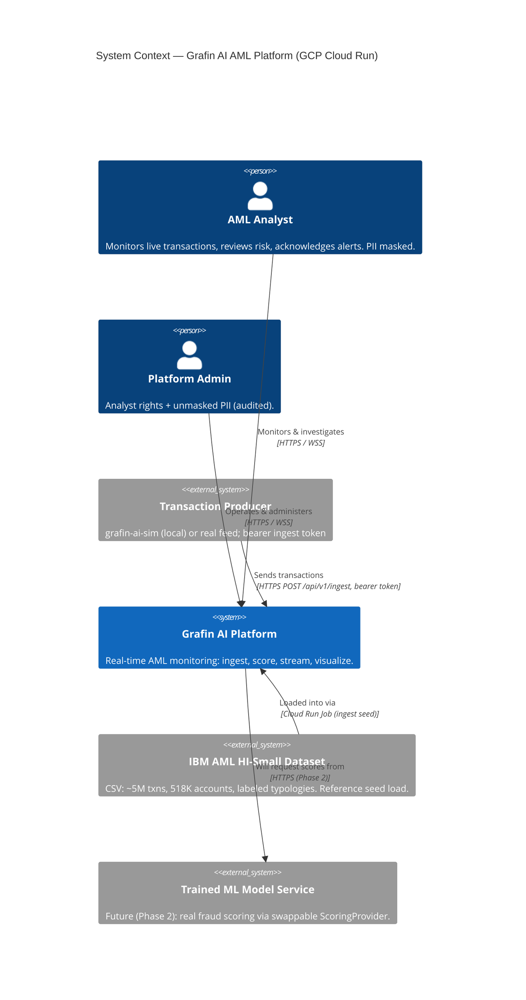

# Grafin AI — C4 Level 1: System Context

**Date:** 2026-08-08 (Updated for GCP Cloud Run deployment)
**Source:** Authored from the approved design (`docs/superpowers/specs/2026-06-25-platform-rearchitecture-design.md`). Container/Code-level docs are generated bottom-up per repo after implementation.

## Purpose

Grafin AI is a real-time Anti-Money-Laundering (AML) monitoring platform for the OJK Hackathon 2025. It ingests transaction data, scores each transaction for laundering risk via a stateless scoring service, and presents a live monitoring dashboard to financial-crime analysts and administrators.

## Actors & External Systems

| Element | Type | Role |
|---|---|---|
| **AML Analyst** | Person (`analyst`) | Monitors the live feed, reviews flagged/blocked transactions and risk profiles, acknowledges alerts. Sees PII masked. |
| **Platform Admin** | Person (`admin`) | All analyst capabilities + may view unmasked PII (audited). |
| **Grafin AI Platform** | Software System | The system under design: real-time AML monitoring (ingest, score, stream, visualize). |
| **Transaction Producer** | External system | Local simulator (`grafin-ai-sim`) or real external feed; sends transactions via bearer token to `POST /api/v1/ingest`. |
| **IBM AML HI-Small Dataset** | External data source | CSV files (~5M transactions, 518K accounts, labeled laundering typologies) localized to Indonesian banks/IDR. Loaded once via ingest job seed. |
| **Trained ML Model Service** | External system *(future, Phase 2)* | A standalone model-serving API the platform will call for real fraud scores once training completes. Today scoring uses ground-truth labels (phase 1 reference implementation). |

## Diagram

## Key Context Notes

- **Transaction flow (live):** Producer → `POST /api/v1/ingest` (bearer token) → Backend ingests + scores via scoring service → persists + publishes to Redis → WS relay → Dashboard live feed.
- **Reference data (seed):** Loaded once via Cloud Run Job (`grafin-ai-ingest`) after schema migration. The Ingest Job reads the HI-Small CSV and populates the database with reference transactions.
- **Scoring (Phase 1):** Uses ground-truth labels from the dataset (label-replay). Phase 2 replaces this with a trained ML model service.
- **PII masking:** Analysts see masked data by default; admins can view unmasked PII (audited).
- Geography shown to analysts is **synthetic seeded enrichment** (the dataset has no province field).

## Implementation Status (Reconciled 2026-08-08)

The Grafin AI Platform is **fully built and deployable to GCP Cloud Run**. See `02-container.md` for the deployment topology.

**Local development:** `make up` runs the full stack locally via docker-compose (backend, frontend, scoring, Postgres, Redis, Prometheus, Grafana). Profiles allow optional sim producer and observability stack.

**Cloud deployment:** Terraform provisions the GCP infrastructure (Cloud Run services/jobs, Cloud SQL, Memorystore, Artifact Registry, Secret Manager). See `docs/deploy/gcp-runbook.md` for the operator checklist.

**The Phase-2 Trained ML Model Service is the only external system not yet present** (dashed above). Until then, the reference implementation uses ground-truth labels for scoring, and the dashboard labels model accuracy as "Simulated (Phase 1)".
