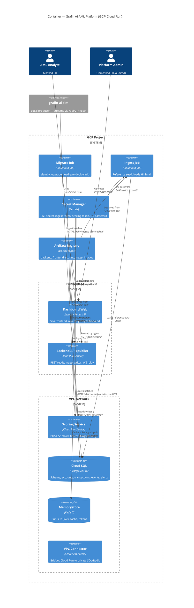

# Grafin AI — C4 Level 2: Container

**Date:** 2026-08-08 (GCP Cloud Run deployment topology)
**Source:** Authored from the approved design (`docs/superpowers/specs/2026-06-25-deploy-split-design.md`). Component + Code levels are generated per repo (bottom-up) after implementation.

## Containers (GCP Cloud Run)

| Container | Repo / Service | Tech | Responsibility | Ingress |
|---|---|---|---|---|
| **Dashboard Web** | `grafin-ai-dashboard-web` / Cloud Run Service | React 18, Vite, TanStack Query, nginx | SPA frontend + reverse proxy; terminates TLS; proxies `/api` + `/ws` to backend. | Public (`https://app.<domain>`) |
| **Backend API** | `grafin-ai-backend` / Cloud Run Service | FastAPI, SQLAlchemy 2.0, asyncpg | REST aggregations, WS relay, auth/RBAC, PII masking. **Owns DB schema + migrations.** Token-gated `POST /api/v1/ingest` write-path: scores each batch via scoring service, persists transactions/events/alerts, publishes to Redis for WS relay. | Public (`https://api.<domain>`) |
| **Scoring Service** | `grafin-ai-scoring` / Cloud Run Service | FastAPI (stateless) | Stateless scorer exposing `POST /v1/score`; returns scores/labels for a batch. Called by backend ingest path via internal URL. | Internal (VPC only) |
| **Migrate Job** | `grafin-ai-backend` / Cloud Run Job | FastAPI + Alembic | One-shot schema migration: `alembic upgrade head`. Runs before ingest + services take traffic. | None (one-shot) |
| **Ingest Job** | `grafin-ai-ingest` / Cloud Run Job | Python | Reference dataset seed: loads HI-Small transactions into Postgres. Runs after migrate. | None (one-shot) |
| **Cloud SQL** | GCP Managed Service | PostgreSQL 16 | Source of truth: accounts, transactions, events, alerts, users. Private IP via VPC connector. | VPC Private |
| **Memorystore** | GCP Managed Service | Redis 7 | Pub/sub (live events), cache, rate-limit, refresh-token store. Private IP. | VPC Private |
| **Secret Manager** | GCP Managed Service | — | Centralized secrets: JWT secret, ingest token, scoring token, DB password. | Service-account scoped |
| **Artifact Registry** | GCP Managed Service | Docker repos | Stores built images for backend, frontend, scoring, ingest services + jobs. | Service-account scoped |
| **VPC Connector** | GCP Managed Service | Serverless VPC Access | Bridges Cloud Run to private Cloud SQL + Memorystore. | VPC only |

## Diagram



## Local Development (docker-compose)

For local development, a mirror stack runs via `docker-compose`:
- `postgres:16-alpine` (same schema as Cloud SQL)
- `redis:7-alpine` (same channel/cache as Memorystore)
- `backend` service (migrates, seeds, serves)
- `scoring` service (internal to compose network)
- `frontend` service (nginx with `${BACKEND_URL}=http://backend:8000`)
- Optional `ingest` one-shot (loads reference seed)
- Optional `sim` profile (streams via `/api/v1/ingest`)
- Optional `observability` profile (Prometheus + Grafana)

**Run locally:**
```bash
cp .env.example .env                          # set secrets/tokens
make up                                       # default stack (no sim, no observability)
make sim                                      # add sim producer
make obs                                      # add Prometheus/Grafana
```

See `README.md` for full quickstart.

## Critical flows

**Live transaction (commit-then-notify):**
Backend ingest → score via scoring service → INSERT `transaction_events` + alerts → **COMMIT** (Postgres durable) → publish to Redis `grafin:events:live` → WS relay → Dashboard. On reconnect, dashboard backfills via `GET /transactions/live?after_seq=` from Postgres. Postgres is authoritative; WS is notification only.

**Dashboard read:** Dashboard → Backend REST → SQL aggregation over persisted events. Redis-cached per time bucket.

## Deployment flow

Deploys are **always a deliberate operator action** — nothing deploys automatically on a merge to `main`.

1. **CI (automatic):** Each service repo runs `.github/workflows/ci.yml` (test/lint) on pushes and PRs. CI never deploys.
2. **Terraform provisioning:** `grafin-ai-deploy/terraform/` provisions GCP infrastructure: networking, Cloud SQL, Memorystore, Secret Manager, services, jobs. Terraform owns resource creation and wiring; it ignores subsequent image changes.
3. **Image build + rollout (manual):** Either route, operator-triggered:
   - **Local:** `make deploy` in the service repo (build → push to Artifact Registry → `gcloud run deploy`), using the operator's own `gcloud auth login`.
   - **GitHub:** Actions tab → **deploy** → **Run workflow** (`workflow_dispatch`), authenticating via Workload Identity Federation.
4. **Deploy-init jobs:** Operator runs `gcloud run jobs execute grafin-migrate` then (in `grafin-ai-ingest`) `make execute` to prepare data.

## Notes

- **Service-to-service auth:** Backend → scoring uses HTTP with bearer token (scoring token from Secret Manager). Backend and scoring are in the same VPC via VPC connector.
- **No long-lived API keys:** All GCP authentication is via Workload Identity Federation; CI/CD workflows assume GitHub Actions' OIDC token exchange for short-lived GCP credentials.
- **Frontend templating:** nginx image uses env substitution for the backend upstream (`${BACKEND_URL}`). Local compose sets it to `http://backend:8000`; Terraform template injects the backend Cloud Run URL.
- **Secrets management:** All secrets (JWT, ingest token, scoring token, DB password) are stored in GCP Secret Manager. Service accounts have least-privilege access (IAM roles).
- **Data residency:** All data persists in Cloud SQL + Memorystore within the GCP project region.
- **Observability:** Cloud Monitoring + optional self-hosted Prometheus/Grafana (controlled via Terraform `deploy_observability` variable).

> **Updated 2026-08-08 (Phase 6 — Deploy):** Moved from polyrepo compose to GCP Cloud Run. Pipeline containers (ETL, replay) deleted. Each service owns CI/CD. Nginx templated for multi-environment.

## Implementation status (as of 2026-08-08)

| Component | Status | Evidence |
|---|---|---|
| Backend API | ✅ Implemented | `grafin-ai-backend` with per-repo CI + GCP deploy workflow |
| Frontend SPA | ✅ Implemented | `grafin-ai-dashboard-web` with nginx templating + per-repo CI + deploy workflow |
| Scoring Service | ✅ Implemented | `grafin-ai-scoring` with per-repo CI + deploy workflow |
| Ingest Job | ✅ Implemented | `grafin-ai-ingest` with per-repo CI + deploy workflow |
| Migrate Job | ✅ Implemented | Alembic integration in backend, deployed as Cloud Run Job |
| Local Compose | ✅ Working | `docker-compose.yml` with `sim` and `observability` profiles |
| GCP Terraform IaC | ✅ Authored | `grafin-ai-deploy/terraform/` (validate + plan ready; apply is operator step) |
| CI/CD Workflows | ✅ Wired | 4 service repos with `.github/workflows/{ci,deploy}.yml` |
| Docs (C4 + Runbook) | ✅ Updated | This file + `docs/deploy/gcp-runbook.md` |

Deployment to live GCP is the operator's step (requires GCP project, Workload Identity Federation setup, domain + DNS, and running `terraform apply` + job init).
