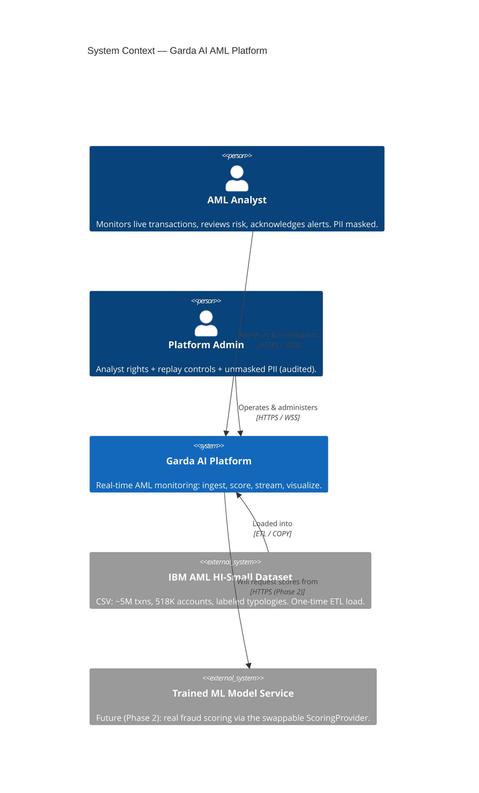

# Garda AI — C4 Level 1: System Context

**Date:** 2026-06-22
**Source:** Authored from the approved design (`docs/superpowers/specs/2026-06-22-system-architecture-design.md`). Container/Code-level docs are generated bottom-up per repo after implementation.

## Purpose

Garda AI is a real-time Anti-Money-Laundering (AML) monitoring platform for the OJK Hackathon 2025. It ingests transaction data, scores each transaction for laundering risk, and presents a live monitoring dashboard to financial-crime analysts and administrators.

## Actors & external systems

| Element | Type | Role |
|---|---|---|
| **AML Analyst** | Person (`analyst`) | Monitors the live feed, reviews flagged/blocked transactions and risk profiles, acknowledges alerts. Sees PII masked. |
| **Platform Admin** | Person (`admin`) | All analyst capabilities + controls the replay simulation (play/pause/speed), may view unmasked PII (audited). |
| **Garda AI Platform** | Software System | The system under design. |
| **IBM AML HI-Small Dataset** | External data source | CSV files (~5M transactions, 518K accounts, labeled laundering typologies) localized to Indonesian banks/IDR. Loaded once via ETL. |
| **Trained ML Model Service** | External system *(future, Phase 2)* | A standalone model-serving API the platform will call for real fraud scores once training completes. Today scoring is in-process label-replay. |

## Diagram

## Key context notes

- **Phase 1 (now):** scoring derives from the dataset's ground-truth `is_laundering` label (label-replay). The "Trained ML Model Service" relationship is dashed/future.
- **Phase 2:** the model swaps in behind the `ScoringProvider` interface — no change to actors or other systems.
- Geography shown to analysts is **synthetic seeded enrichment** (the dataset has no province field).

## Implementation status (reconciled 2026-06-22)

The Garda AI Platform system is **fully built and runnable** (`make up` in `garda-ai-deploy`): frontend, backend, pipeline (ETL + replay), Postgres, Redis, Prometheus, Grafana — see `02-container.md` for the per-container evidence. The dataset is loaded via the one-shot ETL. The **only external system not yet present is the Phase-2 Trained ML Model Service** (dashed above); until then the in-process `LabelReplayScorer` provides scoring and the dashboard honestly labels model accuracy as "Simulated (Phase 1)".
