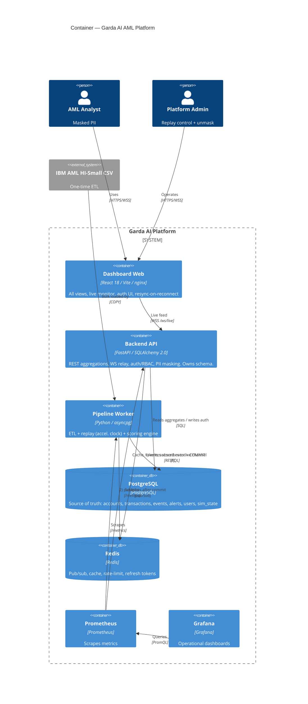

# Garda AI — C4 Level 2: Container

**Date:** 2026-06-22
**Source:** Authored from the approved design (`docs/specs/2026-06-22-system-architecture-design.md`). Component + Code levels are generated per repo (bottom-up) after implementation.

## Containers

| Container | Repo | Tech | Responsibility |
|---|---|---|---|
| **Dashboard Web** | `garda-ai-dashboard-web` | React 18, Vite, TanStack Query, nginx | All views; REST reads + WS live feed; auth UI; resync-on-reconnect. nginx also terminates TLS and proxies `/api` + `/ws`. |
| **Backend API** | `garda-ai-backend` | FastAPI, SQLAlchemy 2.0, asyncpg | REST aggregations for every view, WS relay, auth/RBAC, PII masking. **Owns DB schema + migrations.** |
| **Pipeline Worker** | `garda-ai-pipeline` | Python, pandas/polars, asyncpg | ETL (CSV→Postgres), replay worker (accelerated clock), scoring engine (`ScoringProvider`). Only writer of `transactions` / `transaction_events`. |
| **PostgreSQL** | — | PostgreSQL | Single source of truth: accounts, transactions, scored events, alerts, users, sim_state. |
| **Redis** | — | Redis | Pub/sub (live events), aggregate cache, rate-limit, refresh-token store, sim_state cache. |
| **Prometheus** | `garda-ai-deploy` | Prometheus | Scrapes `/metrics` from backend + pipeline. |
| **Grafana** | `garda-ai-deploy` | Grafana | Provisioned dashboards (API health, replay progress, fraud-rate over sim time). |

## Diagram

## Critical flows

**Live transaction (commit-then-notify):**
`Worker.score()` → INSERT `transaction_events` → **COMMIT** (Postgres durable) → publish to Redis → `Backend` WS relay → `Dashboard` appends events with `seq >` cursor. On reconnect the dashboard backfills via `GET /transactions/live?after_seq=` from Postgres. Postgres is authoritative; WS is notification only → eventually consistent, never divergent.

**Dashboard read:** `Dashboard` → `Backend` REST → SQL aggregation over events surfaced so far (`surfaced_at ≤ sim_now`), Redis-cached by sim-clock bucket.

**Simulation control (admin):** `Dashboard` → `Backend POST /sim/control` → writes `sim_state` → `Worker` reads and adjusts replay speed / play / pause / seek.

## Notes

- Containers map 1:1 to repos (polyrepo); Postgres/Redis/Prometheus/Grafana are infra provisioned via `garda-ai-deploy` docker-compose.
- The scoring engine is a **module inside Pipeline Worker** now; the dashed Phase-2 path promotes it to a standalone Model Service container behind the same `ScoringProvider` interface.
