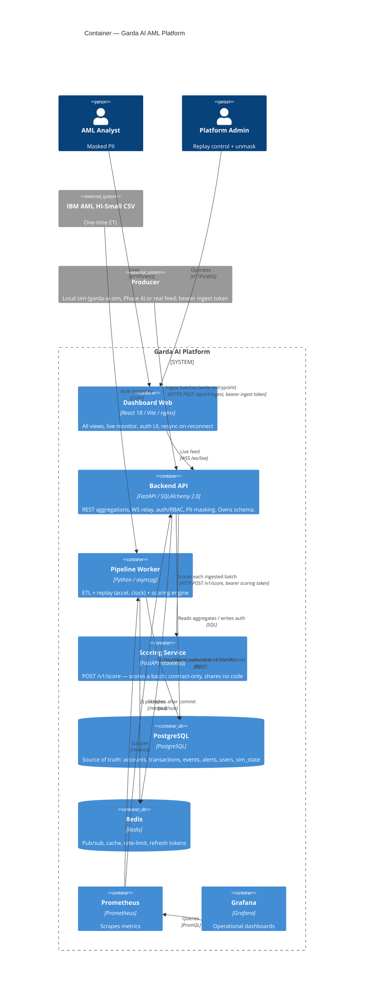

# Garda AI — C4 Level 2: Container

**Date:** 2026-06-22
**Source:** Authored from the approved design (`docs/superpowers/specs/2026-06-22-system-architecture-design.md`). Component + Code levels are generated per repo (bottom-up) after implementation.

## Containers

| Container | Repo | Tech | Responsibility |
|---|---|---|---|
| **Dashboard Web** | `garda-ai-dashboard-web` | React 18, Vite, TanStack Query, nginx | All views; REST reads + WS live feed; auth UI; resync-on-reconnect. nginx also terminates TLS and proxies `/api` + `/ws`. |
| **Backend API** | `garda-ai-backend` | FastAPI, SQLAlchemy 2.0, asyncpg | REST aggregations for every view, WS relay, auth/RBAC, PII masking. **Owns DB schema + migrations.** Token-gated `POST /api/v1/ingest` write-path: scores each batch via the scoring service, persists transactions/events/alerts, publishes to Redis for the WS relay. |
| **Pipeline Worker** | `garda-ai-pipeline` | Python, pandas/polars, asyncpg | ETL (CSV→Postgres), replay worker (accelerated clock), scoring engine (`ScoringProvider`). Only writer of `transactions` / `transaction_events`. Builds from its **own** context; imports nothing from the backend — shares the DB schema and the `garda:events:live` Redis channel **by contract**, not by code. |
| **Scoring Service** | `garda-ai-scoring` | FastAPI (stateless) | Stateless scorer exposing `POST /v1/score`; returns scores/labels for a batch of transactions. Shares **no code** with the backend — the scoring API is a contract only. Called by the backend ingest write-path (Phase 2); the replay scoring engine still runs in-process in Pipeline Worker until Phase 5. |
| **PostgreSQL** | — | PostgreSQL | Single source of truth: accounts, transactions, scored events, alerts, users, sim_state. |
| **Redis** | — | Redis | Pub/sub (live events), aggregate cache, rate-limit, refresh-token store, sim_state cache. |
| **Prometheus** | `garda-ai-deploy` | Prometheus | Scrapes `/metrics` from backend + pipeline. |
| **Grafana** | `garda-ai-deploy` | Grafana | Provisioned dashboards (API health, replay progress, fraud-rate over sim time). |

## Diagram

## Critical flows

**Live transaction (commit-then-notify):**
`Worker.score()` → INSERT `transaction_events` → **COMMIT** (Postgres durable) → publish to Redis → `Backend` WS relay → `Dashboard` appends events with `seq >` cursor. On reconnect the dashboard backfills via `GET /transactions/live?after_seq=` from Postgres. Postgres is authoritative; WS is notification only → eventually consistent, never divergent.

**Dashboard read:** `Dashboard` → `Backend` REST → SQL aggregation over events surfaced so far (`surfaced_at ≤ sim_now`), Redis-cached by sim-clock bucket.

**Simulation control (admin):** `Dashboard` → `Backend POST /sim/control` → writes `sim_state` → `Worker` reads and adjusts replay speed / play / pause / seek.

## Notes

- Containers map 1:1 to repos (polyrepo); Postgres/Redis/Prometheus/Grafana are infra provisioned via `garda-ai-deploy` docker-compose.
- The scoring engine is a **module inside Pipeline Worker** now; the dashed Phase-2 path promotes it to a standalone Model Service container behind the same `ScoringProvider` interface.
- **No service repo depends on another in code.** The backend is the schema **source of truth** via Alembic migrations applied at deploy init; the pipeline keeps its own local channel constant + a committed DDL snapshot for tests and writes via raw SQL. The only pipeline↔backend couplings are runtime/data: both connect to Postgres, and the pipeline publishes to the `garda:events:live` Redis channel that the backend's WS relay consumes. These are data couplings shared **by contract** (duplicated, not imported), not build/code dependencies.

> **Updated 2026-06-23:** pipeline decoupled from backend — own build context; channel + schema shared by contract.

> **Updated 2026-06-25 (Phase 2):** the `garda-ai-scoring` service (Phase 1, stateless `POST /v1/score`) plus the backend `POST /api/v1/ingest` write-path are **additive**. The ingest path scores each batch via the scoring service (bearer scoring token), persists transactions/events/alerts, and publishes to Redis for the WS relay. The scoring API, the `garda:events:live` channel, and the DB schema are **contracts** — scoring and backend share no code. The existing replay path and all read endpoints are **unchanged** until Phase 5 (read re-anchoring).

## Implementation status (reconciled 2026-06-22 — all containers built)

| Container | Status | Evidence |
|---|---|---|
| Backend API | ✅ implemented | `garda-ai-backend` main, 74 tests; per-repo C4 `docs/c4/` |
| Pipeline (ETL one-shot + replay worker) | ✅ implemented | `garda-ai-pipeline` main, 31 tests; `garda-etl` + `garda-replay` |
| Dashboard Web | ✅ implemented | `garda-ai-dashboard-web` main, 11 tests; all views wired |
| PostgreSQL / Redis | ✅ provisioned | `garda-ai-deploy/docker-compose.yml` (healthchecked) |
| Prometheus / Grafana | ✅ provisioned | `docker-compose.yml` + `observability/` (scrapes backend `/metrics`) |

The whole stack starts with `make up` (see `garda-ai-deploy/README.md`): backend migrates+seeds, the ETL one-shot loads the dataset, the replay worker streams scored events to Redis `garda:events:live`, and the dashboard consumes REST + the WS relay. The only **not-yet-built** element is the Phase-2 standalone **Trained ML Model Service** (the `MLModelScorer` swaps in behind `ScoringProvider`). Known observability gap: the replay worker has no HTTP `/metrics` endpoint yet, so Prometheus scrapes the backend only.
