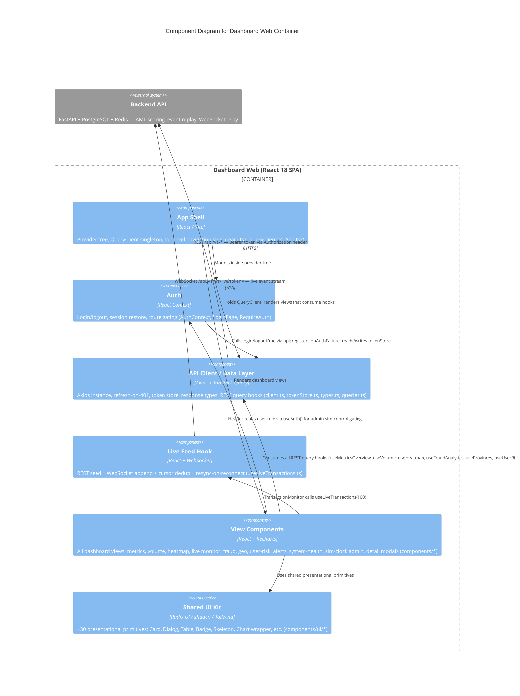

# C4 Component Level: Dashboard Web Container

## Overview

- **Container**: Dashboard Web
- **Description**: React 18 TypeScript single-page application providing authenticated, real-time visibility into AML transaction flows, fraud scores, geographic risk, user-risk profiles, and system health. Fully wired to the Garda AI FastAPI backend over REST and WebSocket.
- **Technology**: React 18, TypeScript 5, Vite, TanStack Query v5, Axios, Recharts, Radix UI / shadcn
- **Deployment context**: Served as a static build behind nginx, which proxies `/api/v1/*` REST and `/api/v1/ws/live` WebSocket to the Backend API container.

---

## Components

### 1. API Client / Data Layer

- **Name**: API Client / Data Layer
- **Modules**: `src/api/client.ts`, `src/api/tokenStore.ts`, `src/api/types.ts`, `src/api/queries.ts`
- **Type**: Service Layer

#### Purpose

Provides all outbound communication with the Backend API container. Centralises the Axios instance, bearer-token injection, single-flight refresh-on-401 recovery, localStorage token persistence, TypeScript response-model mirrors, and TanStack Query hooks for every REST endpoint.

#### Software Features

- **Authenticated HTTP client**: Axios instance with `baseURL` from `VITE_API_BASE_URL` (default `/api/v1`); request interceptor injects `Authorization: Bearer <access_token>` on every outgoing call.
- **Single-flight token refresh**: Module-level `refreshing` promise coalesces concurrent 401 failures into one `POST /auth/refresh` call; all waiting requests are retried with the new token.
- **Auth-failure callback**: `onAuthFailure(cb)` lets the Auth component register a logout trigger when refresh also fails.
- **Token persistence**: `tokenStore` reads/writes `garda.access` and `garda.refresh` keys in `localStorage`; exposes `getAccess`, `getRefresh`, `set`, and `clear`.
- **Response type contracts**: Hand-authored TypeScript mirrors of backend Pydantic models (`TokenResponse`, `Me`, `MetricsOverview`, `VolumeResponse`, `HeatmapResponse`, `FraudAnalytics`, `GeoResponse`, `LiveItem / LiveResponse`, `TransactionDetail`, `RiskProfile`, `UserRiskResponse`, `AlertsResponse`, `SystemHealth`, `SimState`, `LiveEvent`). Regenerable from the live OpenAPI spec via `npm run gen:api`.
- **TanStack Query hooks**: Fourteen hooks covering all REST endpoints — `useMetricsOverview`, `useVolume(range)`, `useHeatmap`, `useFraudAnalytics`, `useProvinces`, `useUserRisk(risk?)`, `useUserProfile(entityId)`, `useAlerts(status?)`, `useAckAlert` (mutation), `useTransactionDetail(id)`, `useLiveRecent(limit?)`, `useSystemHealth`, `useSimState` (5 s poll), `useSimControl` (mutation). Mutations invalidate relevant query keys on success.

#### Interfaces

**REST outbound (to Backend API)**

| Hook / function | Method | Path | Notes |
|---|---|---|---|
| `useMetricsOverview` | GET | `/metrics/overview` | — |
| `useVolume` | GET | `/metrics/volume?range=` | param-driven re-fetch |
| `useHeatmap` | GET | `/metrics/heatmap` | — |
| `useFraudAnalytics` | GET | `/analytics/fraud` | — |
| `useProvinces` | GET | `/geo/provinces` | — |
| `useUserRisk` | GET | `/users/risk?risk=` | optional filter |
| `useUserProfile` | GET | `/users/:entityId/profile` | `enabled: !!entityId` |
| `useAlerts` | GET | `/alerts?status=` | — |
| `useAckAlert` | POST | `/alerts/:id/ack` | mutation |
| `useTransactionDetail` | GET | `/transactions/:id` | `enabled: id != null` |
| `useLiveRecent` | GET | `/transactions/live?limit=` | initial seed |
| `useSystemHealth` | GET | `/system/health` | — |
| `useSimState` | GET | `/sim/state` | 5 s refetchInterval |
| `useSimControl` | POST | `/sim/control` | mutation, `Partial<SimState>` |
| `api` (login) | POST | `/auth/login` | via AuthContext |
| `api` (logout) | POST | `/auth/logout` | via AuthContext |
| `api` (me) | GET | `/auth/me` | via AuthContext |
| `refreshAccess` | POST | `/auth/refresh` | automatic on 401 |

**Internal API surface (consumed by other components)**

- `api: AxiosInstance` — shared Axios instance
- `onAuthFailure(cb: () => void): void` — register 401-terminal callback
- `tokenStore.{getAccess, getRefresh, set, clear}` — token persistence
- All `use*` hooks returning `UseQueryResult<T>` or `UseMutationResult`

#### Dependencies

- **External packages**: `axios`, `@tanstack/react-query`
- **External system**: Backend API container — REST `/api/v1/*` (Bearer token via `Authorization` header)

---

### 2. Live Feed Hook

- **Name**: Live Feed Hook
- **Modules**: `src/api/useLiveTransactions.ts`
- **Type**: Data Hook / Real-time Integration

#### Purpose

Provides a bounded, ordered, deduplicated buffer of live transaction events by combining REST-based seeding with WebSocket streaming. Implements the consistency contract between the browser and the Backend API WebSocket relay.

#### Software Features

- **REST seed**: On mount, fetches up to `max` (default 100) items from `GET /transactions/live` and sets the `cursor` to `max(seq)` of the initial window.
- **WebSocket connection**: Opens a connection to `VITE_WS_URL ?? '/api/v1/ws/live'`. Auth token is passed as `?token=<access_token>` because the browser WebSocket API does not support custom headers.
- **Ordered append**: Incoming `LiveEvent` frames with `seq > cursor` are mapped to `LiveItem` (handling nullable fields from the worker) and prepended to the buffer. Events with `seq <= cursor` are silently discarded (client-side deduplication).
- **Reconnect + resync**: On WebSocket `close`, reconnects after 1 s. `ws.onopen` triggers `resync()` with `?after_seq=cursor`, closing any gap accumulated during the disconnect window (at-least-once delivery guarantee).
- **Server-push resync**: Backend can push `{ type: 'resync' }` control frames to force a REST reconciliation without a reconnect cycle.
- **Control frame filtering**: `{ type: 'connected' }` and `{ type: 'resync' }` frames are handled and not treated as transaction events.

#### Interfaces

```typescript
useLiveTransactions(max?: number): { items: LiveItem[] }
```

#### Dependencies

- **API Client / Data Layer**: `api` (Axios, for `resync` REST calls), `tokenStore.getAccess()`, `LiveItem` / `LiveEvent` types
- **External system**: Backend API container — WebSocket `/api/v1/ws/live?token=<access_token>`; REST `/transactions/live?after_seq=` (backfill / resync)

---

### 3. Auth Component

- **Name**: Auth
- **Modules**: `src/auth/AuthContext.tsx`, `src/auth/LoginPage.tsx`, `src/auth/RequireAuth.tsx`
- **Type**: Security / Session Management

#### Purpose

Manages the full authentication lifecycle: login, session restoration on page load, logout, and route gating. Bridges the token store and the API client's auth-failure callback to ensure the application always reflects the correct authentication state.

#### Software Features

- **Session restore**: On mount, if `tokenStore.getAccess()` is non-null, calls `GET /auth/me` to restore the `user: Me` state without requiring re-login.
- **Login**: `login(email, password)` POSTs `/auth/login`, persists tokens via `tokenStore.set`, then fetches `Me` via `GET /auth/me`.
- **Logout**: `logout()` fire-and-forgets `POST /auth/logout` with the refresh token, clears token store, and sets `user` to `null`.
- **Forced logout on 401-terminal**: Registers with `onAuthFailure` so that unrecoverable 401s (e.g. expired refresh token) clear the session transparently.
- **`ready` flag**: Prevents the route guard from flashing the login form during the async session-restore check.
- **Route guard**: `RequireAuth` renders `null` while `ready === false`, `<LoginPage />` when unauthenticated, and children when authenticated.
- **Login form**: `LoginPage` provides email/password form with inline error display and disabled-while-busy submit button.
- **Role exposure**: `useAuth().user.role` is consumed by `Header` to gate admin-only sim controls.

#### Interfaces

**`AuthValue` context shape**

```typescript
{
  user:   Me | null;
  ready:  boolean;
  login:  (email: string, password: string) => Promise<void>;
  logout: () => void;
}
```

**`RequireAuth` props**

```typescript
RequireAuth({ children: ReactNode }): JSX.Element | null
```

#### Dependencies

- **API Client / Data Layer**: `api` (login/logout/me calls), `onAuthFailure`, `tokenStore`, `TokenResponse` / `Me` types
- **External system**: Backend API container — `POST /auth/login`, `GET /auth/me`, `POST /auth/logout`

---

### 4. View Components

- **Name**: View Components
- **Modules**: `src/components/MetricsOverview.tsx`, `src/components/TransactionVolume.tsx`, `src/components/TransactionHeatmap.tsx`, `src/components/TransactionMonitor.tsx`, `src/components/FraudAnalytics.tsx`, `src/components/GeographicMap.tsx`, `src/components/UserRiskProfiling.tsx`, `src/components/AlertsPanel.tsx`, `src/components/Header.tsx`, `src/components/TransactionDetailsModal.tsx`, `src/components/UserProfileDetailsModal.tsx`, `src/components/Sidebar.tsx`
- **Type**: Presentation / View

#### Purpose

All dashboard views and controls that render data fetched by the API Client / Data Layer or Live Feed Hook. Provides the user-facing AML monitoring interface — metrics, charts, live transaction feed, fraud analytics, geographic risk, user risk profiles, alerts, system health, and sim-clock admin controls.

#### Software Features

- **KPI cards** (`MetricsOverview`): Total Transactions, Fraud Detected, Fraud Rate, Total Amount (IDR-formatted). Skeleton on load, error card on failure.
- **Volume chart** (`TransactionVolume`): Recharts `AreaChart` with animated period-selector (`24h` / `weekly` / `monthly` / `yearly`); drives `useVolume(range)`.
- **Activity heatmap** (`TransactionHeatmap`): 7×24 grid (day × hour) with intensity normalised to `rawValue / maxValue`; hover shows raw count.
- **Live transaction monitor** (`TransactionMonitor`): Scrollable real-time table driven by `useLiveTransactions(100)`. Row click opens `TransactionDetailsModal`; bank cell opens `UserProfileDetailsModal`.
- **Fraud analytics** (`FraudAnalytics`): Three cards — detection metrics (precision/recall/F1 bars), fraud-by-typology count bar chart, top-suspected-fraud-by-amount bar chart.
- **Geographic risk** (`GeographicMap`): Ranked province list with fraud count, change percentage, and risk-level badge. PII is masked server-side; the UI renders what it receives.
- **User risk profiling** (`UserRiskProfiling`): Full-page view with risk-distribution PieChart + BarChart (client-derived), search/filter bar, paginated risk-profile table. Opens `UserProfileDetailsModal` on row click.
- **Alerts panel** (`AlertsPanel`): Scrollable alert list; Acknowledge button fires `useAckAlert` mutation.
- **Transaction detail modal** (`TransactionDetailsModal`): Shows fraud score, typology badge, bank details, and a four-panel AI narrative (pattern matching, behaviour analysis, network analysis, recommendation) keyed from the static `typologyAnalysis` map.
- **User profile detail modal** (`UserProfileDetailsModal`): Shows risk score, risk factors, and static analysis narratives from `riskAnalysisTemplates` keyed by `risk_level`. Phase-1 note: monthly activity / risk-history charts are hidden because the API does not yet expose that data.
- **Header with sim clock** (`Header`): Displays `sim_now` (formatted sim timestamp) with running/paused indicator. Admin users (`user.role === 'admin'`) see play/pause toggle and speed selector — role gated client-side; also enforced server-side. Calls `useSimControl` mutation.
- **Navigation sidebar** (`Sidebar`): Static nav; no API dependencies.
- **System health cards** (inline in `App.tsx` as `SystemHealthCards`): Four cards — Database, Model Accuracy (labelled "Simulated" when `model_accuracy_simulated === true`), Redis, Events Surfaced. Unavailable or unimplemented series are hidden rather than shown as zero (Phase-1 honesty).

#### Interfaces

Components accept props from `App` (navigation callbacks, `currentView`) and consume hooks directly. Key prop surfaces:

- `Sidebar({ currentView: string; onNavigate: (view: string) => void })`
- `TransactionMonitor` — opens modals internally; no required external props
- `Header` — reads auth context and sim state directly via hooks

#### Dependencies

- **API Client / Data Layer**: All `use*` REST query hooks (`useMetricsOverview`, `useVolume`, `useHeatmap`, `useFraudAnalytics`, `useProvinces`, `useUserRisk`, `useUserProfile`, `useAlerts`, `useAckAlert`, `useTransactionDetail`, `useSystemHealth`, `useSimState`, `useSimControl`)
- **Live Feed Hook**: `useLiveTransactions` (used by `TransactionMonitor`)
- **Auth**: `useAuth()` (used by `Header` to read `user.role`)
- **Shared UI Kit**: All presentational primitives from `components/ui/*`

---

### 5. App Shell

- **Name**: App Shell
- **Modules**: `src/main.tsx`, `src/queryClient.ts`, `src/App.tsx`
- **Type**: Application Shell / Provider Wiring

#### Purpose

Bootstraps the application by assembling the provider tree and the top-level navigation shell. Defines the order of context providers and renders the appropriate view based on navigation state.

#### Software Features

- **Provider tree**: `main.tsx` mounts React with the following provider order (outer to inner): `QueryClientProvider` → `AuthProvider` → `RequireAuth` → `App`. `QueryClientProvider` wraps `AuthProvider` to allow future query invalidation from within auth actions.
- **QueryClient singleton**: `queryClient.ts` exports a shared `QueryClient` with `retry: 1`, `refetchOnWindowFocus: false`, `staleTime: 2000 ms`.
- **Navigation shell**: `App.tsx` renders fixed `Sidebar` + `Header`, then switches between the main dashboard view and the `/user-risk-profiling` view via `currentView` state.
- **Inline system health**: `App.tsx` defines the `SystemHealthCards` inline component (calls `useSystemHealth`).

#### Interfaces

None exposed externally — this is the application root.

#### Dependencies

- **Auth**: `AuthProvider`, `RequireAuth`
- **API Client / Data Layer**: `queryClient` (QueryClient instance), `useSystemHealth` (via `SystemHealthCards`)
- **View Components**: All dashboard views rendered inside `App`
- **External packages**: `react`, `react-dom`, `@tanstack/react-query`

---

## Component Diagram



---

## Cross-Cutting Notes

### PII Masking

PII is masked server-side before responses leave the Backend API. View Components render exactly what they receive; no client-side masking or redaction is applied.

### Admin Sim Controls

The sim-clock play/pause/speed controls in `Header` are gated client-side by `user.role === 'admin'` (read from `useAuth()`). The same gate is enforced server-side on the Backend API (`POST /sim/control`), so client-side gating is defence-in-depth only.

### Phase-1 Honesty

- `SystemHealthCards` displays `model_accuracy_simulated: true` as a "Simulated" label so operators know the ML scoring is not measured against ground truth.
- Unavailable data series (e.g. monthly activity history in `UserProfileDetailsModal`) are hidden rather than shown as zero or placeholder values, reflecting the Phase-1 label-replay mode of the backend.

### WS Authentication

The browser `WebSocket` constructor does not support custom request headers. The access token is therefore passed as a URL query parameter (`?token=<access_token>`). The Backend API validates this token identically to the `Authorization: Bearer` header used for REST calls.

### REST / WS Consistency Contract

`useLiveTransactions` maintains a `cursor` ref at `max(seq)` received. Reconnect calls `resync()` with `?after_seq=cursor` to recover any events missed during disconnect (at-least-once delivery, client-side dedup). The backend may also push `{ type: 'resync' }` frames to trigger reconciliation on demand.

---

## Code References

| Component | Code-level doc section |
|---|---|
| API Client / Data Layer | [04-code.md — client.ts](./04-code.md#srcapiclientts), [tokenStore.ts](./04-code.md#srcapitokenstorets), [types.ts](./04-code.md#srcapitypests), [queries.ts](./04-code.md#srcapiquerysts) |
| Live Feed Hook | [04-code.md — useLiveTransactions.ts](./04-code.md#srcapiuselivetransactionsts) |
| Auth | [04-code.md — AuthContext.tsx](./04-code.md#srcauthauthcontexttsx), [LoginPage.tsx](./04-code.md#srcauthloginpagetsx), [RequireAuth.tsx](./04-code.md#srcauthrequireauthtsx) |
| View Components | [04-code.md — View Components](./04-code.md#view-components) |
| App Shell | [04-code.md — queryClient.ts](./04-code.md#srcqueryclientts), [main.tsx](./04-code.md#srcmaintsx), [App.tsx](./04-code.md#srcapptsx) |
