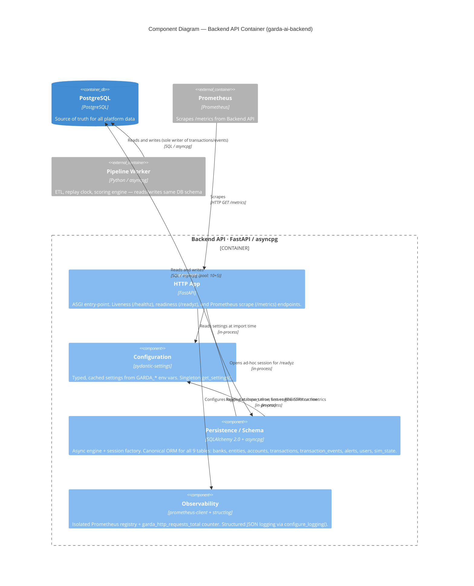

# C4 Component Level: Backend API Container

**Date:** 2026-06-22
**Container:** Backend API (`garda-ai-backend`)
**Parent diagram:** [`garda-ai-deploy/docs/c4/02-container.md`](../../../garda-ai-deploy/docs/c4/02-container.md)
**Code-level source:** [`docs/c4/04-code.md`](./04-code.md)

---

## Container Context

The **Backend API** container is one of two application containers in the Garda AI AML platform (the other being the Pipeline Worker). It is a FastAPI/asyncpg ASGI service that:

- Owns the PostgreSQL schema and ORM models used by every platform service
- Exposes health and readiness probes consumed by the container orchestrator (Docker Compose / Kubernetes)
- Exposes a Prometheus `/metrics` endpoint scraped by the platform Prometheus instance
- Will serve REST aggregation endpoints and a WebSocket live-feed relay in future phases (not yet implemented)

This document zooms into the **components within that container**. All components run in the same Python process.

---

## Component Summary

| Component | Modules | Responsibility |
|---|---|---|
| **Configuration** | `config.py` | Typed, environment-driven settings; singleton access |
| **Persistence / Schema** | `db.py`, `schema/` (6 files) | Async DB engine + session factory; canonical ORM data model (9 tables) |
| **Observability** | `observability.py` | Isolated Prometheus registry + metrics; structured JSON logging setup |
| **HTTP App** | `main.py` | FastAPI ASGI app; liveness, readiness, and metrics endpoints |

No other components exist in the current codebase. Components planned for future phases are listed at the end of this document.

---

## Component: Configuration

### Overview

- **Name**: Configuration
- **Type**: Library (singleton provider)
- **Technology**: Python 3.12+, pydantic-settings

### Purpose

Provides a single, validated, cached view of all runtime configuration sourced from environment variables (prefix `GARDA_`) and an optional `.env` file. All other components read configuration through this component — none read environment variables directly.

### Software Features

- **Typed settings**: Declares `database_url` (required), `env` (default `"development"`), and `log_level` (default `"INFO"`) as typed pydantic fields; unknown variables are silently ignored.
- **Singleton caching**: `get_settings()` is decorated with `@lru_cache(maxsize=1)`, guaranteeing the settings object is constructed exactly once per process lifetime.
- **`.env` file support**: Reads a `.env` file at startup if present, enabling local development without shell exports.

### Code Elements

- [`config.py`](../../garda_ai_backend/config.py) — `Settings(BaseSettings)` class and `get_settings()` cached factory function

### Public Interface

#### `get_settings() -> Settings`

The only public symbol. Returns the singleton `Settings` instance.

| Field | Type | Default | Source |
|---|---|---|---|
| `database_url` | `str` | required | `GARDA_DATABASE_URL` env var |
| `env` | `str` | `"development"` | `GARDA_ENV` env var |
| `log_level` | `str` | `"INFO"` | `GARDA_LOG_LEVEL` env var |

### Dependencies

- **External**: `pydantic-settings` (BaseSettings, SettingsConfigDict)
- **Components used**: none

---

## Component: Persistence / Schema

### Overview

- **Name**: Persistence / Schema
- **Type**: Library (data access layer + schema registry)
- **Technology**: Python 3.12+, SQLAlchemy 2.0 (async), asyncpg

### Purpose

Provides two closely coupled concerns that are deliberately co-located: the **async database session infrastructure** (`db.py`) and the **canonical ORM data model** (`schema/`). They are grouped as one component because the session factory and ORM models are meaningless without each other — consumers always need both to execute queries.

The schema sub-package is the authoritative definition of all nine PostgreSQL tables used by the platform. The Pipeline Worker and any future services depend on the models defined here (or on the SQL schema that `Base.metadata.create_all()` produces).

### Software Features

- **Async engine with connection pooling**: Creates an `asyncpg`-backed SQLAlchemy engine with `pool_size=10`, `max_overflow=5`, and `pool_pre_ping=True` for resilient connection management.
- **Lazy engine initialisation**: The engine and session factory are constructed on first use and cached for the process lifetime, avoiding startup failures if PostgreSQL is not yet reachable at import time.
- **Request-scoped sessions**: `get_session()` is a FastAPI `yield`-dependency that allocates one `AsyncSession` per HTTP request and returns the connection to the pool on exit, even under exception.
- **Declarative ORM base**: All nine table classes inherit from a single `Base(DeclarativeBase)`, ensuring shared metadata and enabling `Base.metadata.create_all()` for schema migration bootstrapping.
- **Reference tables** (`Bank`, `Entity`, `Account`): Master data for institutions, legal entities, and accounts, including ML-assigned `risk_score` / `risk_category` on `Account`.
- **Transaction tables** (`Transaction`, `TransactionEvent`): Core fact tables. `Transaction` is the primary financial transfer record; `TransactionEvent` is the append-only scoring ledger (one row per scoring pass, status transitions: `approved`, `flagged`, `blocked`).
- **Alert table** (`Alert`): Human-facing alerts raised from flagged scoring events; tracks analyst acknowledgement workflow (`acknowledged_by`, `acknowledged_at`).
- **User table** (`User`): Platform user accounts (analysts and admins) with hashed credentials and RBAC role field.
- **Simulation control table** (`SimState`): Database-level singleton (`CHECK(id = 1)`) controlling the label-replay clock (`sim_now`, `speed`, `running`). Safe for concurrent `UPSERT` without a distributed lock.

### Code Elements

- [`db.py`](../../garda_ai_backend/db.py) — `build_engine()`, `_maker()`, `get_session()`
- [`schema/base.py`](../../garda_ai_backend/schema/base.py) — `Base(DeclarativeBase)`
- [`schema/reference.py`](../../garda_ai_backend/schema/reference.py) — `Bank`, `Entity`, `Account`
- [`schema/transactions.py`](../../garda_ai_backend/schema/transactions.py) — `Transaction`, `TransactionEvent`
- [`schema/alerts.py`](../../garda_ai_backend/schema/alerts.py) — `Alert`
- [`schema/users.py`](../../garda_ai_backend/schema/users.py) — `User`
- [`schema/sim.py`](../../garda_ai_backend/schema/sim.py) — `SimState`
- [`schema/__init__.py`](../../garda_ai_backend/schema/__init__.py) — re-exports all ORM classes under `garda_ai_backend.schema`

### Public Interface

#### `get_session() -> AsyncIterator[AsyncSession]`

FastAPI dependency. Yields one session per request; auto-closes on completion or exception. Intended usage:

```python
Annotated[AsyncSession, Depends(get_session)]
```

#### `build_engine(url: str) -> AsyncEngine`

Constructs a configured async engine from a connection URL. Exposed for use by testing or migration tooling that needs direct engine access.

#### ORM models (via `garda_ai_backend.schema`)

All nine model classes are importable from the package root:

```python
from garda_ai_backend.schema import (
    Base, Bank, Entity, Account,
    Transaction, TransactionEvent,
    Alert, User, SimState,
)
```

`Base.metadata` carries the full DDL and is used by Alembic (or `create_all`) to materialise the schema.

### Dependencies

- **Configuration component**: calls `get_settings()` to obtain `database_url` on first engine construction
- **External — PostgreSQL**: connects via `asyncpg` driver (`postgresql+asyncpg://` URL); pool size 10 + overflow 5

---

## Component: Observability

### Overview

- **Name**: Observability
- **Type**: Library (cross-cutting concern)
- **Technology**: Python 3.12+, prometheus-client, structlog

### Purpose

Provides the two pillars of runtime observability for the Backend API container: **metrics collection** via an isolated Prometheus registry, and **structured logging** via JSON-formatted `structlog` output. Both are configured at import time of `main.py`, before the ASGI server begins accepting requests.

### Software Features

- **Isolated Prometheus registry**: `REGISTRY = CollectorRegistry()` avoids polluting the default process-global registry, preventing conflicts when running alongside other libraries or test frameworks that also register metrics.
- **HTTP request counter**: `REQUEST_COUNT` (`garda_http_requests_total`) is a labelled Counter with dimensions `method`, `path`, `status`. Defined and ready for instrumentation — not yet incremented (middleware/route instrumentation is a planned next step).
- **Structured JSON logging**: `configure_logging(level)` chains three structlog processors — `add_log_level`, `TimeStamper(fmt="iso")`, `JSONRenderer` — producing machine-parseable JSON log lines compatible with log aggregation pipelines (e.g., Loki, Datadog, Cloud Logging).
- **Log level propagation**: Sets the minimum level on both stdlib `logging` and the structlog bound logger, so third-party libraries that use stdlib logging also respect the configured threshold.

### Code Elements

- [`observability.py`](../../garda_ai_backend/observability.py) — `REGISTRY`, `REQUEST_COUNT`, `configure_logging()`

### Public Interface

#### `REGISTRY: CollectorRegistry`

The isolated Prometheus registry. The HTTP App component passes this to `generate_latest()` to serve the `/metrics` endpoint. Future middleware or route handlers should register additional collectors against this registry.

#### `REQUEST_COUNT: Counter`

Pre-defined counter metric. Labels: `method`, `path`, `status`. Currently defined but not yet incremented anywhere in the codebase.

#### `configure_logging(level: str = "INFO") -> None`

Configures stdlib `logging` and `structlog` with structured JSON processors. Called once at process startup from `main.py`.

### Dependencies

- **External**: `prometheus-client` (CollectorRegistry, Counter), `structlog`, `logging`
- **Components used**: none

---

## Component: HTTP App

### Overview

- **Name**: HTTP App
- **Type**: Application (ASGI service entry-point)
- **Technology**: Python 3.12+, FastAPI

### Purpose

The ASGI entry-point for the Backend API container. Creates and owns the `FastAPI` application instance, wires together all other components at startup, and exposes the three currently implemented HTTP endpoints: a liveness probe, a readiness probe, and a Prometheus metrics scrape endpoint.

This component is the only component that is externally reachable — all other components are called only from within this component or from each other.

### Software Features

- **Import-time initialisation**: Calls `get_settings()` and `configure_logging()` as module-level side effects, ensuring logging is active before any request arrives and before the ASGI server calls any lifecycle hook.
- **Liveness probe (`GET /healthz`)**: Returns `{"status": "ok"}` unconditionally. Does not touch the database; safe to call before PostgreSQL is available. Used by container orchestrators to determine whether to restart the process.
- **Readiness probe (`GET /readyz`)**: Executes `SELECT 1` against PostgreSQL using an ad-hoc session from `_maker()`. Returns HTTP 200 `{"status": "ready"}` on success, or HTTP 503 `{"status": "not-ready"}` on any exception. Used by load-balancers and orchestrators to gate traffic.
- **Metrics endpoint (`GET /metrics`)**: Serialises the Observability component's `REGISTRY` via `prometheus_client.generate_latest()` and returns the Prometheus text exposition format with the correct `Content-Type`. Scraped by the platform Prometheus instance.

### Code Elements

- [`main.py`](../../garda_ai_backend/main.py) — `app: FastAPI`, `healthz()`, `readyz()`, `metrics()`

### Public Interface

#### HTTP endpoints

| Method | Path | Description | Response |
|---|---|---|---|
| `GET` | `/healthz` | Liveness probe | `200 {"status": "ok"}` |
| `GET` | `/readyz` | Readiness probe (DB ping) | `200 {"status": "ready"}` or `503 {"status": "not-ready"}` |
| `GET` | `/metrics` | Prometheus scrape | `200` Prometheus text format |

### Dependencies

- **Configuration component**: `get_settings()` read at import time to obtain `log_level`
- **Persistence / Schema component**: `_maker()` called inside `GET /readyz` to open an ad-hoc database session
- **Observability component**: `configure_logging()` called at import time; `REGISTRY` passed to `generate_latest()` in `GET /metrics`
- **External — Prometheus**: scrapes `GET /metrics` on the configured interval

---

## Component Diagram

The diagram below shows the four components within the Backend API container, their internal relationships, and their connections to external systems and other containers.



---

## Planned Components (Not Yet Implemented)

The following components appear in the Container diagram (`garda-ai-deploy/docs/c4/02-container.md`) or are implied by the schema (e.g., `users` table, `sim_state` table) but have **no implementation in this codebase** as of 2026-06-22. They are listed here to mark the boundary between what is present and what is planned.

| Planned Component | Schema Evidence | Container Diagram Reference | Notes |
|---|---|---|---|
| **Authentication / RBAC** | `users` table (`email`, `password_hash`, `role`) and `alerts.acknowledged_by` FK | "auth/RBAC" listed under Backend API responsibility | No auth middleware, no login endpoint, no JWT/session handling exists |
| **REST API — Aggregations** | `transaction_events`, `alerts`, `accounts` tables ready for query | "REST aggregations for every view" in container spec | No view endpoints (`/transactions`, `/alerts`, `/accounts`, etc.) exist |
| **WebSocket Relay** | `transaction_events.seq` cursor design in container spec | "WS relay" listed under Backend API responsibility | No WebSocket route or Redis subscriber exists |
| **Redis Integration** | No Redis client code anywhere in `garda_ai_backend/` | "Cache, tokens, subscribes to live channel" in container spec | Redis container is provisioned by `garda-ai-deploy` but Backend API does not connect to it |
| **Simulation Control API** | `sim_state` table (singleton, `running`, `speed`, `sim_now`) | `POST /sim/control` mentioned in critical flows | No route for simulation control exists |
| **PII Masking** | `entities.name`, `accounts.id` are obvious PII fields | "PII masking" listed under Backend API responsibility | No masking layer exists |

---

## Relationship to the Container Diagram

The Container diagram in `garda-ai-deploy/docs/c4/02-container.md` assigns the following responsibilities to the **Backend API** container. The table below maps each responsibility to its implementation status:

| Container-level responsibility | Status | Implementing component |
|---|---|---|
| REST aggregations for every view | Not implemented | — (planned: REST API Aggregations) |
| WebSocket live-feed relay | Not implemented | — (planned: WebSocket Relay) |
| Auth / RBAC | Not implemented | — (planned: Authentication / RBAC) |
| PII masking | Not implemented | — (planned: PII Masking) |
| Owns DB schema + migrations | Implemented (schema only; no Alembic migrations yet) | Persistence / Schema |
| Health / readiness probes | Implemented | HTTP App |
| Prometheus `/metrics` endpoint | Implemented | HTTP App + Observability |
| Connects to PostgreSQL | Implemented | Persistence / Schema |
| Connects to Redis | Not implemented | — (planned: Redis Integration) |

The four implemented components form the foundation layer. Every planned component will depend on Configuration and Persistence / Schema; some (REST API, WebSocket) will also depend on a future Redis Integration component.
