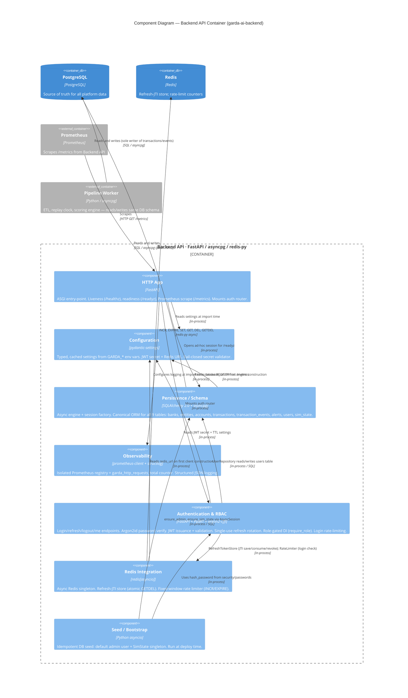

# C4 Component Level: Backend API Container

**Date:** 2026-06-22
**Container:** Backend API (`garda-ai-backend`)
**Parent diagram:** [`garda-ai-deploy/docs/c4/02-container.md`](../../../garda-ai-deploy/docs/c4/02-container.md)
**Code-level source:** [`docs/c4/04-code.md`](./04-code.md)

---

## Container Context

The **Backend API** container is one of two application containers in the Garda AI AML platform (the other being the Pipeline Worker). It is a FastAPI/asyncpg ASGI service that:

- Owns the PostgreSQL schema and ORM models used by every platform service
- Exposes health and readiness probes consumed by the container orchestrator (Docker Compose / Kubernetes)
- Exposes a Prometheus `/metrics` endpoint scraped by the platform Prometheus instance
- Authenticates users via argon2id + JWT access/refresh token pairs with single-use rotation
- Enforces role-based access control on protected endpoints
- Stores revocable refresh-token JTIs and per-IP login rate-limit counters in Redis
- Will serve REST aggregation endpoints and a WebSocket live-feed relay in future phases (not yet implemented)

This document zooms into the **components within that container**. All components run in the same Python process.

---

## Component Summary

| Component | Modules | Responsibility |
|---|---|---|
| **Configuration** | `config.py` | Typed, environment-driven settings; singleton access; fail-closed JWT secret validator |
| **Persistence / Schema** | `db.py`, `schema/` (6 files) | Async DB engine + session factory; canonical ORM data model (9 tables) |
| **Observability** | `observability.py` | Isolated Prometheus registry + metrics; structured JSON logging setup |
| **HTTP App** | `main.py` | FastAPI ASGI app; liveness, readiness, and metrics endpoints; mounts auth router |
| **Authentication & RBAC** | `api/auth.py`, `api/deps.py`, `api/schemas.py`, `services/auth.py`, `security/passwords.py`, `security/tokens.py`, `security/refresh_store.py`, `repositories/users.py` | Login, refresh (rotation), logout, me; JWT issuance + validation; role-gated access; revocable refresh tokens; login rate-limiting |
| **Redis Integration** | `redis_client.py`, `security/refresh_store.py`, `api/ratelimit.py` | Async Redis singleton; revocable refresh-JTI store (atomic consume); fixed-window rate limiting |
| **Seed / Bootstrap** | `seed.py` | Idempotent DB seed: default admin user + simulation state singleton |

---

## Component: Configuration

### Overview

- **Name**: Configuration
- **Type**: Library (singleton provider)
- **Technology**: Python 3.12+, pydantic-settings

### Purpose

Provides a single, validated, cached view of all runtime configuration sourced from environment variables (prefix `GARDA_`) and an optional `.env` file. All other components read configuration through this component — none read environment variables directly.

### Software Features

- **Typed settings**: Declares `database_url` (required), `redis_url`, `jwt_secret`, `jwt_algorithm`, `jwt_access_ttl_min`, `jwt_refresh_ttl_days`, `env`, and `log_level` as typed pydantic fields; unknown variables are silently ignored.
- **Fail-closed JWT secret guard**: `_require_strong_jwt_secret_outside_dev` raises `ValueError` at startup if `env != "development"` and `jwt_secret` is the default placeholder or fewer than 32 characters. Prevents accidental deployment with a weak secret.
- **Singleton caching**: `get_settings()` is decorated with `@lru_cache(maxsize=1)`, guaranteeing the settings object is constructed exactly once per process lifetime.
- **`.env` file support**: Reads a `.env` file at startup if present, enabling local development without shell exports.

### Code Elements

- [`config.py`](../../garda_ai_backend/config.py) — `Settings(BaseSettings)` class and `get_settings()` cached factory function

### Public Interface

#### `get_settings() -> Settings`

The only public symbol. Returns the singleton `Settings` instance.

| Field | Type | Default | Source |
|---|---|---|---|
| `database_url` | `str` | required | `GARDA_DATABASE_URL` |
| `env` | `str` | `"development"` | `GARDA_ENV` |
| `log_level` | `str` | `"INFO"` | `GARDA_LOG_LEVEL` |
| `redis_url` | `str` | `"redis://localhost:6379/0"` | `GARDA_REDIS_URL` |
| `jwt_secret` | `str` | `"change-me-in-prod"` | `GARDA_JWT_SECRET` |
| `jwt_algorithm` | `str` | `"HS256"` | `GARDA_JWT_ALGORITHM` |
| `jwt_access_ttl_min` | `int` | `15` | `GARDA_JWT_ACCESS_TTL_MIN` |
| `jwt_refresh_ttl_days` | `int` | `7` | `GARDA_JWT_REFRESH_TTL_DAYS` |

### Dependencies

- **External**: `pydantic-settings` (BaseSettings, SettingsConfigDict), `pydantic` (model_validator)
- **Components used**: none

---

## Component: Persistence / Schema

### Overview

- **Name**: Persistence / Schema
- **Type**: Library (data access layer + schema registry)
- **Technology**: Python 3.12+, SQLAlchemy 2.0 (async), asyncpg

### Purpose

Provides two closely coupled concerns that are deliberately co-located: the **async database session infrastructure** (`db.py`) and the **canonical ORM data model** (`schema/`). They are grouped as one component because the session factory and ORM models are meaningless without each other — consumers always need both to execute queries.

The schema sub-package is the authoritative definition of all nine PostgreSQL tables used by the platform. The Pipeline Worker and any future services depend on the models defined here (or on the SQL schema that `Base.metadata.create_all()` produces).

### Software Features

- **Async engine with connection pooling**: Creates an `asyncpg`-backed SQLAlchemy engine with `pool_size=10`, `max_overflow=5`, and `pool_pre_ping=True` for resilient connection management.
- **Lazy engine initialisation**: The engine and session factory are constructed on first use and cached for the process lifetime, avoiding startup failures if PostgreSQL is not yet reachable at import time.
- **Request-scoped sessions**: `get_session()` is a FastAPI `yield`-dependency that allocates one `AsyncSession` per HTTP request and returns the connection to the pool on exit, even under exception.
- **Declarative ORM base**: All nine table classes inherit from a single `Base(DeclarativeBase)`, ensuring shared metadata and enabling `Base.metadata.create_all()` for schema migration bootstrapping.
- **Reference tables** (`Bank`, `Entity`, `Account`): Master data for institutions, legal entities, and accounts, including ML-assigned `risk_score` / `risk_category` on `Account`.
- **Transaction tables** (`Transaction`, `TransactionEvent`): Core fact tables. `Transaction` is the primary financial transfer record; `TransactionEvent` is the append-only scoring ledger (one row per scoring pass, status transitions: `approved`, `flagged`, `blocked`).
- **Alert table** (`Alert`): Human-facing alerts raised from flagged scoring events; tracks analyst acknowledgement workflow (`acknowledged_by`, `acknowledged_at`).
- **User table** (`User`): Platform user accounts (analysts and admins) with Argon2id-hashed credentials and RBAC role field.
- **Simulation control table** (`SimState`): Database-level singleton (`CHECK(id = 1)`) controlling the label-replay clock (`sim_now`, `speed`, `running`). Safe for concurrent `UPSERT` without a distributed lock.

### Code Elements

- [`db.py`](../../garda_ai_backend/db.py) — `build_engine()`, `_maker()`, `get_session()`
- [`schema/base.py`](../../garda_ai_backend/schema/base.py) — `Base(DeclarativeBase)`
- [`schema/reference.py`](../../garda_ai_backend/schema/reference.py) — `Bank`, `Entity`, `Account`
- [`schema/transactions.py`](../../garda_ai_backend/schema/transactions.py) — `Transaction`, `TransactionEvent`
- [`schema/alerts.py`](../../garda_ai_backend/schema/alerts.py) — `Alert`
- [`schema/users.py`](../../garda_ai_backend/schema/users.py) — `User`
- [`schema/sim.py`](../../garda_ai_backend/schema/sim.py) — `SimState`
- [`schema/__init__.py`](../../garda_ai_backend/schema/__init__.py) — re-exports all ORM classes under `garda_ai_backend.schema`

### Public Interface

#### `get_session() -> AsyncIterator[AsyncSession]`

FastAPI dependency. Yields one session per request; auto-closes on completion or exception. Intended usage:

```python
Annotated[AsyncSession, Depends(get_session)]
```

#### `build_engine(url: str) -> AsyncEngine`

Constructs a configured async engine from a connection URL. Exposed for use by testing or migration tooling that needs direct engine access.

#### ORM models (via `garda_ai_backend.schema`)

All nine model classes are importable from the package root:

```python
from garda_ai_backend.schema import (
    Base, Bank, Entity, Account,
    Transaction, TransactionEvent,
    Alert, User, SimState,
)
```

`Base.metadata` carries the full DDL and is used by Alembic (or `create_all`) to materialise the schema.

### Dependencies

- **Configuration component**: calls `get_settings()` to obtain `database_url` on first engine construction
- **External — PostgreSQL**: connects via `asyncpg` driver (`postgresql+asyncpg://` URL); pool size 10 + overflow 5

---

## Component: Observability

### Overview

- **Name**: Observability
- **Type**: Library (cross-cutting concern)
- **Technology**: Python 3.12+, prometheus-client, structlog

### Purpose

Provides the two pillars of runtime observability for the Backend API container: **metrics collection** via an isolated Prometheus registry, and **structured logging** via JSON-formatted `structlog` output. Both are configured at import time of `main.py`, before the ASGI server begins accepting requests.

### Software Features

- **Isolated Prometheus registry**: `REGISTRY = CollectorRegistry()` avoids polluting the default process-global registry, preventing conflicts when running alongside other libraries or test frameworks that also register metrics.
- **HTTP request counter**: `REQUEST_COUNT` (`garda_http_requests_total`) is a labelled Counter with dimensions `method`, `path`, `status`. Defined and ready for instrumentation — not yet incremented (middleware/route instrumentation is a planned next step).
- **Structured JSON logging**: `configure_logging(level)` chains three structlog processors — `add_log_level`, `TimeStamper(fmt="iso")`, `JSONRenderer` — producing machine-parseable JSON log lines compatible with log aggregation pipelines (e.g., Loki, Datadog, Cloud Logging).
- **Log level propagation**: Sets the minimum level on both stdlib `logging` and the structlog bound logger, so third-party libraries that use stdlib logging also respect the configured threshold.

### Code Elements

- [`observability.py`](../../garda_ai_backend/observability.py) — `REGISTRY`, `REQUEST_COUNT`, `configure_logging()`

### Public Interface

#### `REGISTRY: CollectorRegistry`

The isolated Prometheus registry. The HTTP App component passes this to `generate_latest()` to serve the `/metrics` endpoint. Future middleware or route handlers should register additional collectors against this registry.

#### `REQUEST_COUNT: Counter`

Pre-defined counter metric. Labels: `method`, `path`, `status`. Currently defined but not yet incremented anywhere in the codebase.

#### `configure_logging(level: str = "INFO") -> None`

Configures stdlib `logging` and `structlog` with structured JSON processors. Called once at process startup from `main.py`.

### Dependencies

- **External**: `prometheus-client` (CollectorRegistry, Counter), `structlog`, `logging`
- **Components used**: none

---

## Component: HTTP App

### Overview

- **Name**: HTTP App
- **Type**: Application (ASGI service entry-point)
- **Technology**: Python 3.12+, FastAPI

### Purpose

The ASGI entry-point for the Backend API container. Creates and owns the `FastAPI` application instance, wires together all other components at startup, and exposes the currently implemented HTTP endpoints: a liveness probe, a readiness probe, a Prometheus metrics scrape endpoint, and the auth router mounted at `/api/v1/auth`.

### Software Features

- **Import-time initialisation**: Calls `get_settings()` and `configure_logging()` as module-level side effects, ensuring logging is active before any request arrives and before the ASGI server calls any lifecycle hook.
- **Auth router mounting**: Includes the Authentication & RBAC component's `router` (prefix `/api/v1/auth`) so all auth endpoints are served by this process.
- **Liveness probe (`GET /healthz`)**: Returns `{"status": "ok"}` unconditionally. Does not touch the database; safe to call before PostgreSQL is available.
- **Readiness probe (`GET /readyz`)**: Executes `SELECT 1` against PostgreSQL using an ad-hoc session from `_maker()`. Returns HTTP 200 `{"status": "ready"}` on success, or HTTP 503 `{"status": "not-ready"}` on any exception.
- **Metrics endpoint (`GET /metrics`)**: Serialises the Observability component's `REGISTRY` via `prometheus_client.generate_latest()` and returns the Prometheus text exposition format with the correct `Content-Type`.

### Code Elements

- [`main.py`](../../garda_ai_backend/main.py) — `app: FastAPI`, `healthz()`, `readyz()`, `metrics()`

### Public Interface

#### HTTP endpoints

| Method | Path | Description | Response |
|---|---|---|---|
| `GET` | `/healthz` | Liveness probe | `200 {"status": "ok"}` |
| `GET` | `/readyz` | Readiness probe (DB ping) | `200 {"status": "ready"}` or `503 {"status": "not-ready"}` |
| `GET` | `/metrics` | Prometheus scrape | `200` Prometheus text format |
| — | `/api/v1/auth/*` | Auth endpoints (delegated) | See Authentication & RBAC component |

### Dependencies

- **Configuration component**: `get_settings()` read at import time to obtain `log_level`
- **Persistence / Schema component**: `_maker()` called inside `GET /readyz` to open an ad-hoc database session
- **Observability component**: `configure_logging()` called at import time; `REGISTRY` passed to `generate_latest()` in `GET /metrics`
- **Authentication & RBAC component**: auth `router` included via `app.include_router()`
- **External — Prometheus**: scrapes `GET /metrics` on the configured interval

---

## Component: Authentication & RBAC

### Overview

- **Name**: Authentication & RBAC
- **Type**: Application (auth layer)
- **Technology**: Python 3.12+, FastAPI, PyJWT, argon2-cffi, pydantic

### Purpose

Implements the complete authentication and authorisation lifecycle for the platform. Handles credential verification (Argon2id), JWT access/refresh token issuance, single-use refresh token rotation, token revocation on logout, identity injection into request handlers, and role-based access control gating. Login attempts are rate-limited per source IP.

This component spans the HTTP router layer (`api/`), the service layer (`services/`), the security primitives (`security/`), and the data access layer (`repositories/`) — all tightly coupled around the single concern of auth.

### Software Features

- **Login (`POST /api/v1/auth/login`)**: Accepts email + password, verifies credentials via Argon2id, issues a fresh access + refresh token pair. Rate-limited to 10 requests / 60 s per source IP.
- **Timing equalization**: `dummy_verify()` runs a full Argon2id verification cycle when the email is not found, preventing user enumeration via response latency differences.
- **Token issuance**: Access tokens (15 min TTL, HS256) carry `sub`, `role`, `type="access"`. Refresh tokens (7-day TTL) carry `sub`, `type="refresh"`, and a UUID `jti` used as the Redis store key.
- **Refresh token rotation (`POST /api/v1/auth/refresh`)**: Decodes the refresh token, atomically consumes the JTI from Redis (`GETDEL`), fetches the user, and issues a new token pair. Prevents replay attacks — a JTI can only be spent once.
- **Logout (`POST /api/v1/auth/logout`)**: Revokes the refresh JTI from Redis (best-effort; silently ignores invalid tokens). Returns HTTP 204.
- **Identity probe (`GET /api/v1/auth/me`)**: Requires a valid Bearer access token; returns `{id, email, role}` from a fresh DB lookup.
- **FastAPI dependency injection**: `CurrentUserDep` extracts and validates the Bearer token on every protected route, raising HTTP 401 on failure. `require_role(*roles)` factory raises HTTP 403 if the authenticated user's role is not in the permitted set.
- **Pydantic request/response models**: `LoginRequest`, `RefreshRequest`, `TokenResponse`, `MeResponse` enforce input validation and output shape.

### Code Elements

- [`api/auth.py`](../../garda_ai_backend/api/auth.py) — `router`; routes: `POST /login`, `POST /refresh`, `POST /logout`, `GET /me`
- [`api/deps.py`](../../garda_ai_backend/api/deps.py) — `CurrentUser`, `get_current_user`, `require_role`, `get_auth_service`; type aliases: `SessionDep`, `RedisDep`, `SettingsDep`, `AuthServiceDep`, `CurrentUserDep`
- [`api/schemas.py`](../../garda_ai_backend/api/schemas.py) — `LoginRequest`, `RefreshRequest`, `TokenResponse`, `MeResponse`
- [`services/auth.py`](../../garda_ai_backend/services/auth.py) — `AuthService`, `TokenPair`, `AuthError`
- [`security/passwords.py`](../../garda_ai_backend/security/passwords.py) — `hash_password`, `verify_password`, `dummy_verify`
- [`security/tokens.py`](../../garda_ai_backend/security/tokens.py) — `create_access_token`, `create_refresh_token`, `decode_token`, `InvalidToken`
- [`security/refresh_store.py`](../../garda_ai_backend/security/refresh_store.py) — `RefreshTokenStore` (save, is_valid, consume, revoke)
- [`repositories/users.py`](../../garda_ai_backend/repositories/users.py) — `UserRepository` (get_by_email, get_by_id, create)

### Public Interface

#### HTTP endpoints (mounted at `/api/v1/auth`)

| Method | Path | Auth required | Description | Response |
|---|---|---|---|---|
| `POST` | `/api/v1/auth/login` | No | Credential verification; issues token pair | `200 TokenResponse` or `401` |
| `POST` | `/api/v1/auth/refresh` | No (refresh token in body) | Single-use token rotation | `200 TokenResponse` or `401` |
| `POST` | `/api/v1/auth/logout` | No (refresh token in body) | Revoke refresh JTI | `204` |
| `GET` | `/api/v1/auth/me` | Bearer access token | Return current user identity | `200 MeResponse` or `401/404` |

#### FastAPI dependency injection points

| Symbol | Usage |
|---|---|
| `CurrentUserDep` | Inject authenticated `CurrentUser(id, role)` into any route |
| `require_role("admin")` | Wrap `CurrentUserDep`; raises HTTP 403 if role not permitted |
| `AuthServiceDep` | Inject a fully wired `AuthService` |

### Dependencies

- **Persistence / Schema component**: `UserRepository` reads/writes the `users` table via `AsyncSession`
- **Redis Integration component**: `RefreshTokenStore` and `RateLimiter` both consume the Redis client (`RedisDep`)
- **Configuration component**: `get_settings()` provides JWT secret and TTL values

---

## Component: Redis Integration

### Overview

- **Name**: Redis Integration
- **Type**: Library (external-resource adapter)
- **Technology**: Python 3.12+, redis[asyncio]

### Purpose

Provides the async Redis client singleton and the two Redis-backed behaviours currently implemented: **revocable refresh-token JTI storage** and **fixed-window per-IP rate limiting**. This component acts as the adapter layer between the application and the Redis container provisioned by `garda-ai-deploy`.

Aggregate caching and pub/sub subscription (for the future WebSocket relay) are architecturally planned but not yet implemented.

### Software Features

- **Async Redis singleton** (`redis_client.py`): `get_redis()` returns a lazily constructed `redis.asyncio.Redis` client with `decode_responses=True`. URL sourced from `Settings.redis_url`.
- **Refresh JTI store** (`security/refresh_store.py`): `RefreshTokenStore` persists valid refresh-token JTIs at `refresh:{jti}` with TTL matching the JWT expiry. `consume()` uses Redis `GETDEL` for atomic single-use enforcement — two concurrent refresh requests cannot both spend the same token.
- **Fixed-window rate limiter** (`api/ratelimit.py`): `RateLimiter` increments `ratelimit:{key}` via `INCR`, sets TTL on first increment, and raises HTTP 429 when the window limit is exceeded. Currently applied to `POST /api/v1/auth/login` at 10 requests / 60 s per IP.

### Code Elements

- [`redis_client.py`](../../garda_ai_backend/redis_client.py) — `build_redis()`, `get_redis()`
- [`security/refresh_store.py`](../../garda_ai_backend/security/refresh_store.py) — `RefreshTokenStore` (shared with Authentication & RBAC component)
- [`api/ratelimit.py`](../../garda_ai_backend/api/ratelimit.py) — `RateLimiter`

### Public Interface

#### `get_redis() -> Redis`

Lazy singleton accessor. Returns the shared `redis.asyncio.Redis` client. Used as the source of the `RedisDep` FastAPI dependency injected into `AuthService` and `RateLimiter`.

#### `RefreshTokenStore`

| Method | Signature | Description |
|---|---|---|
| `save` | `(jti, user_id, ttl_seconds) -> None` | Store JTI with TTL |
| `is_valid` | `(jti, user_id) -> bool` | Non-consuming existence check |
| `consume` | `(jti, user_id) -> bool` | Atomic fetch-and-delete (GETDEL) |
| `revoke` | `(jti) -> None` | Unconditional delete (logout) |

#### `RateLimiter`

| Method | Signature | Description |
|---|---|---|
| `check` | `(key: str) -> None` | Increment counter; raise HTTP 429 if over limit |

### Dependencies

- **Configuration component**: `get_settings().redis_url` consumed on first `get_redis()` call
- **External — Redis**: connects via `redis.asyncio.Redis`; uses `SET`, `GET`, `DEL`, `GETDEL`, `INCR`, `EXPIRE`

---

## Component: Seed / Bootstrap

### Overview

- **Name**: Seed / Bootstrap
- **Type**: Utility (run-once CLI tool)
- **Technology**: Python 3.12+

### Purpose

Provides idempotent database seeding functions for bootstrapping the platform. Ensures a default admin user and a simulation state singleton exist in PostgreSQL before the service begins operating. Designed to be run at deploy time or during local development setup; safe to run repeatedly without duplicating data.

### Software Features

- **Idempotent admin creation** (`ensure_admin`): Checks for an existing user by email; creates one with role `"admin"` and an Argon2id-hashed password only if absent. Returns the existing or newly created `User`.
- **Idempotent simulation state** (`ensure_sim_state`): Returns the existing singleton `SimState` (id=1) if present; otherwise inserts a new one with `running=False` and the provided `start` time and `speed`.
- **CLI entry point** (`_main`): Seeds `admin@garda.local` with password `"admin"` and sets the simulation clock to `2025-09-01T00:00:00Z` at 60x speed. Invoked via `python -m garda_ai_backend.seed`.

### Code Elements

- [`seed.py`](../../garda_ai_backend/seed.py) — `ensure_admin()`, `ensure_sim_state()`, `_main()`

### Public Interface

#### `ensure_admin(session, email, password) -> User`

Creates the admin user if absent.

#### `ensure_sim_state(session, start, speed) -> SimState`

Creates the simulation state singleton if absent.

### Dependencies

- **Persistence / Schema component**: `_maker()` for session; `User`, `SimState` ORM models
- **Authentication & RBAC component**: `hash_password()` from `security/passwords.py`

---

## Component Diagram

The diagram below shows all seven components within the Backend API container, their internal relationships, and their connections to external systems and other containers.



---

## Planned Components (Not Yet Implemented)

The following components are planned for future phases but have **no implementation in this codebase** as of 2026-06-22.

| Planned Component | Schema Evidence | Notes |
|---|---|---|
| **REST API — Aggregations** | `transaction_events`, `alerts`, `accounts` tables ready for query | No view endpoints (`/transactions`, `/alerts`, `/accounts`, etc.) exist |
| **WebSocket Relay** | `transaction_events.seq` cursor design in container spec | No WebSocket route or Redis subscriber exists |
| **PII Masking** | `entities.name`, `accounts.id` are obvious PII fields | No masking layer exists |
| **Simulation Control API** | `sim_state` table (singleton, `running`, `speed`, `sim_now`) | No route for simulation control exists; `seed.py` seeds initial state only |
| **Aggregate Caching** | Redis provisioned; `redis_client.py` available | No cache-aside or read-through layer over query results exists |

---

## Relationship to the Container Diagram

The Container diagram in `garda-ai-deploy/docs/c4/02-container.md` assigns the following responsibilities to the **Backend API** container. The table below maps each responsibility to its implementation status:

| Container-level responsibility | Status | Implementing component |
|---|---|---|
| REST aggregations for every view | Not implemented | — (planned: REST API Aggregations) |
| WebSocket live-feed relay | Not implemented | — (planned: WebSocket Relay) |
| Auth / RBAC | **Implemented** | Authentication & RBAC |
| PII masking | Not implemented | — (planned: PII Masking) |
| Owns DB schema + migrations | Implemented | Persistence / Schema |
| Health / readiness probes | Implemented | HTTP App |
| Prometheus `/metrics` endpoint | Implemented | HTTP App + Observability |
| Connects to PostgreSQL | Implemented | Persistence / Schema |
| Connects to Redis | **Implemented** (JTI store + rate limiting) | Redis Integration |
| Login rate-limiting | **Implemented** | Redis Integration (via Authentication & RBAC) |
| Bootstrap / seed | **Implemented** | Seed / Bootstrap |

The seven implemented components form the foundation and auth layers. Every planned component will depend on Configuration and Persistence / Schema; REST API and WebSocket components will also depend on Redis Integration and Authentication & RBAC.
