# C4 Component Level: Backend API Container

**Date:** 2026-06-22
**Container:** Backend API (`garda-ai-backend`)
**Parent diagram:** [`garda-ai-deploy/docs/c4/02-container.md`](../../../garda-ai-deploy/docs/c4/02-container.md)
**Code-level source:** [`docs/c4/04-code.md`](./04-code.md)

---

## Container Context

The **Backend API** container is one of two application containers in the Garda AI AML platform (the other being the Pipeline Worker). It is a FastAPI/asyncpg ASGI service that:

- Owns the PostgreSQL schema and ORM models used by every platform service
- Exposes health and readiness probes consumed by the container orchestrator (Docker Compose / Kubernetes)
- Exposes a Prometheus `/metrics` endpoint scraped by the platform Prometheus instance
- Authenticates users via argon2id + JWT access/refresh token pairs with single-use rotation
- Enforces role-based access control on protected endpoints
- Stores revocable refresh-token JTIs and per-IP login rate-limit counters in Redis
- Serves REST aggregation endpoints for all dashboard views, role-gated and temporally bounded by the simulation clock
- Masks PII (entity names, account IDs) in user-risk responses based on caller role
- Caches aggregate query results in Redis, keyed to the current simulation timestamp
- Provides a WebSocket live-feed relay that fans out scored events from the Redis `garda:events:live` pub/sub channel to authenticated dashboard clients

This document zooms into the **components within that container**. All components run in the same Python process.

---

## Component Summary

| Component | Modules | Responsibility |
|---|---|---|
| **Configuration** | `config.py` | Typed, environment-driven settings; singleton access; fail-closed JWT secret validator |
| **Persistence / Schema** | `db.py`, `schema/` (6 files) | Async DB engine + session factory; canonical ORM data model (9 tables) |
| **Observability** | `observability.py` | Isolated Prometheus registry + metrics; structured JSON logging setup |
| **HTTP App** | `main.py` | FastAPI ASGI app; liveness, readiness, and metrics endpoints; mounts all routers |
| **Authentication & RBAC** | `api/auth.py`, `api/deps.py`, `api/schemas.py`, `services/auth.py`, `security/passwords.py`, `security/tokens.py`, `security/refresh_store.py`, `repositories/users.py` | Login, refresh (rotation), logout, me; JWT issuance + validation; role-gated access; revocable refresh tokens; login rate-limiting |
| **Redis Integration** | `redis_client.py`, `security/refresh_store.py`, `api/ratelimit.py` | Async Redis singleton; revocable refresh-JTI store (atomic consume); fixed-window rate limiting |
| **Seed / Bootstrap** | `seed.py` | Idempotent DB seed: default admin user + simulation state singleton |
| **View / Read API** | `api/sim.py`, `api/metrics.py`, `api/analytics.py`, `api/geo.py`, `api/transactions.py`, `api/users_view.py`, `api/alerts.py`, `api/system.py`, `api/view_schemas.py`, `repositories/sim.py`, `repositories/metrics.py`, `repositories/analytics.py`, `repositories/geo.py`, `repositories/transactions.py`, `repositories/users_view.py`, `repositories/alerts.py`, `api/deps.py` (`SimNowDep`) | Server-side aggregation of all dashboard data over `transaction_events` filtered by `surfaced_at <= sim_now`; role-gated; simulation clock as the temporal boundary |
| **PII Masking** | `api/masking.py` | Masks entity names and account/payment IDs in user-risk serialization; applied in router layer, not in repositories |
| **Aggregate Caching** | `api/cache.py` | `sim_now`-keyed cache-aside over Redis for aggregate endpoints (metrics, analytics, geo); transactions/live and user-risk are uncached |
| **Live WebSocket Relay** | `api/ws.py`, `api/ws_auth.py`, `realtime/channels.py` | Authenticated (`?token=` access JWT) live fan-out; subscribes to `garda:events:live` Redis pub/sub channel and forwards scored events to dashboard clients via a single blocking poll loop |

---

## Component: Configuration

### Overview

- **Name**: Configuration
- **Type**: Library (singleton provider)
- **Technology**: Python 3.12+, pydantic-settings

### Purpose

Provides a single, validated, cached view of all runtime configuration sourced from environment variables (prefix `GARDA_`) and an optional `.env` file. All other components read configuration through this component — none read environment variables directly.

### Software Features

- **Typed settings**: Declares `database_url` (required), `redis_url`, `jwt_secret`, `jwt_algorithm`, `jwt_access_ttl_min`, `jwt_refresh_ttl_days`, `env`, and `log_level` as typed pydantic fields; unknown variables are silently ignored.
- **Fail-closed JWT secret guard**: `_require_strong_jwt_secret_outside_dev` raises `ValueError` at startup if `env != "development"` and `jwt_secret` is the default placeholder or fewer than 32 characters. Prevents accidental deployment with a weak secret.
- **Singleton caching**: `get_settings()` is decorated with `@lru_cache(maxsize=1)`, guaranteeing the settings object is constructed exactly once per process lifetime.
- **`.env` file support**: Reads a `.env` file at startup if present, enabling local development without shell exports.

### Code Elements

- [`config.py`](../../garda_ai_backend/config.py) — `Settings(BaseSettings)` class and `get_settings()` cached factory function

### Public Interface

#### `get_settings() -> Settings`

The only public symbol. Returns the singleton `Settings` instance.

| Field | Type | Default | Source |
|---|---|---|---|
| `database_url` | `str` | required | `GARDA_DATABASE_URL` |
| `env` | `str` | `"development"` | `GARDA_ENV` |
| `log_level` | `str` | `"INFO"` | `GARDA_LOG_LEVEL` |
| `redis_url` | `str` | `"redis://localhost:6379/0"` | `GARDA_REDIS_URL` |
| `jwt_secret` | `str` | `"change-me-in-prod"` | `GARDA_JWT_SECRET` |
| `jwt_algorithm` | `str` | `"HS256"` | `GARDA_JWT_ALGORITHM` |
| `jwt_access_ttl_min` | `int` | `15` | `GARDA_JWT_ACCESS_TTL_MIN` |
| `jwt_refresh_ttl_days` | `int` | `7` | `GARDA_JWT_REFRESH_TTL_DAYS` |

### Dependencies

- **External**: `pydantic-settings` (BaseSettings, SettingsConfigDict), `pydantic` (model_validator)
- **Components used**: none

---

## Component: Persistence / Schema

### Overview

- **Name**: Persistence / Schema
- **Type**: Library (data access layer + schema registry)
- **Technology**: Python 3.12+, SQLAlchemy 2.0 (async), asyncpg

### Purpose

Provides two closely coupled concerns that are deliberately co-located: the **async database session infrastructure** (`db.py`) and the **canonical ORM data model** (`schema/`). They are grouped as one component because the session factory and ORM models are meaningless without each other — consumers always need both to execute queries.

The schema sub-package is the authoritative definition of all nine PostgreSQL tables used by the platform. The Pipeline Worker and any future services depend on the models defined here (or on the SQL schema that `Base.metadata.create_all()` produces).

### Software Features

- **Async engine with connection pooling**: Creates an `asyncpg`-backed SQLAlchemy engine with `pool_size=10`, `max_overflow=5`, and `pool_pre_ping=True` for resilient connection management.
- **Lazy engine initialisation**: The engine and session factory are constructed on first use and cached for the process lifetime, avoiding startup failures if PostgreSQL is not yet reachable at import time.
- **Request-scoped sessions**: `get_session()` is a FastAPI `yield`-dependency that allocates one `AsyncSession` per HTTP request and returns the connection to the pool on exit, even under exception.
- **Declarative ORM base**: All nine table classes inherit from a single `Base(DeclarativeBase)`, ensuring shared metadata and enabling `Base.metadata.create_all()` for schema migration bootstrapping.
- **Reference tables** (`Bank`, `Entity`, `Account`): Master data for institutions, legal entities, and accounts, including ML-assigned `risk_score` / `risk_category` on `Account`.
- **Transaction tables** (`Transaction`, `TransactionEvent`): Core fact tables. `Transaction` is the primary financial transfer record; `TransactionEvent` is the append-only scoring ledger (one row per scoring pass, status transitions: `approved`, `flagged`, `blocked`).
- **Alert table** (`Alert`): Human-facing alerts raised from flagged scoring events; tracks analyst acknowledgement workflow (`acknowledged_by`, `acknowledged_at`).
- **User table** (`User`): Platform user accounts (analysts and admins) with Argon2id-hashed credentials and RBAC role field.
- **Simulation control table** (`SimState`): Database-level singleton (`CHECK(id = 1)`) controlling the label-replay clock (`sim_now`, `speed`, `running`). Safe for concurrent `UPSERT` without a distributed lock.

### Code Elements

- [`db.py`](../../garda_ai_backend/db.py) — `build_engine()`, `_maker()`, `get_session()`
- [`schema/base.py`](../../garda_ai_backend/schema/base.py) — `Base(DeclarativeBase)`
- [`schema/reference.py`](../../garda_ai_backend/schema/reference.py) — `Bank`, `Entity`, `Account`
- [`schema/transactions.py`](../../garda_ai_backend/schema/transactions.py) — `Transaction`, `TransactionEvent`
- [`schema/alerts.py`](../../garda_ai_backend/schema/alerts.py) — `Alert`
- [`schema/users.py`](../../garda_ai_backend/schema/users.py) — `User`
- [`schema/sim.py`](../../garda_ai_backend/schema/sim.py) — `SimState`
- [`schema/__init__.py`](../../garda_ai_backend/schema/__init__.py) — re-exports all ORM classes under `garda_ai_backend.schema`

### Public Interface

#### `get_session() -> AsyncIterator[AsyncSession]`

FastAPI dependency. Yields one session per request; auto-closes on completion or exception. Intended usage:

```python
Annotated[AsyncSession, Depends(get_session)]
```

#### `build_engine(url: str) -> AsyncEngine`

Constructs a configured async engine from a connection URL. Exposed for use by testing or migration tooling that needs direct engine access.

#### ORM models (via `garda_ai_backend.schema`)

All nine model classes are importable from the package root:

```python
from garda_ai_backend.schema import (
    Base, Bank, Entity, Account,
    Transaction, TransactionEvent,
    Alert, User, SimState,
)
```

`Base.metadata` carries the full DDL and is used by Alembic (or `create_all`) to materialise the schema.

### Dependencies

- **Configuration component**: calls `get_settings()` to obtain `database_url` on first engine construction
- **External — PostgreSQL**: connects via `asyncpg` driver (`postgresql+asyncpg://` URL); pool size 10 + overflow 5

---

## Component: Observability

### Overview

- **Name**: Observability
- **Type**: Library (cross-cutting concern)
- **Technology**: Python 3.12+, prometheus-client, structlog

### Purpose

Provides the two pillars of runtime observability for the Backend API container: **metrics collection** via an isolated Prometheus registry, and **structured logging** via JSON-formatted `structlog` output. Both are configured at import time of `main.py`, before the ASGI server begins accepting requests.

### Software Features

- **Isolated Prometheus registry**: `REGISTRY = CollectorRegistry()` avoids polluting the default process-global registry, preventing conflicts when running alongside other libraries or test frameworks that also register metrics.
- **HTTP request counter**: `REQUEST_COUNT` (`garda_http_requests_total`) is a labelled Counter with dimensions `method`, `path`, `status`. Defined and ready for instrumentation — not yet incremented (middleware/route instrumentation is a planned next step).
- **Structured JSON logging**: `configure_logging(level)` chains three structlog processors — `add_log_level`, `TimeStamper(fmt="iso")`, `JSONRenderer` — producing machine-parseable JSON log lines compatible with log aggregation pipelines (e.g., Loki, Datadog, Cloud Logging).
- **Log level propagation**: Sets the minimum level on both stdlib `logging` and the structlog bound logger, so third-party libraries that use stdlib logging also respect the configured threshold.

### Code Elements

- [`observability.py`](../../garda_ai_backend/observability.py) — `REGISTRY`, `REQUEST_COUNT`, `configure_logging()`

### Public Interface

#### `REGISTRY: CollectorRegistry`

The isolated Prometheus registry. The HTTP App component passes this to `generate_latest()` to serve the `/metrics` endpoint. Future middleware or route handlers should register additional collectors against this registry.

#### `REQUEST_COUNT: Counter`

Pre-defined counter metric. Labels: `method`, `path`, `status`. Currently defined but not yet incremented anywhere in the codebase.

#### `configure_logging(level: str = "INFO") -> None`

Configures stdlib `logging` and `structlog` with structured JSON processors. Called once at process startup from `main.py`.

### Dependencies

- **External**: `prometheus-client` (CollectorRegistry, Counter), `structlog`, `logging`
- **Components used**: none

---

## Component: HTTP App

### Overview

- **Name**: HTTP App
- **Type**: Application (ASGI service entry-point)
- **Technology**: Python 3.12+, FastAPI

### Purpose

The ASGI entry-point for the Backend API container. Creates and owns the `FastAPI` application instance, wires together all components at startup, and mounts all implemented routers. Exposes infrastructure endpoints (liveness, readiness, Prometheus scrape) directly; delegates all API routes to their respective component routers.

### Software Features

- **Import-time initialisation**: Calls `get_settings()` and `configure_logging()` as module-level side effects, ensuring logging is active before any request arrives and before the ASGI server calls any lifecycle hook.
- **Router mounting**: Includes all component routers — `auth`, `sim`, `metrics`, `analytics`, `geo`, `transactions`, `users_view`, `alerts`, `system`, `ws` — so all API and WebSocket endpoints are served by this process.
- **Liveness probe (`GET /healthz`)**: Returns `{"status": "ok"}` unconditionally. Does not touch the database; safe to call before PostgreSQL is available.
- **Readiness probe (`GET /readyz`)**: Executes `SELECT 1` against PostgreSQL and `PING` against Redis. Returns HTTP 200 `{"status": "ready"}` on success, or HTTP 503 `{"status": "not-ready"}` on any exception.
- **Metrics endpoint (`GET /metrics`)**: Serialises the Observability component's `REGISTRY` via `prometheus_client.generate_latest()` and returns the Prometheus text exposition format with the correct `Content-Type`.

### Code Elements

- [`main.py`](../../garda_ai_backend/main.py) — `app: FastAPI`, `healthz()`, `readyz()`, `metrics()`

### Public Interface

#### HTTP endpoints

| Method | Path | Description | Response |
|---|---|---|---|
| `GET` | `/healthz` | Liveness probe | `200 {"status": "ok"}` |
| `GET` | `/readyz` | Readiness probe (DB + Redis ping) | `200 {"status": "ready"}` or `503 {"status": "not-ready"}` |
| `GET` | `/metrics` | Prometheus scrape | `200` Prometheus text format |
| — | `/api/v1/auth/*` | Auth endpoints (delegated) | See Authentication & RBAC component |
| — | `/api/v1/sim/*` | Simulation control (delegated) | See View / Read API component |
| — | `/api/v1/metrics/*` | Metrics aggregation (delegated) | See View / Read API component |
| — | `/api/v1/analytics/*` | Analytics aggregation (delegated) | See View / Read API component |
| — | `/api/v1/geo/*` | Geo aggregation (delegated) | See View / Read API component |
| — | `/api/v1/transactions/*` | Transaction views (delegated) | See View / Read API component |
| — | `/api/v1/users/*` | User risk views (delegated) | See View / Read API component |
| — | `/api/v1/alerts/*` | Alert views (delegated) | See View / Read API component |
| — | `/api/v1/system/*` | System health (delegated) | See View / Read API component |
| — | `/api/v1/ws/*` | WebSocket live feed (delegated) | See Live WebSocket Relay component |

### Dependencies

- **Configuration component**: `get_settings()` read at import time to obtain `log_level`
- **Persistence / Schema component**: `_maker()` called inside `GET /readyz` to open an ad-hoc database session
- **Observability component**: `configure_logging()` called at import time; `REGISTRY` passed to `generate_latest()` in `GET /metrics`
- **Authentication & RBAC component**: auth `router` included via `app.include_router()`
- **View / Read API component**: all eight view routers included via `app.include_router()`
- **Live WebSocket Relay component**: ws `router` included via `app.include_router()`
- **Redis Integration component**: `get_redis()` called inside `GET /readyz` to ping Redis
- **External — Prometheus**: scrapes `GET /metrics` on the configured interval

---

## Component: Authentication & RBAC

### Overview

- **Name**: Authentication & RBAC
- **Type**: Application (auth layer)
- **Technology**: Python 3.12+, FastAPI, PyJWT, argon2-cffi, pydantic

### Purpose

Implements the complete authentication and authorisation lifecycle for the platform. Handles credential verification (Argon2id), JWT access/refresh token issuance, single-use refresh token rotation, token revocation on logout, identity injection into request handlers, and role-based access control gating. Login attempts are rate-limited per source IP. The `require_role` and `CurrentUserDep` factories defined here are also consumed by the View / Read API component to gate dashboard endpoints. The `decode_token` primitive from `security/tokens.py` is additionally consumed by the Live WebSocket Relay component for query-parameter token authentication.

This component spans the HTTP router layer (`api/`), the service layer (`services/`), the security primitives (`security/`), and the data access layer (`repositories/`) — all tightly coupled around the single concern of auth.

### Software Features

- **Login (`POST /api/v1/auth/login`)**: Accepts email + password, verifies credentials via Argon2id, issues a fresh access + refresh token pair. Rate-limited to 10 requests / 60 s per source IP.
- **Timing equalization**: `dummy_verify()` runs a full Argon2id verification cycle when the email is not found, preventing user enumeration via response latency differences.
- **Token issuance**: Access tokens (15 min TTL, HS256) carry `sub`, `role`, `type="access"`. Refresh tokens (7-day TTL) carry `sub`, `type="refresh"`, and a UUID `jti` used as the Redis store key.
- **Refresh token rotation (`POST /api/v1/auth/refresh`)**: Decodes the refresh token, atomically consumes the JTI from Redis (`GETDEL`), fetches the user, and issues a new token pair. Prevents replay attacks — a JTI can only be spent once.
- **Logout (`POST /api/v1/auth/logout`)**: Revokes the refresh JTI from Redis (best-effort; silently ignores invalid tokens). Returns HTTP 204.
- **Identity probe (`GET /api/v1/auth/me`)**: Requires a valid Bearer access token; returns `{id, email, role}` from a fresh DB lookup.
- **FastAPI dependency injection**: `CurrentUserDep` extracts and validates the Bearer token on every protected route, raising HTTP 401 on failure. `require_role(*roles)` factory raises HTTP 403 if the authenticated user's role is not in the permitted set.
- **Pydantic request/response models**: `LoginRequest`, `RefreshRequest`, `TokenResponse`, `MeResponse` enforce input validation and output shape.

### Code Elements

- [`api/auth.py`](../../garda_ai_backend/api/auth.py) — `router`; routes: `POST /login`, `POST /refresh`, `POST /logout`, `GET /me`
- [`api/deps.py`](../../garda_ai_backend/api/deps.py) — `CurrentUser`, `get_current_user`, `require_role`, `get_auth_service`, `get_sim_now`, `SimNowDep`; type aliases: `SessionDep`, `RedisDep`, `SettingsDep`, `AuthServiceDep`, `CurrentUserDep`
- [`api/schemas.py`](../../garda_ai_backend/api/schemas.py) — `LoginRequest`, `RefreshRequest`, `TokenResponse`, `MeResponse`
- [`services/auth.py`](../../garda_ai_backend/services/auth.py) — `AuthService`, `TokenPair`, `AuthError`
- [`security/passwords.py`](../../garda_ai_backend/security/passwords.py) — `hash_password`, `verify_password`, `dummy_verify`
- [`security/tokens.py`](../../garda_ai_backend/security/tokens.py) — `create_access_token`, `create_refresh_token`, `decode_token`, `InvalidToken`
- [`security/refresh_store.py`](../../garda_ai_backend/security/refresh_store.py) — `RefreshTokenStore` (save, is_valid, consume, revoke)
- [`repositories/users.py`](../../garda_ai_backend/repositories/users.py) — `UserRepository` (get_by_email, get_by_id, create)

### Public Interface

#### HTTP endpoints (mounted at `/api/v1/auth`)

| Method | Path | Auth required | Description | Response |
|---|---|---|---|---|
| `POST` | `/api/v1/auth/login` | No | Credential verification; issues token pair | `200 TokenResponse` or `401` |
| `POST` | `/api/v1/auth/refresh` | No (refresh token in body) | Single-use token rotation | `200 TokenResponse` or `401` |
| `POST` | `/api/v1/auth/logout` | No (refresh token in body) | Revoke refresh JTI | `204` |
| `GET` | `/api/v1/auth/me` | Bearer access token | Return current user identity | `200 MeResponse` or `401/404` |

#### FastAPI dependency injection points

| Symbol | Usage |
|---|---|
| `CurrentUserDep` | Inject authenticated `CurrentUser(id, role)` into any route |
| `require_role("admin")` | Wrap `CurrentUserDep`; raises HTTP 403 if role not permitted |
| `AuthServiceDep` | Inject a fully wired `AuthService` |
| `SimNowDep` | Inject current simulation clock datetime; raises HTTP 404 if uninitialized |

### Dependencies

- **Persistence / Schema component**: `UserRepository` reads/writes the `users` table via `AsyncSession`; `SimRepository` reads `sim_state` for `SimNowDep`
- **Redis Integration component**: `RefreshTokenStore` and `RateLimiter` both consume the Redis client (`RedisDep`)
- **Configuration component**: `get_settings()` provides JWT secret and TTL values

---

## Component: Redis Integration

### Overview

- **Name**: Redis Integration
- **Type**: Library (external-resource adapter)
- **Technology**: Python 3.12+, redis[asyncio]

### Purpose

Provides the async Redis client singleton and the Redis-backed behaviours currently implemented: **revocable refresh-token JTI storage**, **fixed-window per-IP rate limiting**, and **aggregate response caching**. This component acts as the adapter layer between the application and the Redis container provisioned by `garda-ai-deploy`. The Aggregate Caching component (`api/cache.py`) and the Live WebSocket Relay component use the Redis client provided here.

### Software Features

- **Async Redis singleton** (`redis_client.py`): `get_redis()` returns a lazily constructed `redis.asyncio.Redis` client with `decode_responses=True`. URL sourced from `Settings.redis_url`.
- **Refresh JTI store** (`security/refresh_store.py`): `RefreshTokenStore` persists valid refresh-token JTIs at `refresh:{jti}` with TTL matching the JWT expiry. `consume()` uses Redis `GETDEL` for atomic single-use enforcement — two concurrent refresh requests cannot both spend the same token.
- **Fixed-window rate limiter** (`api/ratelimit.py`): `RateLimiter` increments `ratelimit:{key}` via `INCR`, sets TTL on first increment, and raises HTTP 429 when the window limit is exceeded. Currently applied to `POST /api/v1/auth/login` at 10 requests / 60 s per IP.
- **Aggregate cache backing store**: The `agg:{key}` key namespace is used by `api/cache.py` (`cached_json`) to store serialised JSON of aggregate query results. Redis is the storage medium; the caching logic lives in the Aggregate Caching component.
- **Pub/sub transport for live events**: The `redis.asyncio.Redis` client returned by `get_redis()` also provides the `pubsub()` interface consumed by the Live WebSocket Relay to subscribe to `garda:events:live`.

### Code Elements

- [`redis_client.py`](../../garda_ai_backend/redis_client.py) — `build_redis()`, `get_redis()`
- [`security/refresh_store.py`](../../garda_ai_backend/security/refresh_store.py) — `RefreshTokenStore` (shared with Authentication & RBAC component)
- [`api/ratelimit.py`](../../garda_ai_backend/api/ratelimit.py) — `RateLimiter`

### Public Interface

#### `get_redis() -> Redis`

Lazy singleton accessor. Returns the shared `redis.asyncio.Redis` client. Used as the source of the `RedisDep` FastAPI dependency injected into `AuthService`, `RateLimiter`, `cached_json`, and the Live WebSocket Relay.

#### `RefreshTokenStore`

| Method | Signature | Description |
|---|---|---|
| `save` | `(jti, user_id, ttl_seconds) -> None` | Store JTI with TTL |
| `is_valid` | `(jti, user_id) -> bool` | Non-consuming existence check |
| `consume` | `(jti, user_id) -> bool` | Atomic fetch-and-delete (GETDEL) |
| `revoke` | `(jti) -> None` | Unconditional delete (logout) |

#### `RateLimiter`

| Method | Signature | Description |
|---|---|---|
| `check` | `(key: str) -> None` | Increment counter; raise HTTP 429 if over limit |

### Dependencies

- **Configuration component**: `get_settings().redis_url` consumed on first `get_redis()` call
- **External — Redis**: connects via `redis.asyncio.Redis`; uses `SET`, `GET`, `DEL`, `GETDEL`, `INCR`, `EXPIRE`, `PING`, `SUBSCRIBE` (pub/sub)

---

## Component: Seed / Bootstrap

### Overview

- **Name**: Seed / Bootstrap
- **Type**: Utility (run-once CLI tool)
- **Technology**: Python 3.12+

### Purpose

Provides idempotent database seeding functions for bootstrapping the platform. Ensures a default admin user and a simulation state singleton exist in PostgreSQL before the service begins operating. Designed to be run at deploy time or during local development setup; safe to run repeatedly without duplicating data.

### Software Features

- **Idempotent admin creation** (`ensure_admin`): Checks for an existing user by email; creates one with role `"admin"` and an Argon2id-hashed password only if absent. Returns the existing or newly created `User`.
- **Idempotent simulation state** (`ensure_sim_state`): Returns the existing singleton `SimState` (id=1) if present; otherwise inserts a new one with `running=False` and the provided `start` time and `speed`.
- **CLI entry point** (`_main`): Seeds `admin@garda.local` with password `"admin"` and sets the simulation clock to `2025-09-01T00:00:00Z` at 60x speed. Invoked via `python -m garda_ai_backend.seed`.

### Code Elements

- [`seed.py`](../../garda_ai_backend/seed.py) — `ensure_admin()`, `ensure_sim_state()`, `_main()`

### Public Interface

#### `ensure_admin(session, email, password) -> User`

Creates the admin user if absent.

#### `ensure_sim_state(session, start, speed) -> SimState`

Creates the simulation state singleton if absent.

### Dependencies

- **Persistence / Schema component**: `_maker()` for session; `User`, `SimState` ORM models
- **Authentication & RBAC component**: `hash_password()` from `security/passwords.py`

---

## Component: View / Read API

### Overview

- **Name**: View / Read API
- **Type**: Application (dashboard read layer)
- **Technology**: Python 3.12+, FastAPI, SQLAlchemy 2.0 (async), pydantic

### Purpose

Serves all dashboard read endpoints for the Garda AI AML platform. Every endpoint aggregates `transaction_events` rows filtered to `surfaced_at <= sim_now`, where `sim_now` is the current simulation clock value injected via the shared `SimNowDep` dependency. This temporal boundary is the single point that makes all dashboard data consistent with the label-replay simulation phase.

All endpoints require an authenticated caller (`CurrentUserDep`). The simulation control mutation endpoint (`POST /api/v1/sim/control`) is additionally admin-only (`require_role("admin")`). Aggregate results for metrics, analytics, and geo are cached in Redis keyed by `sim_now` to avoid repeated heavy queries on consecutive requests with the same clock value. Transaction live-feed and user-risk endpoints are uncached because their result sets change with cursor/filter parameters.

The component is composed of eight FastAPI routers and seven query repositories. Response shapes are declared in the shared `view_schemas.py` module.

### Endpoint Groups

| Router prefix | File | Endpoints | Cached |
|---|---|---|---|
| `/api/v1/sim` | `api/sim.py` | `GET /state`, `POST /control` (admin-only) | No |
| `/api/v1/metrics` | `api/metrics.py` | `GET /overview`, `GET /volume`, `GET /heatmap` | Yes (TTL 5 s) |
| `/api/v1/analytics` | `api/analytics.py` | `GET /fraud` | Yes (TTL 5 s) |
| `/api/v1/geo` | `api/geo.py` | `GET /provinces` | Yes (TTL 10 s) |
| `/api/v1/transactions` | `api/transactions.py` | `GET /live`, `GET /{transaction_id}` | No |
| `/api/v1/users` | `api/users_view.py` | `GET /risk`, `GET /{entity_id}/profile` | No |
| `/api/v1/alerts` | `api/alerts.py` | `GET /` (list), `POST /{alert_id}/ack` | No |
| `/api/v1/system` | `api/system.py` | `GET /health` | No |

### Software Features

- **Temporal boundary via `SimNowDep`**: All view queries receive `sim_now` from a single shared dependency (`get_sim_now` in `api/deps.py`) that reads `SimState.sim_now` from the database and raises HTTP 404 if uninitialised. All repositories apply `WHERE surfaced_at <= sim_now` to their core fact queries.
- **Simulation state read/write** (`api/sim.py`, `repositories/sim.py`): `GET /state` returns the current clock state (any authenticated user). `POST /control` allows an admin to toggle `running`, set `speed`, or advance/rewind `sim_now` directly. `SimRepository` handles the state UPSERT.
- **Metrics aggregations** (`api/metrics.py`, `repositories/metrics.py`): Overview (total count, flagged, blocked, total amount, fraud rate), volume time-series (hour / day / month granularity for 24h / weekly / monthly / yearly windows), and 7×24 activity heatmap. All backed by `MetricsRepository`.
- **Fraud analytics** (`api/analytics.py`, `repositories/analytics.py`): Typology distribution (count + amount per typology), and confusion-matrix-derived detection metrics (precision, recall, F1) computed from `is_laundering` ground truth vs. `status` prediction. Backed by `AnalyticsRepository`.
- **Geo distribution** (`api/geo.py`, `repositories/geo.py`): Province-level fraud counts (flagged + blocked events joined through account → entity → province). Risk level derived by count thresholds (≥100: high, ≥20: medium, else low). Backed by `GeoRepository`.
- **Transaction live-feed** (`api/transactions.py`, `repositories/transactions.py`): Cursor-paginated live window (`after_seq` / `limit`) and single-transaction detail endpoint. `TransactionsRepository` joins `transaction_events` → `transactions` → `banks`. Clients use this endpoint to backfill any missed events (e.g., after a WebSocket reconnect).
- **User risk profiles** (`api/users_view.py`, `repositories/users_view.py`): Risk-list endpoint (optional `risk` category filter, `limit`) and per-entity profile. `UserRiskRepository` joins entities → accounts → transactions → events. PII (entity name) masked in the router layer via `mask_name` (see PII Masking component); admin callers with `unmasked=true` receive plaintext.
- **Alert management** (`api/alerts.py`, `repositories/alerts.py`): Alert list (all or active-only) and acknowledgement mutation (`POST /{alert_id}/ack`). `AlertsRepository` reads and writes the `alerts` table.
- **System health** (`api/system.py`): Authenticated health endpoint (`GET /api/v1/system/health`) checking DB connectivity, Redis connectivity, and the count of surfaced events up to `sim_now`.
- **View schemas** (`api/view_schemas.py`): Pydantic models for all request and response shapes: `SimStateResponse`, `SimControlRequest`, `MetricsOverviewResponse`, `VolumeResponse`, `HeatmapResponse`, `FraudAnalyticsResponse`, `GeoResponse`, `LiveResponse`, `TransactionDetail`, `UserRiskResponse`, `AlertsResponse`, `SystemHealthResponse`.

### Code Elements

**Routers**
- [`api/sim.py`](../../garda_ai_backend/api/sim.py) — `router`; `GET /state`, `POST /control`
- [`api/metrics.py`](../../garda_ai_backend/api/metrics.py) — `router`; `GET /overview`, `GET /volume`, `GET /heatmap`
- [`api/analytics.py`](../../garda_ai_backend/api/analytics.py) — `router`; `GET /fraud`
- [`api/geo.py`](../../garda_ai_backend/api/geo.py) — `router`; `GET /provinces`
- [`api/transactions.py`](../../garda_ai_backend/api/transactions.py) — `router`; `GET /live`, `GET /{transaction_id}`
- [`api/users_view.py`](../../garda_ai_backend/api/users_view.py) — `router`; `GET /risk`, `GET /{entity_id}/profile`
- [`api/alerts.py`](../../garda_ai_backend/api/alerts.py) — `router`; `GET /`, `POST /{alert_id}/ack`
- [`api/system.py`](../../garda_ai_backend/api/system.py) — `router`; `GET /health`

**Repositories**
- [`repositories/sim.py`](../../garda_ai_backend/repositories/sim.py) — `SimRepository` (get_state, get_sim_now, update_state)
- [`repositories/metrics.py`](../../garda_ai_backend/repositories/metrics.py) — `MetricsRepository` (overview, volume, heatmap)
- [`repositories/analytics.py`](../../garda_ai_backend/repositories/analytics.py) — `AnalyticsRepository` (typology_distribution, confusion_counts)
- [`repositories/geo.py`](../../garda_ai_backend/repositories/geo.py) — `GeoRepository` (province_fraud_counts)
- [`repositories/transactions.py`](../../garda_ai_backend/repositories/transactions.py) — `TransactionsRepository` (live_window, detail)
- [`repositories/users_view.py`](../../garda_ai_backend/repositories/users_view.py) — `UserRiskRepository` (risk_list, profile)
- [`repositories/alerts.py`](../../garda_ai_backend/repositories/alerts.py) — `AlertsRepository` (list_alerts, acknowledge)

**Shared**
- [`api/view_schemas.py`](../../garda_ai_backend/api/view_schemas.py) — all Pydantic request/response models for view endpoints
- [`api/deps.py`](../../garda_ai_backend/api/deps.py) — `SimNowDep`, `CurrentUserDep`, `require_role` (shared with Authentication & RBAC)

### Public Interface

#### HTTP endpoints

| Method | Path | Auth | Description | Response |
|---|---|---|---|---|
| `GET` | `/api/v1/sim/state` | Any authenticated | Current simulation clock state | `200 SimStateResponse` or `404` |
| `POST` | `/api/v1/sim/control` | Admin only | Update `running`, `speed`, or `sim_now` | `200 SimStateResponse` |
| `GET` | `/api/v1/metrics/overview` | Any authenticated | Total transactions, flagged, blocked, amount, fraud rate | `200 MetricsOverviewResponse` |
| `GET` | `/api/v1/metrics/volume` | Any authenticated | Time-series volume (`range` query: 24h/weekly/monthly/yearly) | `200 VolumeResponse` |
| `GET` | `/api/v1/metrics/heatmap` | Any authenticated | 7×24 activity heatmap | `200 HeatmapResponse` |
| `GET` | `/api/v1/analytics/fraud` | Any authenticated | Typology distribution + detection metrics (precision/recall/F1) | `200 FraudAnalyticsResponse` |
| `GET` | `/api/v1/geo/provinces` | Any authenticated | Province-level fraud counts with risk levels | `200 GeoResponse` |
| `GET` | `/api/v1/transactions/live` | Any authenticated | Cursor-paginated live event feed (`after_seq`, `limit`) — also the backfill endpoint for WebSocket clients after a reconnect | `200 LiveResponse` |
| `GET` | `/api/v1/transactions/{id}` | Any authenticated | Single transaction detail | `200 TransactionDetail` or `404` |
| `GET` | `/api/v1/users/risk` | Any authenticated | Entity risk list (`risk`, `unmasked`, `limit`) | `200 UserRiskResponse` |
| `GET` | `/api/v1/users/{entity_id}/profile` | Any authenticated | Single entity risk profile | `200 RiskProfile` or `404` |
| `GET` | `/api/v1/alerts` | Any authenticated | Alert list (`status=all\|active`) | `200 AlertsResponse` |
| `POST` | `/api/v1/alerts/{id}/ack` | Any authenticated | Acknowledge an alert | `200 AlertItem` or `404` |
| `GET` | `/api/v1/system/health` | Any authenticated | DB + Redis health + surfaced-events count | `200 SystemHealthResponse` |

### Dependencies

- **Persistence / Schema component**: all seven repositories use `AsyncSession`; ORM models `TransactionEvent`, `Transaction`, `Bank`, `Entity`, `Account`, `Alert`, `SimState`
- **Authentication & RBAC component**: `CurrentUserDep`, `require_role` from `api/deps.py`; `SimNowDep` also lives in `api/deps.py`
- **Aggregate Caching component**: `cached_json` used by metrics, analytics, and geo routers
- **PII Masking component**: `mask_name` called in `api/users_view.py` before serializing `RiskProfile`
- **Redis Integration component**: `RedisDep` injected into cached endpoints to pass to `cached_json`

---

## Component: PII Masking

### Overview

- **Name**: PII Masking
- **Type**: Library (data sanitisation utility)
- **Technology**: Python 3.12+

### Purpose

Provides pure functions for masking personally identifiable information before it is returned to API callers. Applied in the router layer (not in repositories), ensuring that PII sanitisation is a presentation-layer concern that can be bypassed by privileged callers (`unmasked=true` + admin role) without changing the underlying query logic.

Currently applied exclusively in `api/users_view.py` during `RiskProfile` serialization.

### Software Features

- **Name masking** (`mask_name`): Masks each word of an entity name to its initial character followed by four asterisks. Example: `"Ahmad Setiawan"` → `"A**** S****"`.
- **Account ID masking** (`mask_account_id`): Retains the last four characters of an account or payment ID; masks all preceding characters with `*`. IDs of four or fewer characters are fully masked.
- **Payment ID masking** (`mask_payment_id`): Delegates to `mask_account_id` — same masking rule applied to payment reference strings.

### Code Elements

- [`api/masking.py`](../../garda_ai_backend/api/masking.py) — `mask_name`, `mask_account_id`, `mask_payment_id`

### Public Interface

| Function | Signature | Description |
|---|---|---|
| `mask_name` | `(name: str) -> str` | Mask each word to initial + `****` |
| `mask_account_id` | `(account_id: str) -> str` | Keep last 4 chars; mask the rest |
| `mask_payment_id` | `(payment_id: str) -> str` | Alias of `mask_account_id` |

### Dependencies

- **External**: none (pure Python)
- **Components used**: none (consumed by View / Read API)

---

## Component: Aggregate Caching

### Overview

- **Name**: Aggregate Caching
- **Type**: Library (cache-aside decorator)
- **Technology**: Python 3.12+, redis[asyncio]

### Purpose

Provides a single `cached_json` helper that implements a cache-aside pattern over Redis for aggregate query results. Results are serialised to JSON, stored under the `agg:{key}` namespace with a configurable TTL, and returned directly on subsequent requests with the same key. The cache key is always constructed to include `sim_now.isoformat()`, so cached results are automatically invalidated when the simulation clock advances.

Applied to the three heaviest aggregate endpoint groups: metrics (TTL 5 s), analytics (TTL 5 s), and geo (TTL 10 s). Transaction live-feed endpoints and user-risk endpoints are explicitly not cached because their result sets are parametrised by cursor/filter arguments that make key construction impractical without per-request granularity.

### Software Features

- **Cache-aside read-through** (`cached_json`): Checks `agg:{key}` in Redis. On a hit, deserialises and returns the cached value. On a miss, calls the async `compute` callable, serialises the result via `json.dumps(..., default=str)`, stores it with the given TTL, and returns the fresh value.
- **`sim_now`-keyed cache invalidation**: Callers include `sim_now.isoformat()` in the key (e.g., `f"overview:{sim_now.isoformat()}"`), so a new simulation tick produces a new key and the stale entry simply expires by TTL.
- **`default=str` serialisation**: Handles non-JSON-native types (notably `datetime` objects returned by SQLAlchemy) without requiring callers to pre-serialise their results.

### Code Elements

- [`api/cache.py`](../../garda_ai_backend/api/cache.py) — `cached_json`

### Public Interface

#### `cached_json(redis, key, ttl, compute) -> Any`

| Parameter | Type | Description |
|---|---|---|
| `redis` | `Redis` | Async Redis client (from `RedisDep`) |
| `key` | `str` | Cache key suffix; stored as `agg:{key}` |
| `ttl` | `int` | Seconds until the cached entry expires |
| `compute` | `Callable[[], Awaitable[Any]]` | Async factory called on a cache miss |

Returns the cached or freshly computed value.

### Dependencies

- **Redis Integration component**: `redis.asyncio.Redis` client passed in by caller
- **External**: `redis[asyncio]`, `json`
- **Components used**: none (consumed by View / Read API)

---

## Component: Live WebSocket Relay

### Overview

- **Name**: Live WebSocket Relay
- **Type**: Application (real-time push layer)
- **Technology**: Python 3.12+, FastAPI WebSockets, redis[asyncio] pub/sub

### Purpose

Provides authenticated, real-time push of scored AML events to dashboard clients over a persistent WebSocket connection. The relay subscribes to the Redis `garda:events:live` pub/sub channel — the channel the Plan 3 pipeline worker publishes to after each scoring pass — and forwards each message directly to the connected client in a single blocking poll loop. Backpressure is the natural `send_text` await; there is no in-process queue and no resync sentinel.

Authentication is performed before the WebSocket handshake is accepted: the standard JWT access token is passed as a `?token=` query parameter (Bearer headers are not available in the browser WebSocket API). An invalid or missing token causes an immediate close with code 1008 (Policy Violation) before `accept()` is called.

This is the final backend API surface of Plan 2. The pipeline publisher (the Plan 3 worker that writes to `garda:events:live`) is **not part of this repository** and does not exist yet.

### Software Features

- **Auth-before-accept**: `authenticate_ws_token` validates the `?token=` query parameter using `decode_token` and checks `claims["type"] == "access"`. If validation fails, the WebSocket is closed with code 1008 without being accepted — no handshake is completed for unauthenticated callers.
- **Redis pub/sub subscription**: On successful auth, the handler calls `redis.pubsub()` and subscribes to `LIVE_EVENTS_CHANNEL` (`"garda:events:live"`). The channel name is defined as a shared constant in `realtime/channels.py` to keep the relay and the future pipeline publisher in sync.
- **Connected sentinel**: Immediately after `accept()`, a `{"type": "connected"}` message is sent to confirm the subscription is live before any events arrive.
- **Single-loop poll-and-forward**: The handler enters a `while True` loop calling `pubsub.get_message(ignore_subscribe_messages=True, timeout=15)`. When a `"message"` arrives, `send_text(message["data"])` forwards the raw event JSON to the client immediately. No concurrent reader/writer tasks and no in-process queue — the prior concurrent-task pattern delivered correctly under Starlette's in-process test transport but did not deliver messages under uvicorn's real WebSocket transport, so it was replaced by this single-coroutine design.
- **Natural backpressure**: Because `send_text` is awaited inline, a slow client naturally throttles the poll loop. There is no bounded queue, no drop-to-latest, and no `{"type": "resync"}` sentinel. Clients still recover any gaps by calling `GET /transactions/live?after_seq=<last_seq>` (the consistency contract is unchanged).
- **Disconnect detection**: `send_text` raises `WebSocketDisconnect` when the client goes away, ending the loop. The `finally` block unsubscribes and closes the pub/sub connection best-effort.
- **Integration test coverage**: The relay is verified by `tests/test_ws_uvicorn.py`, which runs a real uvicorn instance in-process to confirm end-to-end delivery — the test that exposed the concurrent-task transport failure.
- **Shared channel constant**: `LIVE_EVENTS_CHANNEL = "garda:events:live"` in `realtime/channels.py` is the single source of truth for the channel name, establishing the cross-repo contract between this relay and the Plan 3 pipeline worker.

### Code Elements

- [`api/ws.py`](../../garda_ai_backend/api/ws.py) — `router`; `WS /api/v1/ws/live`; `_POLL_TIMEOUT = 15.0`; single-loop poll-and-forward handler
- [`api/ws_auth.py`](../../garda_ai_backend/api/ws_auth.py) — `authenticate_ws_token(token, secret) -> CurrentUser | None`
- [`realtime/channels.py`](../../garda_ai_backend/realtime/channels.py) — `LIVE_EVENTS_CHANNEL = "garda:events:live"`

### Public Interface

#### WebSocket endpoint

| Protocol | Path | Auth | Description |
|---|---|---|---|
| `WS` | `/api/v1/ws/live` | `?token=<access_jwt>` | Subscribe to live scored-event stream |

**Connection lifecycle:**

1. Client connects with `?token=<access_jwt>`.
2. Server validates the token; closes 1008 on failure (no accept).
3. Server accepts, subscribes to Redis channel, sends `{"type": "connected"}`.
4. Server polls Redis (`get_message`, timeout 15 s) in a single loop; forwards each event payload as a `send_text` call.
5. On client disconnect (`WebSocketDisconnect` raised by `send_text`), the loop exits and the pub/sub connection is closed best-effort.
6. Clients may call `GET /transactions/live?after_seq=<last_seq>` at any time to backfill missed events.

#### `authenticate_ws_token(token: str, secret: str) -> CurrentUser | None`

| Parameter | Type | Description |
|---|---|---|
| `token` | `str` | Raw JWT string from `?token=` query param |
| `secret` | `str` | HMAC secret from `Settings.jwt_secret` |

Returns a `CurrentUser(id, role)` on success, `None` on any validation failure (missing token, invalid signature, wrong type claim).

#### `LIVE_EVENTS_CHANNEL: str`

`"garda:events:live"` — the Redis pub/sub channel name. Cross-repo contract: the Plan 3 pipeline worker must `PUBLISH` to this channel for the relay to receive events.

### Dependencies

- **Authentication & RBAC component**: `decode_token`, `InvalidToken` from `security/tokens.py`; `CurrentUser`, `RedisDep`, `SettingsDep` from `api/deps.py`
- **Redis Integration component**: `RedisDep` (the async Redis client); uses `pubsub()`, `subscribe()`, `listen()`, `unsubscribe()`, `aclose()`
- **Configuration component**: `SettingsDep` provides `jwt_secret` for token validation
- **External — Redis**: subscribes to `garda:events:live` channel; receives messages published by the pipeline worker
- **External (planned) — Pipeline Worker (Plan 3)**: the external publisher that writes scored `TransactionEvent` records to the DB and publishes event JSON to `garda:events:live`; not yet implemented

---

## Component Diagram

The diagram below shows all eleven components within the Backend API container, their internal relationships, and their connections to external systems and other containers.

```mermaid
C4Component
    title Component Diagram — Backend API Container (garda-ai-backend)

    Container_Boundary(api, "Backend API · FastAPI / asyncpg / redis-py") {
        Component(httpApp, "HTTP App", "FastAPI", "ASGI entry-point. Liveness (/healthz), readiness (/readyz), Prometheus scrape (/metrics). Mounts all routers including WebSocket relay.")
        Component(config, "Configuration", "pydantic-settings", "Typed, cached settings from GARDA_* env vars. JWT secret + Redis URL. Fail-closed secret validator.")
        Component(persistence, "Persistence / Schema", "SQLAlchemy 2.0 + asyncpg", "Async engine + session factory. Canonical ORM for all 9 tables: banks, entities, accounts, transactions, transaction_events, alerts, users, sim_state.")
        Component(observability, "Observability", "prometheus-client + structlog", "Isolated Prometheus registry + garda_http_requests_total counter. Structured JSON logging.")
        Component(auth, "Authentication & RBAC", "FastAPI + PyJWT + argon2-cffi", "Login/refresh/logout/me. Argon2id password verify. JWT issuance + validation. Single-use refresh rotation. Role-gated DI (require_role / CurrentUserDep / SimNowDep). Login rate-limiting.")
        Component(redis, "Redis Integration", "redis[asyncio]", "Async Redis singleton. Refresh-JTI store (atomic GETDEL). Fixed-window rate limiter (INCR/EXPIRE). Pub/sub client for live event channel.")
        Component(seed, "Seed / Bootstrap", "Python asyncio", "Idempotent DB seed: default admin user + SimState singleton. Run at deploy time.")
        Component(viewApi, "View / Read API", "FastAPI + SQLAlchemy", "8 routers + 7 repositories. Aggregates transaction_events WHERE surfaced_at <= sim_now. Endpoints: sim, metrics, analytics, geo, transactions, users, alerts, system. /sim/control is admin-only. /transactions/live?after_seq= is the backfill endpoint for WS clients after reconnect.")
        Component(masking, "PII Masking", "Python", "mask_name / mask_account_id. Applied in users_view router before RiskProfile serialization. Admin callers with unmasked=true bypass masking.")
        Component(cache, "Aggregate Caching", "redis[asyncio] + json", "cached_json cache-aside over Redis. sim_now-keyed. Applied to metrics, analytics, geo (TTL 5-10 s). Transactions/live and user-risk are uncached.")
        Component(wsRelay, "Live WebSocket Relay", "FastAPI WebSockets + redis pub/sub", "WS /api/v1/ws/live. Auth-before-accept via ?token= JWT. Single-loop poll-and-forward: subscribe → send connected → get_message(timeout=15) → send_text. No queue; natural send-await backpressure. Clients backfill gaps via GET /transactions/live?after_seq=.")
    }

    ContainerDb(pg, "PostgreSQL", "PostgreSQL", "Source of truth for all platform data")
    ContainerDb(redisDb, "Redis", "Redis", "Refresh-JTI store; rate-limit counters; agg:* cache entries; garda:events:live pub/sub channel")
    Container_Ext(prom, "Prometheus", "Prometheus", "Scrapes /metrics from Backend API")
    Container_Ext(worker, "Pipeline Worker (Plan 3)", "Python / asyncpg", "ETL, replay clock, ML scoring engine — reads/writes same DB schema. PUBLISHES scored events to garda:events:live. Not yet implemented.")
    Container_Ext(dashboard, "Dashboard Client", "Browser / WebSocket", "Connects to WS /api/v1/ws/live; backfills via GET /transactions/live?after_seq=")

    Rel(httpApp, config, "Reads settings at import time", "in-process")
    Rel(httpApp, persistence, "Opens ad-hoc session for /readyz", "in-process")
    Rel(httpApp, observability, "Configures logging at import time; serves REGISTRY on /metrics", "in-process")
    Rel(httpApp, auth, "Mounts auth router", "in-process")
    Rel(httpApp, viewApi, "Mounts 8 view routers", "in-process")
    Rel(httpApp, redis, "Pings Redis for /readyz", "in-process")
    Rel(httpApp, wsRelay, "Mounts WebSocket router", "in-process")

    Rel(persistence, config, "Reads database_url on first engine construction", "in-process")
    Rel(redis, config, "Reads redis_url on first client construction", "in-process")

    Rel(auth, persistence, "UserRepository reads/writes users table; SimRepository reads sim_state for SimNowDep", "in-process / SQL")
    Rel(auth, redis, "RefreshTokenStore (JTI save/consume/revoke); RateLimiter (login check)", "in-process")
    Rel(auth, config, "Reads JWT secret + TTL settings", "in-process")

    Rel(viewApi, persistence, "7 repositories query transaction_events, transactions, alerts, sim_state, entities, accounts, banks", "in-process / SQL")
    Rel(viewApi, auth, "Uses CurrentUserDep, require_role, SimNowDep from api/deps.py", "in-process")
    Rel(viewApi, cache, "metrics, analytics, geo routers call cached_json", "in-process")
    Rel(viewApi, masking, "users_view router calls mask_name for RiskProfile serialization", "in-process")

    Rel(cache, redis, "GET / SET agg:* keys with TTL", "in-process")

    Rel(seed, persistence, "ensure_admin, ensure_sim_state via AsyncSession", "in-process / SQL")
    Rel(seed, auth, "Uses hash_password from security/passwords", "in-process")

    Rel(wsRelay, auth, "authenticate_ws_token uses decode_token + CurrentUser from api/deps.py", "in-process")
    Rel(wsRelay, redis, "redis.pubsub() — SUBSCRIBE garda:events:live", "in-process")
    Rel(wsRelay, config, "Reads jwt_secret via SettingsDep for token validation", "in-process")

    Rel(persistence, pg, "Reads and writes", "SQL / asyncpg (pool: 10+5)")
    Rel(redis, redisDb, "INCR, EXPIRE, SET, GET, DEL, GETDEL, PING, SUBSCRIBE", "redis-py async")
    Rel(cache, redisDb, "GET / SET agg:* (via Redis Integration client)", "redis-py async")
    Rel(wsRelay, redisDb, "SUBSCRIBE garda:events:live — receives published events", "redis-py async pub/sub")
    Rel(prom, httpApp, "Scrapes", "HTTP GET /metrics")
    Rel(worker, pg, "Reads and writes (sole writer of transactions/events)", "SQL / asyncpg")
    Rel(worker, redisDb, "PUBLISH garda:events:live (planned — not yet implemented)", "redis PUBLISH")
    Rel(dashboard, wsRelay, "Connects with ?token=<jwt>; receives live event frames", "WebSocket")
    Rel(dashboard, viewApi, "Backfills via GET /transactions/live?after_seq= after reconnect", "HTTP")
```



---

## Relationship to the Container Diagram

The Container diagram in `garda-ai-deploy/docs/c4/02-container.md` assigns the following responsibilities to the **Backend API** container. The table below maps each responsibility to its implementation status:

| Container-level responsibility | Status | Implementing component |
|---|---|---|
| REST aggregations for every view | **Implemented** | View / Read API |
| WebSocket live-feed relay | **Implemented** | Live WebSocket Relay (`api/ws.py`, `api/ws_auth.py`, `realtime/channels.py`) |
| Auth / RBAC | **Implemented** | Authentication & RBAC |
| PII masking | **Implemented** | PII Masking (applied in View / Read API — users_view router) |
| Aggregate caching | **Implemented** | Aggregate Caching (metrics, analytics, geo; transactions/live and user-risk uncached) |
| Owns DB schema + migrations | **Implemented** | Persistence / Schema |
| Health / readiness probes | **Implemented** | HTTP App |
| Prometheus `/metrics` endpoint | **Implemented** | HTTP App + Observability |
| Connects to PostgreSQL | **Implemented** | Persistence / Schema |
| Connects to Redis | **Implemented** (JTI store + rate limiting + aggregate cache + pub/sub) | Redis Integration + Aggregate Caching + Live WebSocket Relay |
| Login rate-limiting | **Implemented** | Redis Integration (via Authentication & RBAC) |
| Bootstrap / seed | **Implemented** | Seed / Bootstrap |

All eleven components are implemented. Plan 2's backend API surface is complete. The only remaining external dependency is the **Pipeline Worker (Plan 3)**, which must publish scored events to `garda:events:live` — that publisher lives in a separate repository and has not been implemented yet.

---

## Changelog

| Date | Change |
|---|---|
| 2026-06-23 | **Live WebSocket Relay rewritten** (`api/ws.py`): removed concurrent reader/writer tasks and bounded queue (`asyncio.Queue(maxsize=100)`) with drop-to-latest / `{"type":"resync"}` backpressure. Replaced with a single poll-and-forward loop (`pubsub.get_message(timeout=15)` → `send_text`). Root cause: the concurrent-task pattern delivered correctly under Starlette's in-process test transport but failed to deliver messages under uvicorn's real WebSocket transport. Backpressure is now the natural `send_text` await; clients still backfill gaps via `GET /transactions/live?after_seq=`. Covered by new real-against-uvicorn integration test `tests/test_ws_uvicorn.py`. |
