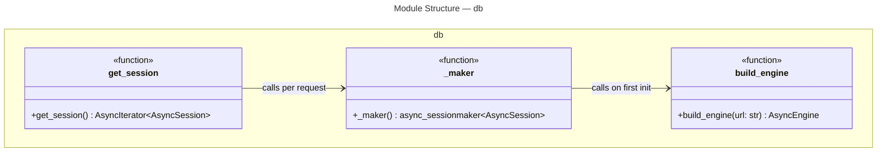
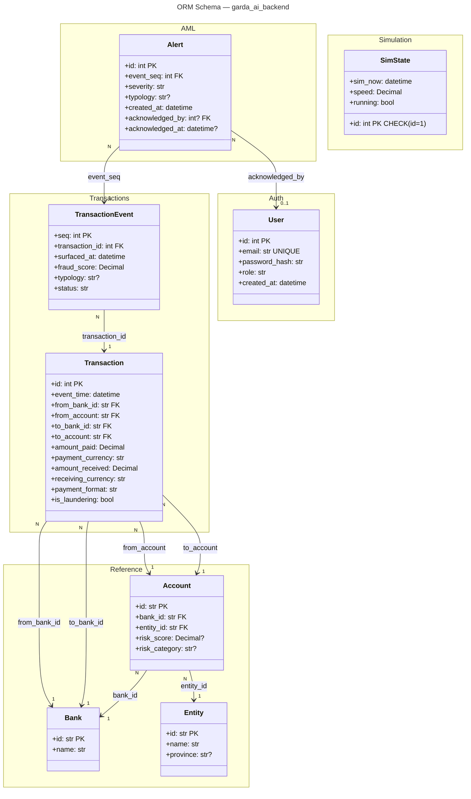
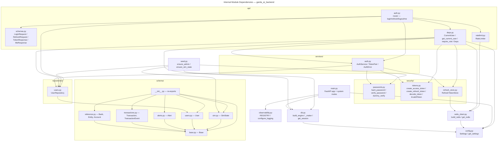

# C4 Code Level: garda_ai_backend

## Overview

- **Name**: Garda AI Backend — Python Package
- **Description**: Core application package for the Garda AI real-time AML detection platform. Implements the FastAPI service, async database and Redis layers, argon2id authentication with JWT token rotation, RBAC, Prometheus observability, and all SQLAlchemy 2.0 ORM models.
- **Location**: [`garda_ai_backend/`](../../garda_ai_backend/)
- **Language**: Python 3.12+
- **Purpose**: Serves the API surface for the AML dashboard, persists transaction and alert data, authenticates users via JWT access/refresh token pairs, enforces role-based access control, exposes health and metrics endpoints, and defines the full relational schema used by all platform services.
- **Version**: `0.1.0` (declared in `garda_ai_backend/__init__.py`)

---

## Module Index

| Module | File | Responsibility |
|---|---|---|
| `config` | `config.py` | Application settings via pydantic-settings; new JWT and Redis fields; fail-closed secret validator |
| `db` | `db.py` | Async SQLAlchemy engine and session factory |
| `redis_client` | `redis_client.py` | Async Redis singleton factory |
| `observability` | `observability.py` | Prometheus registry, counters, structured logging |
| `main` | `main.py` | FastAPI application, lifecycle, HTTP routes |
| `security.passwords` | `security/passwords.py` | Argon2id hashing; dummy_verify for timing equalization |
| `security.tokens` | `security/tokens.py` | JWT access/refresh token creation and decode; `InvalidToken` |
| `security.refresh_store` | `security/refresh_store.py` | Redis-backed refresh JTI store with atomic consume |
| `repositories.users` | `repositories/users.py` | `UserRepository` — DB access for `User` rows |
| `services.auth` | `services/auth.py` | `AuthService` — authenticate, token rotation, logout; `TokenPair`, `AuthError` |
| `api.schemas` | `api/schemas.py` | Pydantic request/response models for the auth API |
| `api.deps` | `api/deps.py` | FastAPI dependency functions; `CurrentUser`; `require_role` factory |
| `api.ratelimit` | `api/ratelimit.py` | `RateLimiter` — Redis fixed-window rate limiting |
| `api.auth` | `api/auth.py` | Auth router: login / refresh / logout / me |
| `seed` | `seed.py` | `ensure_admin`, `ensure_sim_state` — idempotent DB seed |
| `schema.base` | `schema/base.py` | Declarative ORM base |
| `schema.reference` | `schema/reference.py` | Reference tables: Bank, Entity, Account |
| `schema.transactions` | `schema/transactions.py` | Core event tables: Transaction, TransactionEvent |
| `schema.alerts` | `schema/alerts.py` | Alert table |
| `schema.users` | `schema/users.py` | User table |
| `schema.sim` | `schema/sim.py` | Simulation state singleton table |
| `schema` | `schema/__init__.py` | Package re-exports for all ORM models |

---

## Module: `config`

- **File**: [`garda_ai_backend/config.py`](../../garda_ai_backend/config.py)
- **External dependencies**: `pydantic-settings`, `pydantic.model_validator`, `functools.lru_cache`

### Class: `Settings`

```
class Settings(BaseSettings)
```

| Attribute | Type | Default | Description |
|---|---|---|---|
| `database_url` | `str` | required | Async-compatible SQLAlchemy connection URL |
| `env` | `str` | `"development"` | Deployment environment name |
| `log_level` | `str` | `"INFO"` | Python logging level string |
| `redis_url` | `str` | `"redis://localhost:6379/0"` | Redis connection URL used by `redis_client` and `RefreshTokenStore` |
| `jwt_secret` | `str` | `"change-me-in-prod"` | HMAC secret for JWT signing; validated by `_require_strong_jwt_secret_outside_dev` |
| `jwt_algorithm` | `str` | `"HS256"` | JWT signature algorithm |
| `jwt_access_ttl_min` | `int` | `15` | Access token lifetime in minutes |
| `jwt_refresh_ttl_days` | `int` | `7` | Refresh token lifetime in days |

**Configuration**: reads environment variables with prefix `GARDA_`; optionally from `.env`. Extra variables are silently ignored (`extra="ignore"`).

**Inherits from**: `pydantic_settings.BaseSettings`

#### Validator: `_require_strong_jwt_secret_outside_dev`

```python
@model_validator(mode="after")
def _require_strong_jwt_secret_outside_dev(self) -> "Settings"
```

- **Description**: Fail-closed guard. Raises `ValueError` at startup if `env != "development"` and `jwt_secret` is either the default placeholder or fewer than 32 characters. RFC 7518 requires >= 32 bytes for HS256. This prevents accidentally deploying production with the default secret.
- **Returns**: `Settings` (self) if valid
- **Raises**: `ValueError` on misconfiguration

### Function: `get_settings`

```python
@lru_cache(maxsize=1)
def get_settings() -> Settings
```

- **Description**: Returns the singleton `Settings` instance. `lru_cache(maxsize=1)` ensures construction happens exactly once per process.
- **Returns**: `Settings`
- **Dependencies**: `Settings`, `functools.lru_cache`

---

## Module: `db`

- **File**: [`garda_ai_backend/db.py`](../../garda_ai_backend/db.py)
- **External dependencies**: `sqlalchemy.ext.asyncio` (AsyncEngine, AsyncSession, async_sessionmaker, create_async_engine)
- **Internal dependencies**: `garda_ai_backend.config.get_settings`

### Module-level state

| Name | Type | Description |
|---|---|---|
| `_engine` | `AsyncEngine \| None` | Module-level singleton engine; `None` until first call to `_maker()` |
| `_sessionmaker` | `async_sessionmaker[AsyncSession] \| None` | Module-level singleton session factory; `None` until first call to `_maker()` |

### Function: `build_engine`

```python
def build_engine(url: str) -> AsyncEngine
```

- **Description**: Creates and configures an async SQLAlchemy engine from a connection URL. Enables `pool_pre_ping`, sets pool size to 10 with overflow of 5.
- **Parameters**: `url: str` — fully-qualified async database URL
- **Returns**: `AsyncEngine`

### Function: `_maker`

```python
def _maker() -> async_sessionmaker[AsyncSession]
```

- **Description**: Returns the module-level session factory, constructing it on first call. Not intended to be called from outside this module.
- **Returns**: `async_sessionmaker[AsyncSession]`
- **Side effects**: Sets module globals `_engine` and `_sessionmaker` on first call.

### Function: `get_session`

```python
async def get_session() -> AsyncIterator[AsyncSession]
```

- **Description**: FastAPI dependency that yields a single `AsyncSession` for the lifetime of one HTTP request. Note: `api/deps.py` defines its own `get_session` wrapper around `_maker()` — both patterns are in use.
- **Returns**: `AsyncIterator[AsyncSession]`



---

## Module: `redis_client`

- **File**: [`garda_ai_backend/redis_client.py`](../../garda_ai_backend/redis_client.py)
- **External dependencies**: `redis.asyncio.Redis`
- **Internal dependencies**: `garda_ai_backend.config.get_settings`

### Module-level state

| Name | Type | Description |
|---|---|---|
| `_redis` | `Redis \| None` | Module-level singleton; `None` until first call to `get_redis()` |

### Function: `build_redis`

```python
def build_redis(url: str) -> Redis
```

- **Description**: Constructs a `redis.asyncio.Redis` client from a URL string. Sets `decode_responses=True` so all values returned from Redis are `str`, not `bytes`.
- **Parameters**: `url: str` — Redis connection URL (e.g. `redis://localhost:6379/0`)
- **Returns**: `redis.asyncio.Redis`

### Function: `get_redis`

```python
def get_redis() -> Redis
```

- **Description**: Lazy singleton accessor. Returns the existing `_redis` instance or calls `build_redis(get_settings().redis_url)` on first invocation. Used as the source of the `RedisDep` FastAPI dependency.
- **Returns**: `redis.asyncio.Redis`
- **Dependencies**: `build_redis`, `get_settings`

---

## Module: `observability`

- **File**: [`garda_ai_backend/observability.py`](../../garda_ai_backend/observability.py)
- **External dependencies**: `prometheus_client` (CollectorRegistry, Counter), `structlog`, `logging`

### Module-level objects

| Name | Type | Description |
|---|---|---|
| `REGISTRY` | `prometheus_client.CollectorRegistry` | Isolated Prometheus registry; avoids polluting the global default registry |
| `REQUEST_COUNT` | `prometheus_client.Counter` | Counter `garda_http_requests_total` with labels `method`, `path`, `status` |

### Function: `configure_logging`

```python
def configure_logging(level: str = "INFO") -> None
```

- **Description**: Configures Python's `logging` module and `structlog` for structured JSON output with `add_log_level`, `TimeStamper(fmt="iso")`, and `JSONRenderer` processors.
- **Parameters**: `level: str` — Python logging level name (default `"INFO"`)
- **Returns**: `None`

---

## Module: `main`

- **File**: [`garda_ai_backend/main.py`](../../garda_ai_backend/main.py)
- **External dependencies**: `fastapi`, `prometheus_client`, `sqlalchemy.text`
- **Internal dependencies**: `config.get_settings`, `db._maker`, `observability.REGISTRY`, `observability.configure_logging`

### Object: `app`

```python
app = FastAPI(title="Garda AI Backend", version="0.1.0")
```

The root ASGI application instance. On import, calls `get_settings()` and `configure_logging(settings.log_level)` as side effects.

### Route: `GET /healthz`

```python
@app.get("/healthz")
async def healthz() -> dict[str, str]
```

- **Description**: Liveness probe. Returns `{"status": "ok"}` unconditionally.

### Route: `GET /readyz`

```python
@app.get("/readyz")
async def readyz() -> Response
```

- **Description**: Readiness probe. Executes `SELECT 1` via a temporary DB session; returns HTTP 503 on failure.
- **Dependencies**: `db._maker`, `sqlalchemy.text`

### Route: `GET /metrics`

```python
@app.get("/metrics")
async def metrics() -> Response
```

- **Description**: Prometheus scrape endpoint. Serialises all metrics in `REGISTRY`.
- **Dependencies**: `observability.REGISTRY`, `prometheus_client.generate_latest`

---

## Module: `security.passwords`

- **File**: [`garda_ai_backend/security/passwords.py`](../../garda_ai_backend/security/passwords.py)
- **External dependencies**: `argon2` (`PasswordHasher`, `VerifyMismatchError`)

### Module-level state

| Name | Type | Description |
|---|---|---|
| `_ph` | `argon2.PasswordHasher` | Shared Argon2id hasher instance |
| `_DUMMY_HASH` | `str` | Pre-computed Argon2id hash of a fixed placeholder string used by `dummy_verify` |

### Function: `hash_password`

```python
def hash_password(plain: str) -> str
```

- **Description**: Hashes a plaintext password using Argon2id via `_ph.hash()`.
- **Parameters**: `plain: str` — cleartext password
- **Returns**: `str` — Argon2id encoded hash string
- **Dependencies**: `_ph`

### Function: `verify_password`

```python
def verify_password(plain: str, hashed: str) -> bool
```

- **Description**: Verifies a plaintext password against an Argon2id hash. Returns `False` on `VerifyMismatchError`; propagates other exceptions.
- **Parameters**:
  - `plain: str` — cleartext password to verify
  - `hashed: str` — stored Argon2id hash
- **Returns**: `bool`
- **Dependencies**: `_ph`, `argon2.exceptions.VerifyMismatchError`

### Function: `dummy_verify`

```python
def dummy_verify() -> None
```

- **Description**: Runs `verify_password("x", _DUMMY_HASH)` to consume an Argon2id verification's worth of CPU time. Called by `AuthService.authenticate` when a user is not found, so that an attacker cannot distinguish unknown email addresses from wrong passwords by measuring response latency.
- **Returns**: `None`
- **Dependencies**: `verify_password`, `_DUMMY_HASH`

---

## Module: `security.tokens`

- **File**: [`garda_ai_backend/security/tokens.py`](../../garda_ai_backend/security/tokens.py)
- **External dependencies**: `PyJWT` (`jwt`), `datetime`, `uuid`

### Class: `InvalidToken`

```python
class InvalidToken(Exception)
```

- **Description**: Raised by `decode_token` when a JWT fails signature verification, is expired, or is missing required claims. Callers should treat this as a terminal auth failure.

### Function: `create_access_token`

```python
def create_access_token(
    subject: str, role: str, secret: str, ttl_min: int, algorithm: str = "HS256"
) -> str
```

- **Description**: Creates a short-lived access JWT with claims `sub`, `role`, `type="access"`, `iat`, `exp`.
- **Parameters**:
  - `subject: str` — user ID (string form)
  - `role: str` — RBAC role embedded in the token
  - `secret: str` — HMAC signing key
  - `ttl_min: int` — token lifetime in minutes
  - `algorithm: str` — JWT algorithm (default `"HS256"`)
- **Returns**: `str` — encoded JWT

### Function: `create_refresh_token`

```python
def create_refresh_token(
    subject: str, secret: str, ttl_days: int, algorithm: str = "HS256"
) -> str
```

- **Description**: Creates a long-lived refresh JWT with claims `sub`, `type="refresh"`, `jti` (UUID hex, used as the Redis store key), `iat`, `exp`.
- **Parameters**:
  - `subject: str` — user ID
  - `secret: str` — HMAC signing key
  - `ttl_days: int` — token lifetime in days
  - `algorithm: str` — JWT algorithm (default `"HS256"`)
- **Returns**: `str` — encoded JWT

### Function: `decode_token`

```python
def decode_token(token: str, secret: str, algorithm: str = "HS256") -> dict
```

- **Description**: Decodes and validates a JWT. Requires `exp`, `iat`, and `sub` claims. Applies a 10-second leeway on expiry. Wraps any `jwt.PyJWTError` as `InvalidToken`.
- **Parameters**:
  - `token: str` — encoded JWT string
  - `secret: str` — HMAC signing key
  - `algorithm: str` — JWT algorithm (default `"HS256"`)
- **Returns**: `dict` — decoded payload
- **Raises**: `InvalidToken` on any JWT validation failure

---

## Module: `security.refresh_store`

- **File**: [`garda_ai_backend/security/refresh_store.py`](../../garda_ai_backend/security/refresh_store.py)
- **External dependencies**: `redis.asyncio.Redis`

### Class: `RefreshTokenStore`

```python
class RefreshTokenStore
```

- **Description**: Stores valid refresh-token JTIs in Redis, keyed as `refresh:{jti}`, with the value being the owning `user_id` string. Provides save, validation, atomic single-use consumption, and explicit revocation. Backed by TTL expiry so tokens auto-expire from Redis when they expire from the JWT.

#### Method: `__init__`

```python
def __init__(self, redis: Redis) -> None
```

- **Parameters**: `redis: Redis` — async Redis client

#### Static Method: `_key`

```python
@staticmethod
def _key(jti: str) -> str
```

- **Description**: Returns `f"refresh:{jti}"` — the Redis key namespace for refresh JTIs.

#### Method: `save`

```python
async def save(self, jti: str, user_id: str, ttl_seconds: int) -> None
```

- **Description**: Stores `user_id` at `refresh:{jti}` with TTL `ttl_seconds`. Called immediately after a refresh token is issued.
- **Parameters**:
  - `jti: str` — UUID hex from the token's `jti` claim
  - `user_id: str` — string user ID
  - `ttl_seconds: int` — Redis TTL matching the token's JWT expiry

#### Method: `is_valid`

```python
async def is_valid(self, jti: str, user_id: str) -> bool
```

- **Description**: Checks that the JTI exists in Redis and belongs to the given user. Does not consume the token.
- **Returns**: `bool`

#### Method: `consume`

```python
async def consume(self, jti: str, user_id: str) -> bool
```

- **Description**: Atomically fetches and deletes the JTI entry using Redis `GETDEL`. Returns `True` only if the entry existed and matched `user_id`. The atomicity closes the validate-then-revoke race that would allow two concurrent refresh requests to both spend the same token (refresh token rotation replay attack).
- **Returns**: `bool`

#### Method: `revoke`

```python
async def revoke(self, jti: str) -> None
```

- **Description**: Deletes the JTI entry from Redis unconditionally. Used during logout.

---

## Module: `repositories.users`

- **File**: [`garda_ai_backend/repositories/users.py`](../../garda_ai_backend/repositories/users.py)
- **External dependencies**: `sqlalchemy.ext.asyncio.AsyncSession`, `sqlalchemy.select`
- **Internal dependencies**: `garda_ai_backend.schema.User`

### Class: `UserRepository`

```python
class UserRepository
```

- **Description**: Data-access object for the `users` table. Wraps an `AsyncSession` and provides typed async queries. Does not commit — callers own the transaction boundary.

#### Method: `__init__`

```python
def __init__(self, session: AsyncSession) -> None
```

- **Parameters**: `session: AsyncSession` — active SQLAlchemy async session

#### Method: `get_by_email`

```python
async def get_by_email(self, email: str) -> User | None
```

- **Description**: Executes `SELECT * FROM users WHERE email = ?`. Returns the matching `User` or `None`.
- **Parameters**: `email: str`
- **Returns**: `User | None`

#### Method: `get_by_id`

```python
async def get_by_id(self, user_id: int) -> User | None
```

- **Description**: Fetches a `User` by primary key using `session.get()` (uses identity map before hitting the DB).
- **Parameters**: `user_id: int`
- **Returns**: `User | None`

#### Method: `create`

```python
async def create(
    self, email: str, password_hash: str, role: str, created_at: datetime
) -> User
```

- **Description**: Constructs a `User` ORM object, adds it to the session, and calls `flush()` to assign the surrogate `id` without committing. The caller is responsible for `commit()`.
- **Parameters**:
  - `email: str`
  - `password_hash: str` — pre-hashed credential (Argon2id)
  - `role: str` — RBAC role (`"admin"` or `"analyst"`)
  - `created_at: datetime` — timezone-aware creation timestamp
- **Returns**: `User` (with `id` populated after flush)

---

## Module: `services.auth`

- **File**: [`garda_ai_backend/services/auth.py`](../../garda_ai_backend/services/auth.py)
- **External dependencies**: `dataclasses`
- **Internal dependencies**: `repositories.users.UserRepository`, `security.passwords.{dummy_verify, verify_password}`, `security.refresh_store.RefreshTokenStore`, `security.tokens.{InvalidToken, create_access_token, create_refresh_token, decode_token}`

### Class: `AuthError`

```python
class AuthError(Exception)
```

- **Description**: Raised by `AuthService` methods on any authentication or token-refresh failure. Callers (HTTP handlers) translate this to HTTP 401.

### Dataclass: `TokenPair`

```python
@dataclass(frozen=True)
class TokenPair:
    access_token: str
    refresh_token: str
```

- **Description**: Immutable value object returned from `AuthService._issue`. Holds both tokens of a freshly issued pair.

### Class: `AuthService`

```python
class AuthService
```

- **Description**: Orchestrates the full authentication lifecycle: credential verification, token issuance, refresh rotation, and logout. Depends on `UserRepository` (DB) and `RefreshTokenStore` (Redis).

#### Method: `__init__`

```python
def __init__(
    self,
    users: UserRepository,
    refresh_store: RefreshTokenStore,
    secret: str,
    access_ttl_min: int,
    refresh_ttl_days: int,
) -> None
```

#### Private Method: `_issue`

```python
async def _issue(self, user_id: str, role: str) -> TokenPair
```

- **Description**: Creates an access token, a refresh token, decodes the refresh token to extract its `jti`, saves the JTI in `RefreshTokenStore`, and returns a `TokenPair`. Called by both `authenticate` and `refresh`.

#### Method: `authenticate`

```python
async def authenticate(self, email: str, password: str) -> TokenPair
```

- **Description**: Looks up the user by email. If not found, calls `dummy_verify()` to equalize Argon2id timing before raising `AuthError("invalid credentials")`. If found, verifies the password and issues a fresh `TokenPair`.
- **Raises**: `AuthError` on invalid credentials

#### Method: `refresh`

```python
async def refresh(self, refresh_token: str) -> TokenPair
```

- **Description**: Implements single-use refresh token rotation. Decodes the token, asserts `type == "refresh"`, atomically consumes the JTI from `RefreshTokenStore` (GETDEL), fetches the user, and issues a new `TokenPair` (new access + new refresh). If the JTI was already consumed or revoked, raises `AuthError`.
- **Raises**: `AuthError` on any failure
- **Security note**: The atomic `consume` step prevents replay attacks where two concurrent requests both try to use the same refresh token.

#### Method: `logout`

```python
async def logout(self, refresh_token: str) -> None
```

- **Description**: Decodes the refresh token (silently ignores `InvalidToken`), and if it is a valid refresh token with a `jti`, revokes the JTI from `RefreshTokenStore`. Logout is best-effort — an already-expired or invalid token does not raise.

---

## Module: `api.schemas`

- **File**: [`garda_ai_backend/api/schemas.py`](../../garda_ai_backend/api/schemas.py)
- **External dependencies**: `pydantic` (BaseModel, EmailStr)

### Class: `LoginRequest`

```python
class LoginRequest(BaseModel):
    email: EmailStr
    password: str
```

- **Description**: Request body for `POST /api/v1/auth/login`. Pydantic validates email format.

### Class: `RefreshRequest`

```python
class RefreshRequest(BaseModel):
    refresh_token: str
```

- **Description**: Request body for `POST /api/v1/auth/refresh` and `POST /api/v1/auth/logout`.

### Class: `TokenResponse`

```python
class TokenResponse(BaseModel):
    access_token: str
    refresh_token: str
    token_type: str = "bearer"
```

- **Description**: Response body for login and refresh endpoints. Follows OAuth2 Bearer token convention.

### Class: `MeResponse`

```python
class MeResponse(BaseModel):
    id: int
    email: EmailStr
    role: str
```

- **Description**: Response body for `GET /api/v1/auth/me`. Returns non-sensitive user identity fields.

---

## Module: `api.deps`

- **File**: [`garda_ai_backend/api/deps.py`](../../garda_ai_backend/api/deps.py)
- **External dependencies**: `fastapi` (Depends, HTTPException, HTTPBearer, HTTPAuthorizationCredentials), `redis.asyncio.Redis`, `sqlalchemy.ext.asyncio.AsyncSession`
- **Internal dependencies**: `config.Settings`, `config.get_settings`, `db._maker`, `redis_client.get_redis`, `repositories.users.UserRepository`, `security.refresh_store.RefreshTokenStore`, `security.tokens.{InvalidToken, decode_token}`, `services.auth.AuthService`

### Dataclass: `CurrentUser`

```python
@dataclass(frozen=True)
class CurrentUser:
    id: int
    role: str
```

- **Description**: Minimal identity object extracted from a validated access JWT. Injected into route handlers via `CurrentUserDep`.

### Function: `get_session`

```python
async def get_session() -> AsyncIterator[AsyncSession]
```

- **Description**: FastAPI dependency that opens a managed `AsyncSession` via `_maker()()`. Session is closed on exit.

### Function: `get_redis_dep`

```python
def get_redis_dep() -> Redis
```

- **Description**: Thin FastAPI dependency wrapper around `get_redis()`.

### Function: `get_settings_dep`

```python
def get_settings_dep() -> Settings
```

- **Description**: Thin FastAPI dependency wrapper around `get_settings()`.

### Annotated Type Aliases

| Name | Type | Description |
|---|---|---|
| `SessionDep` | `Annotated[AsyncSession, Depends(get_session)]` | Inject a DB session |
| `RedisDep` | `Annotated[Redis, Depends(get_redis_dep)]` | Inject the Redis client |
| `SettingsDep` | `Annotated[Settings, Depends(get_settings_dep)]` | Inject app settings |
| `AuthServiceDep` | `Annotated[AuthService, Depends(get_auth_service)]` | Inject a fully wired `AuthService` |
| `CurrentUserDep` | `Annotated[CurrentUser, Depends(get_current_user)]` | Inject the authenticated user |

### Function: `get_auth_service`

```python
def get_auth_service(
    session: SessionDep, redis: RedisDep, settings: SettingsDep
) -> AuthService
```

- **Description**: Constructs an `AuthService` by wiring a `UserRepository` (from session) and `RefreshTokenStore` (from redis) with JWT settings from `Settings`.
- **Returns**: `AuthService`

### Function: `get_current_user`

```python
def get_current_user(
    credentials: Annotated[HTTPAuthorizationCredentials, Depends(_bearer)],
    settings: SettingsDep,
) -> CurrentUser
```

- **Description**: FastAPI dependency that extracts the Bearer token from the `Authorization` header, calls `decode_token`, asserts `type == "access"`, and returns a `CurrentUser`. Raises HTTP 401 on any validation failure.
- **Returns**: `CurrentUser`
- **Raises**: `HTTPException(401)` on invalid or missing token

### Function: `require_role`

```python
def require_role(*roles: str) -> Callable[[CurrentUser], CurrentUser]
```

- **Description**: Factory that returns a FastAPI dependency function. The inner `guard` function accepts `CurrentUserDep` and raises HTTP 403 if the user's role is not in `roles`. Usage: `Depends(require_role("admin"))`.
- **Parameters**: `*roles: str` — one or more permitted role strings
- **Returns**: `Callable[[CurrentUser], CurrentUser]` — a dependency that passes or raises

---

## Module: `api.ratelimit`

- **File**: [`garda_ai_backend/api/ratelimit.py`](../../garda_ai_backend/api/ratelimit.py)
- **External dependencies**: `fastapi` (HTTPException), `redis.asyncio.Redis`

### Class: `RateLimiter`

```python
class RateLimiter
```

- **Description**: Fixed-window per-key rate limiter backed by Redis `INCR` + `EXPIRE`. Each `check()` call increments a counter at `ratelimit:{key}`. On the first increment the TTL is set to `window_seconds`. If the counter exceeds `limit`, raises HTTP 429.

#### Method: `__init__`

```python
def __init__(self, redis: Redis, limit: int, window_seconds: int) -> None
```

- **Parameters**:
  - `redis: Redis` — async Redis client
  - `limit: int` — maximum allowed requests per window
  - `window_seconds: int` — window duration in seconds

#### Method: `check`

```python
async def check(self, key: str) -> None
```

- **Description**: Increments `ratelimit:{key}`, sets TTL on first increment, raises HTTP 429 if `count > limit`.
- **Parameters**: `key: str` — discriminator (e.g. `"login:{client_ip}"`)
- **Raises**: `HTTPException(429)` when the limit is exceeded

---

## Module: `api.auth`

- **File**: [`garda_ai_backend/api/auth.py`](../../garda_ai_backend/api/auth.py)
- **External dependencies**: `fastapi` (APIRouter, Depends, HTTPException, Request, Response)
- **Internal dependencies**: `api.deps.{AuthServiceDep, CurrentUserDep, RedisDep, SessionDep}`, `api.ratelimit.RateLimiter`, `api.schemas.{LoginRequest, MeResponse, RefreshRequest, TokenResponse}`, `repositories.users.UserRepository`, `services.auth.AuthError`

### Object: `router`

```python
router = APIRouter(prefix="/api/v1/auth", tags=["auth"])
```

All auth routes are mounted under `/api/v1/auth`.

### Constants

| Name | Value | Description |
|---|---|---|
| `_LOGIN_LIMIT` | `10` | Max login attempts per IP per window |
| `_LOGIN_WINDOW_SECONDS` | `60` | Rate-limit window duration (1 minute) |

### Dependency: `login_rate_limit`

```python
async def login_rate_limit(request: Request, redis: RedisDep) -> None
```

- **Description**: FastAPI dependency applied to `POST /login`. Creates a `RateLimiter` and calls `check(f"login:{client_ip}")`. Limits each IP to 10 login attempts per 60 seconds.

### Route: `POST /api/v1/auth/login`

```python
@router.post("/login", response_model=TokenResponse, dependencies=[Depends(login_rate_limit)])
async def login(body: LoginRequest, auth: AuthServiceDep) -> TokenResponse
```

- **Description**: Calls `auth.authenticate(email, password)`. Returns a `TokenResponse` on success; raises HTTP 401 on `AuthError`.
- **Rate limited**: 10 requests / 60 s per source IP

### Route: `POST /api/v1/auth/refresh`

```python
@router.post("/refresh", response_model=TokenResponse)
async def refresh(body: RefreshRequest, auth: AuthServiceDep) -> TokenResponse
```

- **Description**: Calls `auth.refresh(refresh_token)`. Issues a new `TokenPair` (rotation). Raises HTTP 401 on `AuthError`.

### Route: `POST /api/v1/auth/logout`

```python
@router.post("/logout", status_code=status.HTTP_204_NO_CONTENT)
async def logout(body: RefreshRequest, auth: AuthServiceDep) -> Response
```

- **Description**: Calls `auth.logout(refresh_token)` to revoke the JTI from Redis. Returns HTTP 204 No Content. Logout never raises — invalid tokens are silently ignored.

### Route: `GET /api/v1/auth/me`

```python
@router.get("/me", response_model=MeResponse)
async def me(user: CurrentUserDep, session: SessionDep) -> MeResponse
```

- **Description**: Returns identity fields for the currently authenticated user. Requires a valid Bearer access token (enforced by `CurrentUserDep`). Fetches fresh data from DB via `UserRepository.get_by_id`. Raises HTTP 404 if the user row has been deleted.

---

## Module: `seed`

- **File**: [`garda_ai_backend/seed.py`](../../garda_ai_backend/seed.py)
- **External dependencies**: `asyncio`, `datetime`
- **Internal dependencies**: `db._maker`, `repositories.users.UserRepository`, `schema.SimState`, `security.passwords.hash_password`

### Function: `ensure_admin`

```python
async def ensure_admin(session: AsyncSession, email: str, password: str) -> User
```

- **Description**: Idempotent admin creation. Checks whether a user with `email` already exists in the DB. If not, creates one with role `"admin"` and an Argon2id-hashed password. Returns the existing or new `User`.
- **Parameters**:
  - `session: AsyncSession`
  - `email: str` — admin email address
  - `password: str` — cleartext password (hashed before storage)
- **Returns**: `User`
- **Dependencies**: `UserRepository`, `hash_password`

### Function: `ensure_sim_state`

```python
async def ensure_sim_state(session: AsyncSession, start: datetime, speed: float) -> SimState
```

- **Description**: Idempotent simulation state creation. Returns the existing singleton `SimState` (id=1) if present, otherwise creates a new one with `running=False`.
- **Parameters**:
  - `session: AsyncSession`
  - `start: datetime` — initial simulated clock time
  - `speed: float` — initial playback speed multiplier
- **Returns**: `SimState`

### Private Function: `_main`

```python
async def _main() -> None
```

- **Description**: Entry point when `seed.py` is run directly (`python -m garda_ai_backend.seed`). Seeds the default admin (`admin@garda.local` / `admin`) and sets the simulation clock to `2025-09-01T00:00:00Z` at 60x speed. Commits the transaction.
- **Dependencies**: `db._maker`, `ensure_admin`, `ensure_sim_state`

---

## Module: `schema`

The `schema/` sub-package defines all SQLAlchemy 2.0 ORM models using the **mapped-column** API with Python type annotations (`Mapped[T]`). All models inherit from a single `DeclarativeBase` subclass.

### `schema/base.py` — `Base`

- **File**: [`garda_ai_backend/schema/base.py`](../../garda_ai_backend/schema/base.py)
- **External dependencies**: `sqlalchemy.orm.DeclarativeBase`

```python
class Base(DeclarativeBase):
    pass
```

Empty declarative base. All ORM model classes inherit from `Base`, registering their table metadata in `Base.metadata`.

---

### `schema/reference.py` — Reference Tables

- **File**: [`garda_ai_backend/schema/reference.py`](../../garda_ai_backend/schema/reference.py)
- **External dependencies**: `sqlalchemy` (ForeignKey, Numeric, String), `sqlalchemy.orm` (Mapped, mapped_column, relationship)
- **Internal dependencies**: `garda_ai_backend.schema.base.Base`

#### Class: `Bank`

```python
class Bank(Base):
    __tablename__ = "banks"
```

| Column | Python Type | SQL Type | Constraints | Description |
|---|---|---|---|---|
| `id` | `str` | `VARCHAR` | PRIMARY KEY | Bank identifier (e.g. SWIFT/BIC code) |
| `name` | `str` | `VARCHAR` | NOT NULL | Human-readable bank name |

#### Class: `Entity`

```python
class Entity(Base):
    __tablename__ = "entities"
```

| Column | Python Type | SQL Type | Constraints | Description |
|---|---|---|---|---|
| `id` | `str` | `VARCHAR` | PRIMARY KEY | Entity identifier |
| `name` | `str` | `VARCHAR` | NOT NULL | Legal name |
| `province` | `str \| None` | `VARCHAR` | INDEX, nullable | Geographic province |

#### Class: `Account`

```python
class Account(Base):
    __tablename__ = "accounts"
```

| Column | Python Type | SQL Type | Constraints | Description |
|---|---|---|---|---|
| `id` | `str` | `VARCHAR` | PRIMARY KEY | Account identifier |
| `bank_id` | `str` | `VARCHAR` | FK → `banks.id`, INDEX | Owning bank |
| `entity_id` | `str` | `VARCHAR` | FK → `entities.id`, INDEX | Owning entity |
| `risk_score` | `Decimal \| None` | `NUMERIC` | nullable | ML-assigned risk score |
| `risk_category` | `str \| None` | `VARCHAR` | INDEX, nullable | Risk bucket |

**Relationships**: `bank: Mapped["Bank"]`, `entity: Mapped["Entity"]`

---

### `schema/transactions.py` — Transaction Tables

- **File**: [`garda_ai_backend/schema/transactions.py`](../../garda_ai_backend/schema/transactions.py)

#### Class: `Transaction`

```python
class Transaction(Base):
    __tablename__ = "transactions"
```

| Column | Python Type | SQL Type | Constraints | Description |
|---|---|---|---|---|
| `id` | `int` | `BIGINT` | PRIMARY KEY, autoincrement | Surrogate key |
| `event_time` | `datetime` | `TIMESTAMPTZ` | INDEX | Timestamp of the financial event |
| `from_bank_id` | `str` | `VARCHAR` | FK → `banks.id` | Sending bank |
| `from_account` | `str` | `VARCHAR` | FK → `accounts.id`, INDEX | Sending account |
| `to_bank_id` | `str` | `VARCHAR` | FK → `banks.id` | Receiving bank |
| `to_account` | `str` | `VARCHAR` | FK → `accounts.id`, INDEX | Receiving account |
| `amount_paid` | `Decimal` | `NUMERIC` | NOT NULL | Sent amount |
| `payment_currency` | `str` | `VARCHAR` | NOT NULL | ISO 4217 sent currency |
| `amount_received` | `Decimal` | `NUMERIC` | NOT NULL | Received amount |
| `receiving_currency` | `str` | `VARCHAR` | NOT NULL | ISO 4217 received currency |
| `payment_format` | `str` | `VARCHAR` | NOT NULL | Transfer method |
| `is_laundering` | `bool` | `BOOLEAN` | INDEX | AMLSim ground-truth label |

#### Class: `TransactionEvent`

```python
class TransactionEvent(Base):
    __tablename__ = "transaction_events"
```

| Column | Python Type | SQL Type | Constraints | Description |
|---|---|---|---|---|
| `seq` | `int` | `BIGINT` | PRIMARY KEY, autoincrement | Monotonic sequence number |
| `transaction_id` | `int` | `BIGINT` | FK → `transactions.id`, INDEX | Parent transaction |
| `surfaced_at` | `datetime` | `TIMESTAMPTZ` | INDEX | When the scoring engine surfaced this event |
| `fraud_score` | `Decimal` | `NUMERIC` | NOT NULL | Model-assigned fraud probability (0–1) |
| `typology` | `str \| None` | `VARCHAR` | INDEX, nullable | Detected AML typology |
| `status` | `str` | `VARCHAR` | INDEX | `approved`, `flagged`, or `blocked` |

---

### `schema/alerts.py` — Alert Table

- **File**: [`garda_ai_backend/schema/alerts.py`](../../garda_ai_backend/schema/alerts.py)

#### Class: `Alert`

```python
class Alert(Base):
    __tablename__ = "alerts"
```

| Column | Python Type | SQL Type | Constraints | Description |
|---|---|---|---|---|
| `id` | `int` | `INTEGER` | PRIMARY KEY, autoincrement | Surrogate key |
| `event_seq` | `int` | `BIGINT` | FK → `transaction_events.seq`, INDEX | Triggering scoring event |
| `severity` | `str` | `VARCHAR` | INDEX | Severity level |
| `typology` | `str \| None` | `VARCHAR` | nullable | AML typology |
| `created_at` | `datetime` | `TIMESTAMPTZ` | INDEX | When alert was raised |
| `acknowledged_by` | `int \| None` | `INTEGER` | FK → `users.id`, nullable | Reviewing analyst |
| `acknowledged_at` | `datetime \| None` | `TIMESTAMPTZ` | nullable | Review timestamp |

---

### `schema/users.py` — User Table

- **File**: [`garda_ai_backend/schema/users.py`](../../garda_ai_backend/schema/users.py)

#### Class: `User`

```python
class User(Base):
    __tablename__ = "users"
```

| Column | Python Type | SQL Type | Constraints | Description |
|---|---|---|---|---|
| `id` | `int` | `INTEGER` | PRIMARY KEY, autoincrement | Surrogate key |
| `email` | `str` | `VARCHAR` | UNIQUE, INDEX | Login identifier |
| `password_hash` | `str` | `VARCHAR` | NOT NULL | Argon2id encoded hash |
| `role` | `str` | `VARCHAR` | NOT NULL | RBAC role: `analyst` or `admin` |
| `created_at` | `datetime` | `TIMESTAMPTZ` | NOT NULL | Account creation timestamp |

---

### `schema/sim.py` — Simulation State Table

- **File**: [`garda_ai_backend/schema/sim.py`](../../garda_ai_backend/schema/sim.py)

#### Class: `SimState`

```python
class SimState(Base):
    __tablename__ = "sim_state"
    __table_args__ = (CheckConstraint("id = 1", name="sim_state_singleton"),)
```

| Column | Python Type | SQL Type | Constraints | Description |
|---|---|---|---|---|
| `id` | `int` | `INTEGER` | PRIMARY KEY, default=1, CHECK(id=1) | Enforces singleton row |
| `sim_now` | `datetime` | `TIMESTAMPTZ` | NOT NULL | Current simulated clock time |
| `speed` | `Decimal` | `NUMERIC` | default=1.0 | Playback speed multiplier |
| `running` | `bool` | `BOOLEAN` | default=False | Whether the simulation clock is ticking |

---

### `schema/__init__.py` — Package Re-exports

- **File**: [`garda_ai_backend/schema/__init__.py`](../../garda_ai_backend/schema/__init__.py)

Re-exports all ORM model classes and `Base`:

```python
from garda_ai_backend.schema import Base, Bank, Entity, Account, Transaction, TransactionEvent, Alert, User, SimState
```

---

## Schema: Entity-Relationship Overview



---

## Full Dependency Graph



---

## External Dependencies

| Library | Version Constraint | Usage |
|---|---|---|
| `fastapi` | — | ASGI web framework, route decorators, `Depends`, `HTTPBearer` |
| `pydantic-settings` | — | `BaseSettings` for environment-driven configuration |
| `pydantic` | v2 | `BaseModel`, `EmailStr`, `model_validator` |
| `sqlalchemy` | 2.0+ | Async ORM (mapped-column API), engine, session |
| `asyncpg` | — | Async PostgreSQL driver (via `postgresql+asyncpg://` URL) |
| `redis[asyncio]` | — | `redis.asyncio.Redis`; INCR, EXPIRE, GETDEL, SET, GET, DEL |
| `argon2-cffi` | — | `PasswordHasher` (Argon2id); `VerifyMismatchError` |
| `PyJWT` | — | JWT encode/decode; `PyJWTError` |
| `prometheus-client` | — | `CollectorRegistry`, `Counter`, `generate_latest` |
| `structlog` | — | Structured JSON logging processors |

---

## Notes

- `dummy_verify()` in `security/passwords.py` is a deliberate timing-equalization technique. It ensures `authenticate()` takes the same wall-clock time regardless of whether the email was found, eliminating user enumeration via response latency.
- `RefreshTokenStore.consume()` uses Redis `GETDEL` (atomic fetch-and-delete) to prevent refresh token replay: two concurrent refresh requests cannot both consume the same JTI.
- `Settings._require_strong_jwt_secret_outside_dev` is a fail-closed validator: it prevents the application from starting in any non-development environment without a proper JWT secret (>= 32 characters, not the default placeholder). This is enforced at Pydantic validation time, before the ASGI server begins serving requests.
- `seed.py` seeds a default admin with password `"admin"`. This is intentionally weak for development; production deployments must rotate this before going live.
- The `is_laundering` column on `Transaction` carries the IBM AMLSim ground-truth label used during the label-replay phase; it will be supplanted by `fraud_score` in live operation.
- `SimState` uses a DB-level `CHECK(id = 1)` constraint to enforce the singleton pattern at the SQL layer, making it safe to `UPSERT` from multiple concurrent processes without a distributed lock.
- `REQUEST_COUNT` in `observability.py` is defined but not yet incremented — route-level instrumentation is expected in a future iteration.
