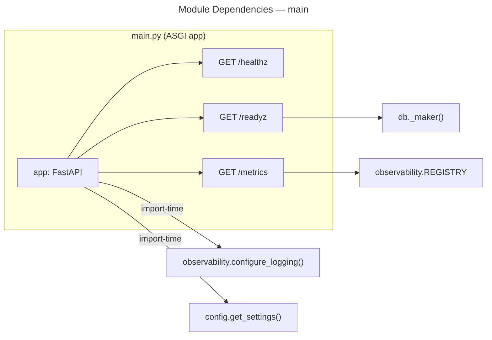
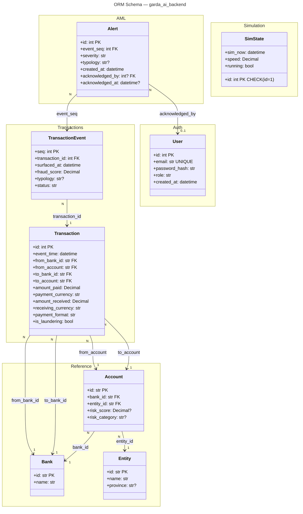
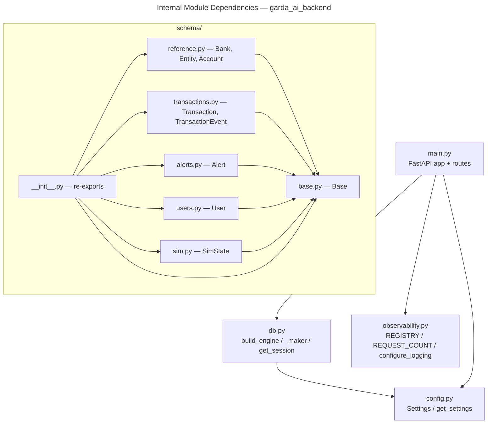

# C4 Code Level: garda_ai_backend

## Overview

- **Name**: Garda AI Backend — Python Package
- **Description**: Core application package for the Garda AI real-time AML detection platform. Implements the FastAPI service, async database layer, Prometheus observability, and all SQLAlchemy 2.0 ORM models.
- **Location**: [`garda_ai_backend/`](../../garda_ai_backend/)
- **Language**: Python 3.12+
- **Purpose**: Serves the API surface for the AML dashboard, persists transaction and alert data, exposes health and metrics endpoints, and defines the full relational schema used by all platform services.
- **Version**: `0.1.0` (declared in `garda_ai_backend/__init__.py`)

---

## Module Index

| Module | File | Responsibility |
|---|---|---|
| `config` | `config.py` | Application settings via pydantic-settings |
| `db` | `db.py` | Async SQLAlchemy engine and session factory |
| `observability` | `observability.py` | Prometheus registry, counters, structured logging |
| `main` | `main.py` | FastAPI application, lifecycle, HTTP routes |
| `schema.base` | `schema/base.py` | Declarative ORM base |
| `schema.reference` | `schema/reference.py` | Reference tables: Bank, Entity, Account |
| `schema.transactions` | `schema/transactions.py` | Core event tables: Transaction, TransactionEvent |
| `schema.alerts` | `schema/alerts.py` | Alert table |
| `schema.users` | `schema/users.py` | User table |
| `schema.sim` | `schema/sim.py` | Simulation state singleton table |
| `schema` | `schema/__init__.py` | Package re-exports for all ORM models |

---

## Module: `config`

- **File**: [`garda_ai_backend/config.py`](../../garda_ai_backend/config.py)
- **External dependencies**: `pydantic-settings`, `functools.lru_cache`

### Class: `Settings`

```
class Settings(BaseSettings)
```

| Attribute | Type | Default | Description |
|---|---|---|---|
| `database_url` | `str` | required | Async-compatible SQLAlchemy connection URL (e.g. `postgresql+asyncpg://...`) |
| `env` | `str` | `"development"` | Deployment environment name |
| `log_level` | `str` | `"INFO"` | Python logging level string |

**Configuration**: reads environment variables with the prefix `GARDA_` and optionally from a `.env` file. Extra environment variables are silently ignored (`extra="ignore"`).

**Inherits from**: `pydantic_settings.BaseSettings`

### Function: `get_settings`

```python
@lru_cache(maxsize=1)
def get_settings() -> Settings
```

- **Description**: Returns the singleton `Settings` instance. The `lru_cache(maxsize=1)` decorator ensures the settings object is constructed exactly once per process lifetime, avoiding repeated environment variable reads.
- **Returns**: `Settings`
- **Dependencies**: `Settings`, `functools.lru_cache`

---

## Module: `db`

- **File**: [`garda_ai_backend/db.py`](../../garda_ai_backend/db.py)
- **External dependencies**: `sqlalchemy.ext.asyncio` (AsyncEngine, AsyncSession, async_sessionmaker, create_async_engine)
- **Internal dependencies**: `garda_ai_backend.config.get_settings`

### Module-level state

| Name | Type | Description |
|---|---|---|
| `_engine` | `AsyncEngine \| None` | Module-level singleton engine; `None` until first call to `_maker()` |
| `_sessionmaker` | `async_sessionmaker[AsyncSession] \| None` | Module-level singleton session factory; `None` until first call to `_maker()` |

### Function: `build_engine`

```python
def build_engine(url: str) -> AsyncEngine
```

- **Description**: Creates and configures an async SQLAlchemy engine from a connection URL. Enables `pool_pre_ping` to verify connections before checkout, sets the pool size to 10 with an overflow allowance of 5 (maximum 15 concurrent connections).
- **Parameters**:
  - `url: str` — fully-qualified async database URL
- **Returns**: `AsyncEngine`
- **Dependencies**: `sqlalchemy.ext.asyncio.create_async_engine`

### Function: `_maker`

```python
def _maker() -> async_sessionmaker[AsyncSession]
```

- **Description**: Returns the module-level session factory, constructing it on first call (lazy initialisation). Reads the database URL from `get_settings()` and delegates engine creation to `build_engine`. Subsequent calls return the cached `_sessionmaker` without rebuilding. Not intended to be called from outside this module.
- **Returns**: `async_sessionmaker[AsyncSession]`
- **Side effects**: Sets module globals `_engine` and `_sessionmaker` on first call.
- **Dependencies**: `build_engine`, `get_settings`, `sqlalchemy.ext.asyncio.async_sessionmaker`

### Function: `get_session`

```python
async def get_session() -> AsyncIterator[AsyncSession]
```

- **Description**: FastAPI dependency that yields a single `AsyncSession` for the lifetime of one HTTP request. Uses `async with _maker()()` so the session is automatically closed (and the connection returned to the pool) on exit, even if an exception is raised.
- **Returns**: `AsyncIterator[AsyncSession]` (used as a generator dependency via `yield`)
- **Dependencies**: `_maker`


---

## Module: `observability`

- **File**: [`garda_ai_backend/observability.py`](../../garda_ai_backend/observability.py)
- **External dependencies**: `prometheus_client` (CollectorRegistry, Counter), `structlog`, `logging`

### Module-level objects

| Name | Type | Description |
|---|---|---|
| `REGISTRY` | `prometheus_client.CollectorRegistry` | Isolated Prometheus registry; avoids polluting the default global registry |
| `REQUEST_COUNT` | `prometheus_client.Counter` | Counter metric `garda_http_requests_total` with labels `method`, `path`, `status` — tracks HTTP request volume by method, route, and response code |

### Function: `configure_logging`

```python
def configure_logging(level: str = "INFO") -> None
```

- **Description**: Configures Python's standard `logging` module and `structlog` for structured JSON output. Applies three structlog processors in order: `add_log_level` (injects the log level field), `TimeStamper(fmt="iso")` (adds an ISO-8601 timestamp), and `JSONRenderer` (serialises the event dict to JSON). Sets the minimum log level on both stdlib and structlog.
- **Parameters**:
  - `level: str` — Python logging level name (default `"INFO"`)
- **Returns**: `None`
- **Dependencies**: `logging.basicConfig`, `structlog.configure`

---

## Module: `main`

- **File**: [`garda_ai_backend/main.py`](../../garda_ai_backend/main.py)
- **External dependencies**: `fastapi` (FastAPI, Response), `prometheus_client` (CONTENT_TYPE_LATEST, generate_latest), `sqlalchemy.text`
- **Internal dependencies**: `garda_ai_backend.config.get_settings`, `garda_ai_backend.db._maker`, `garda_ai_backend.observability.REGISTRY`, `garda_ai_backend.observability.configure_logging`

### Module-level initialisation

On import, `main` calls `get_settings()` and `configure_logging(settings.log_level)`. This means logging is configured as a side-effect of importing the module — FastAPI's ASGI startup does not require an `on_startup` hook for logging setup.

### Object: `app`

```python
app = FastAPI(title="Garda AI Backend", version="0.1.0")
```

The root ASGI application instance. All routes are registered on this object.

### Route: `GET /healthz`

```python
@app.get("/healthz")
async def healthz() -> dict[str, str]
```

- **Description**: Liveness probe. Returns HTTP 200 with `{"status": "ok"}` unconditionally. Does not touch the database; safe to call before the DB is reachable.
- **Returns**: `dict[str, str]`

### Route: `GET /readyz`

```python
@app.get("/readyz")
async def readyz() -> Response
```

- **Description**: Readiness probe. Opens a database session, executes `SELECT 1`, and returns `{"status": "ready"}` with HTTP 200 on success. On any exception (connection error, timeout, etc.) returns `{"status": "not-ready"}` with HTTP 503. Used by Kubernetes/load-balancer readiness gates.
- **Returns**: `fastapi.Response` (JSON body, `application/json`)
- **Dependencies**: `_maker` (creates an ad-hoc session), `sqlalchemy.text`

### Route: `GET /metrics`

```python
@app.get("/metrics")
async def metrics() -> Response
```

- **Description**: Prometheus scrape endpoint. Serialises all metrics registered in the module-level `REGISTRY` (from `observability.py`) using `prometheus_client.generate_latest` and returns them with the correct Prometheus text content type.
- **Returns**: `fastapi.Response` (Prometheus text format)
- **Dependencies**: `REGISTRY`, `prometheus_client.generate_latest`, `prometheus_client.CONTENT_TYPE_LATEST`



---

## Module: `schema`

The `schema/` sub-package defines all SQLAlchemy 2.0 ORM models using the **mapped-column** API with Python type annotations (`Mapped[T]`). All models inherit from a single `DeclarativeBase` subclass, ensuring they share one metadata registry.

### `schema/base.py` — `Base`

- **File**: [`garda_ai_backend/schema/base.py`](../../garda_ai_backend/schema/base.py)
- **External dependencies**: `sqlalchemy.orm.DeclarativeBase`

```python
class Base(DeclarativeBase):
    pass
```

Empty declarative base. All ORM model classes in this package inherit from `Base`, which causes SQLAlchemy to register their table metadata in `Base.metadata`.

---

### `schema/reference.py` — Reference Tables

- **File**: [`garda_ai_backend/schema/reference.py`](../../garda_ai_backend/schema/reference.py)
- **External dependencies**: `sqlalchemy` (ForeignKey, Numeric, String), `sqlalchemy.orm` (Mapped, mapped_column, relationship)
- **Internal dependencies**: `garda_ai_backend.schema.base.Base`

#### Class: `Bank`

```python
class Bank(Base):
    __tablename__ = "banks"
```

| Column | Python Type | SQL Type | Constraints | Description |
|---|---|---|---|---|
| `id` | `str` | `VARCHAR` | PRIMARY KEY | Bank identifier (e.g. SWIFT/BIC code) |
| `name` | `str` | `VARCHAR` | NOT NULL | Human-readable bank name |

Represents an institution that can hold accounts and participate in transactions.

#### Class: `Entity`

```python
class Entity(Base):
    __tablename__ = "entities"
```

| Column | Python Type | SQL Type | Constraints | Description |
|---|---|---|---|---|
| `id` | `str` | `VARCHAR` | PRIMARY KEY | Entity identifier |
| `name` | `str` | `VARCHAR` | NOT NULL | Legal name of the entity (person or company) |
| `province` | `str \| None` | `VARCHAR` | INDEX, nullable | Geographic province from seeded enrichment data |

Represents an individual or organisation that owns one or more accounts.

#### Class: `Account`

```python
class Account(Base):
    __tablename__ = "accounts"
```

| Column | Python Type | SQL Type | Constraints | Description |
|---|---|---|---|---|
| `id` | `str` | `VARCHAR` | PRIMARY KEY | Account identifier |
| `bank_id` | `str` | `VARCHAR` | FK → `banks.id`, INDEX | Owning bank |
| `entity_id` | `str` | `VARCHAR` | FK → `entities.id`, INDEX | Owning entity |
| `risk_score` | `Decimal \| None` | `NUMERIC` | nullable | ML-assigned risk score |
| `risk_category` | `str \| None` | `VARCHAR` | INDEX, nullable | Risk bucket (e.g. `low`, `medium`, `high`) |

**Relationships**:
- `bank: Mapped["Bank"]` — eager-accessible `Bank` via `relationship()`
- `entity: Mapped["Entity"]` — eager-accessible `Entity` via `relationship()`

---

### `schema/transactions.py` — Transaction Tables

- **File**: [`garda_ai_backend/schema/transactions.py`](../../garda_ai_backend/schema/transactions.py)
- **External dependencies**: `sqlalchemy` (BigInteger, Boolean, DateTime, ForeignKey, Numeric, String), `sqlalchemy.orm` (Mapped, mapped_column)
- **Internal dependencies**: `garda_ai_backend.schema.base.Base`

#### Class: `Transaction`

```python
class Transaction(Base):
    __tablename__ = "transactions"
```

| Column | Python Type | SQL Type | Constraints | Description |
|---|---|---|---|---|
| `id` | `int` | `BIGINT` | PRIMARY KEY, autoincrement | Surrogate key |
| `event_time` | `datetime` | `TIMESTAMPTZ` | INDEX | Timestamp of the financial event (timezone-aware) |
| `from_bank_id` | `str` | `VARCHAR` | FK → `banks.id` | Sending bank |
| `from_account` | `str` | `VARCHAR` | FK → `accounts.id`, INDEX | Sending account |
| `to_bank_id` | `str` | `VARCHAR` | FK → `banks.id` | Receiving bank |
| `to_account` | `str` | `VARCHAR` | FK → `accounts.id`, INDEX | Receiving account |
| `amount_paid` | `Decimal` | `NUMERIC` | NOT NULL | Amount debited from sender in `payment_currency` |
| `payment_currency` | `str` | `VARCHAR` | NOT NULL | ISO 4217 currency code for the sent amount |
| `amount_received` | `Decimal` | `NUMERIC` | NOT NULL | Amount credited to receiver in `receiving_currency` |
| `receiving_currency` | `str` | `VARCHAR` | NOT NULL | ISO 4217 currency code for the received amount |
| `payment_format` | `str` | `VARCHAR` | NOT NULL | Transfer method (e.g. `SWIFT`, `ACH`, `RTGS`) |
| `is_laundering` | `bool` | `BOOLEAN` | INDEX | Ground-truth label from the IBM AMLSim dataset used for model training |

The primary fact table. Each row is one financial transfer between two accounts, potentially crossing bank and currency boundaries.

#### Class: `TransactionEvent`

```python
class TransactionEvent(Base):
    __tablename__ = "transaction_events"
```

| Column | Python Type | SQL Type | Constraints | Description |
|---|---|---|---|---|
| `seq` | `int` | `BIGINT` | PRIMARY KEY, autoincrement | Monotonic sequence number |
| `transaction_id` | `int` | `BIGINT` | FK → `transactions.id`, INDEX | Parent transaction |
| `surfaced_at` | `datetime` | `TIMESTAMPTZ` | INDEX | Wall-clock time the scoring engine surfaced this event |
| `fraud_score` | `Decimal` | `NUMERIC` | NOT NULL | Model-assigned fraud probability (0–1) |
| `typology` | `str \| None` | `VARCHAR` | INDEX, nullable | Detected AML typology (e.g. `smurfing`, `layering`) |
| `status` | `str` | `VARCHAR` | INDEX | Processing status: `approved`, `flagged`, or `blocked` |

Represents a scoring event: one record is created each time the ML pipeline processes a transaction. A single `Transaction` may have multiple `TransactionEvent` rows as it moves through review states.

---

### `schema/alerts.py` — Alert Table

- **File**: [`garda_ai_backend/schema/alerts.py`](../../garda_ai_backend/schema/alerts.py)
- **External dependencies**: `sqlalchemy` (DateTime, ForeignKey, Integer, String), `sqlalchemy.orm` (Mapped, mapped_column)
- **Internal dependencies**: `garda_ai_backend.schema.base.Base`

#### Class: `Alert`

```python
class Alert(Base):
    __tablename__ = "alerts"
```

| Column | Python Type | SQL Type | Constraints | Description |
|---|---|---|---|---|
| `id` | `int` | `INTEGER` | PRIMARY KEY, autoincrement | Surrogate key |
| `event_seq` | `int` | `BIGINT` | FK → `transaction_events.seq`, INDEX | Triggering scoring event |
| `severity` | `str` | `VARCHAR` | INDEX | Severity level (e.g. `critical`, `high`, `medium`, `low`) |
| `typology` | `str \| None` | `VARCHAR` | nullable | AML typology inherited from the scoring event |
| `created_at` | `datetime` | `TIMESTAMPTZ` | INDEX | When the alert was raised |
| `acknowledged_by` | `int \| None` | `INTEGER` | FK → `users.id`, nullable | Analyst who reviewed the alert |
| `acknowledged_at` | `datetime \| None` | `TIMESTAMPTZ` | nullable | When the alert was reviewed |

Represents a human-facing alert generated from a flagged `TransactionEvent`. The `acknowledged_by` / `acknowledged_at` columns track analyst workflow state.

---

### `schema/users.py` — User Table

- **File**: [`garda_ai_backend/schema/users.py`](../../garda_ai_backend/schema/users.py)
- **External dependencies**: `sqlalchemy` (DateTime, Integer, String), `sqlalchemy.orm` (Mapped, mapped_column)
- **Internal dependencies**: `garda_ai_backend.schema.base.Base`

#### Class: `User`

```python
class User(Base):
    __tablename__ = "users"
```

| Column | Python Type | SQL Type | Constraints | Description |
|---|---|---|---|---|
| `id` | `int` | `INTEGER` | PRIMARY KEY, autoincrement | Surrogate key |
| `email` | `str` | `VARCHAR` | UNIQUE, INDEX | Login identifier |
| `password_hash` | `str` | `VARCHAR` | NOT NULL | Hashed credential (bcrypt/argon2 expected) |
| `role` | `str` | `VARCHAR` | NOT NULL | RBAC role: `analyst` or `admin` |
| `created_at` | `datetime` | `TIMESTAMPTZ` | NOT NULL | Account creation timestamp |

Platform user who can log in to the AML dashboard and acknowledge alerts.

---

### `schema/sim.py` — Simulation State Table

- **File**: [`garda_ai_backend/schema/sim.py`](../../garda_ai_backend/schema/sim.py)
- **External dependencies**: `sqlalchemy` (Boolean, CheckConstraint, DateTime, Integer, Numeric, false, text), `sqlalchemy.orm` (Mapped, mapped_column)
- **Internal dependencies**: `garda_ai_backend.schema.base.Base`

#### Class: `SimState`

```python
class SimState(Base):
    __tablename__ = "sim_state"
    __table_args__ = (CheckConstraint("id = 1", name="sim_state_singleton"),)
```

| Column | Python Type | SQL Type | Constraints | Description |
|---|---|---|---|---|
| `id` | `int` | `INTEGER` | PRIMARY KEY, default=1, CHECK(id=1) | Enforces singleton row |
| `sim_now` | `datetime` | `TIMESTAMPTZ` | NOT NULL | Current simulated clock time |
| `speed` | `Decimal` | `NUMERIC` | default=1.0 | Playback speed multiplier (1.0 = real-time) |
| `running` | `bool` | `BOOLEAN` | default=False | Whether the simulation clock is ticking |

A singleton control table (the `CHECK(id = 1)` constraint ensures at most one row exists). Used by the label-replay simulation engine to control and observe the simulated time cursor.

---

### `schema/__init__.py` — Package Re-exports

- **File**: [`garda_ai_backend/schema/__init__.py`](../../garda_ai_backend/schema/__init__.py)

Re-exports all ORM model classes and `Base` under the `garda_ai_backend.schema` namespace so consumers can import from a single location:

```python
from garda_ai_backend.schema import Base, Bank, Entity, Account, Transaction, TransactionEvent, Alert, User, SimState
```

**`__all__`**: `Base`, `Bank`, `Entity`, `Account`, `Transaction`, `TransactionEvent`, `Alert`, `User`, `SimState`

---

## Schema: Entity-Relationship Overview



---

## Full Dependency Graph



---

## External Dependencies

| Library | Version Constraint | Usage |
|---|---|---|
| `fastapi` | — | ASGI web framework, route decorators, `Response` |
| `pydantic-settings` | — | `BaseSettings` for environment-driven configuration |
| `sqlalchemy` | 2.0+ | Async ORM (mapped-column API), engine, session |
| `asyncpg` | — | Async PostgreSQL driver (implicit via `postgresql+asyncpg://` URL) |
| `prometheus-client` | — | `CollectorRegistry`, `Counter`, `generate_latest` |
| `structlog` | — | Structured JSON logging processors |

---

## Notes

- The `is_laundering` column on `Transaction` carries the IBM AMLSim ground-truth label used during the label-replay phase. It is not predicted by the model — it is the training signal that will be replaced by `fraud_score` in live operation.
- `SimState` uses a database-level `CHECK(id = 1)` constraint to enforce a singleton pattern at the SQL layer, making it safe to `UPSERT` from multiple concurrent processes without a distributed lock.
- `get_session` is designed as a FastAPI dependency (`yield`-based). Future route handlers should declare it with `Annotated[AsyncSession, Depends(get_session)]`.
- `REQUEST_COUNT` in `observability.py` is defined but not yet incremented — middleware or route instrumentation is expected in a future iteration.
