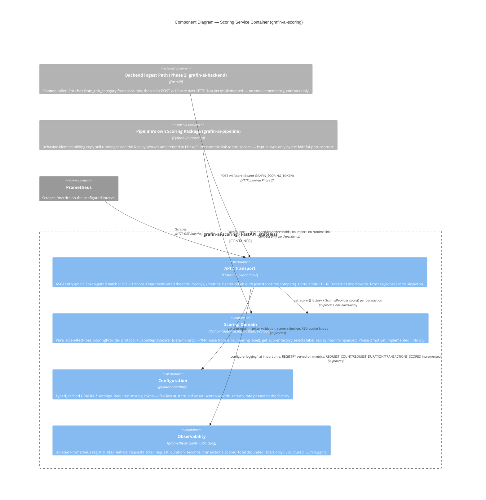

# C4 Component Level: Scoring Service Container

**Date:** 2026-06-25
**Container:** grafin-ai-scoring (Scoring Service)
**Design spec:** [`docs/superpowers/specs/2026-06-25-scoring-service-design.md`](../superpowers/specs/2026-06-25-scoring-service-design.md)
**Anchor spec:** [`grafin-ai-deploy/docs/superpowers/specs/2026-06-25-platform-rearchitecture-design.md`](../../../grafin-ai-deploy/docs/superpowers/specs/2026-06-25-platform-rearchitecture-design.md)
**Parent diagram:** not yet wired into `grafin-ai-deploy/docs/c4/02-container.md` — this container is introduced by Phase 1 of the platform re-architecture and does not appear in the current platform Container diagram, which is updated only when Phase 2 wires the backend to it (see [Platform Fit](#platform-fit--cross-repo-contract) below).

---

## Container Context

**grafin-ai-scoring** is a standalone, **stateless** FastAPI microservice — Phase 1 of the Grafin AI platform re-architecture. It extracts the scoring engine that currently lives inside `grafin-ai-pipeline` into its own independently deployable, horizontally scalable service with a stable HTTP contract:

- Exposes a token-gated batch `POST /v1/score` endpoint that scores transactions and returns `fraud_score` / `typology` / `status` per transaction
- Exposes health and readiness probes (`/healthz`, `/readyz`) and a Prometheus `/metrics` endpoint
- Has **no database and no Redis** — every `/v1/score` response is a pure function of the request body; nothing is persisted or cached
- Ships a faithful, behavior-identical port of the pipeline's `scoring/` package (same seed, same key construction, same thresholds) so a given transaction scores identically to the copy still running inside `grafin-ai-pipeline` until that copy is retired in Phase 5
- Is purely additive for now: nothing else in the platform calls it yet. The backend's ingest path (Phase 2) is the intended caller, over HTTP, and will own risk-category enrichment before calling in — this repo shares **no code** with any other repo in the platform, only the HTTP contract

This document zooms into the **components within that container**. All components run in the same Python process.

---

## Component Summary

| Component | Modules | Responsibility |
|---|---|---|
| **Scoring Domain** | `scoring/types.py`, `scoring/deterministic.py`, `scoring/label_replay.py`, `scoring/factory.py`, `scoring/__init__.py` | Pure, side-effect-free scoring logic: the `ScoringProvider` protocol, the deterministic `LabelReplayScorer`, and the `get_scorer` factory. No I/O, no FastAPI/HTTP imports. |
| **API / Transport** | `api/app.py`, `api/routes.py`, `api/auth.py`, `api/middleware.py`, `api/schemas.py` | FastAPI ASGI app; token-gated batch `POST /v1/score`; `/healthz`, `/readyz`, `/metrics`; bearer-token auth; correlation-ID + RED-metrics middleware. |
| **Configuration** | `config.py` | pydantic-settings, `GRAFIN_`-prefixed env vars, fail-fast required `scoring_token`, singleton `get_settings()`. |
| **Observability** | `observability.py` | Isolated Prometheus registry + RED metrics (request count, request duration, transactions-scored); structlog JSON logging setup. |

---

## Component: Scoring Domain

### Overview

- **Name**: Scoring Domain
- **Type**: Library (pure domain logic)
- **Technology**: Python 3.12+, `dataclasses`, `hashlib`, `typing.Protocol` — standard library only, no third-party runtime dependency

### Purpose

Derives `fraud_score`, `typology`, and `status` for a single transaction from its ground-truth `is_laundering` label, applying controlled deterministic FP/FN noise so detection metrics are realistic rather than a perfect 1.0. Exposes `ScoringProvider` as a transport-agnostic seam: a future `MLModelScorer` (Phase 2) will satisfy the same protocol and become selectable through `get_scorer` without any change to the API layer. The Scoring Domain has **zero I/O side effects** — no database, no Redis, no logging, no HTTP — which is what makes it trivially unit-testable and keeps the eventual ML swap isolated to a single new file. The API layer depends on this component; it never depends on the API layer (one-directional dependency, enforced by the package boundary).

### Software Features

- **`ScoringProvider` protocol** (`types.py`): `@runtime_checkable` async protocol defining `score(txn: TxnInput, ctx: ScoringContext) -> ScoringResult`. The Phase-2 extension seam — any future scorer implementation only needs to satisfy this signature.
- **Typed data contracts** (`types.py`): frozen dataclasses `TxnInput` (transaction identity + the `is_laundering` label), `ScoringContext` (cheap precomputable signals — currently just `from_risk_category`), and `ScoringResult` (`fraud_score: float`, `typology: str | None`, `status: str`).
- **Deterministic hash primitives** (`deterministic.py`): `unit_hash(key)` produces a stable float in `[0, 1)` via SHA-256; `typology_for(key)` deterministically selects one of 7 AML typologies (`Fan-Out`, `Cycle`, `Gather-Scatter`, `Smurfing`, `Mule Account`, `Layering`, `Trade-Based`); `status_for(score)` applies `blocked >= 0.8`, `flagged >= 0.5`, else `approved` (module-level constants, not runtime-configurable in Phase 1).
- **Label-replay scoring** (`label_replay.py`): `LabelReplayScorer` implements `ScoringProvider`. Laundering transactions score `0.70–0.99` normally (a seeded FN slip — default 5% — drops them to `0.10–0.40` instead); clean transactions score `0.01–0.41` normally (a seeded FP spike — default 4% — raises them to `0.55–0.95` instead). Applies a `+0.05` / `+0.02` score bump when `ctx.from_risk_category` is `High` / `Medium`. Rounds the final score to 4 decimal places. `typology` is forced to `None` whenever the final `status` is `approved`, and is always populated (never `None`) for `flagged`/`blocked`.
- **Scorer factory** (`factory.py`): `get_scorer(name, *, seed, fn_rate, fp_rate) -> ScoringProvider` selects the implementation by config name. `"label_replay"` returns a configured `LabelReplayScorer`; `"ml"` raises `ValueError("scorer 'ml' (MLModelScorer) is not yet implemented (Phase 2)")`; any other name raises `ValueError(f"unknown scorer: {name!r}")`.
- **Fully deterministic and reproducible**: every output is seeded by `seed`, `transaction_id`, `from_account`, and `to_account` — identical inputs always produce identical scores, across runs, environments, and batch composition (scoring one transaction in isolation yields the same result as scoring it inside a 1000-item batch).

### Code Elements

- [`scoring/types.py`](../../grafin_ai_scoring/scoring/types.py) — `TxnInput`, `ScoringContext`, `ScoringResult`, `ScoringProvider`
- [`scoring/deterministic.py`](../../grafin_ai_scoring/scoring/deterministic.py) — `unit_hash`, `status_for`, `typology_for`, `TYPOLOGIES`
- [`scoring/label_replay.py`](../../grafin_ai_scoring/scoring/label_replay.py) — `LabelReplayScorer`
- [`scoring/factory.py`](../../grafin_ai_scoring/scoring/factory.py) — `get_scorer`
- [`scoring/__init__.py`](../../grafin_ai_scoring/scoring/__init__.py) — re-exports `get_scorer`, `LabelReplayScorer`, `ScoringContext`, `ScoringProvider`, `ScoringResult`, `TxnInput` under `grafin_ai_scoring.scoring`

### Public Interface

#### Internal Python API

| Symbol | Signature | Description |
|---|---|---|
| `TxnInput` | `(transaction_id: int, from_account: str, to_account: str, amount: Decimal, payment_format: str, is_laundering: bool, event_time: datetime)` | Frozen dataclass; the input record passed to every scorer |
| `ScoringContext` | `(from_risk_category: str \| None = None)` | Frozen dataclass; precomputable contextual signals (`Low \| Medium \| High`) |
| `ScoringResult` | `(fraud_score: float, typology: str \| None, status: str)` | Frozen dataclass; the domain's output |
| `ScoringProvider.score` | `async (txn: TxnInput, ctx: ScoringContext) -> ScoringResult` | The protocol method every scorer implements |
| `LabelReplayScorer(seed="grafin", fn_rate=0.05, fp_rate=0.04).score` | `async (txn, ctx) -> ScoringResult` | Phase-1 implementation |
| `get_scorer` | `(name: str, *, seed: str = "grafin", fn_rate: float = 0.05, fp_rate: float = 0.04) -> ScoringProvider` | Factory; returns a ready scorer instance by config name |
| `unit_hash` | `(key: str) -> float` | Deterministic float in `[0, 1)` from a string key (SHA-256 based) |
| `status_for` | `(score: float, block: float = 0.8, flag: float = 0.5) -> str` | Maps score to `"blocked"` / `"flagged"` / `"approved"` |
| `typology_for` | `(key: str) -> str` | Deterministically picks one of 7 AML typology labels |

### Dependencies

- **External**: none — pure standard-library Python (`dataclasses`, `hashlib`, `typing`)
- **Components used**: none (this component is a dependency leaf; consumed by API / Transport)

---

## Component: API / Transport

### Overview

- **Name**: API / Transport
- **Type**: Application (ASGI service entry-point)
- **Technology**: Python 3.12+, FastAPI, pydantic v2, uvicorn

### Purpose

The ASGI entry-point and HTTP boundary for the Scoring Service. Wires together Configuration and Observability at import time, mounts the versioned scoring router, and exposes the unauthenticated ops endpoints. Deliberately kept separate from the Scoring Domain — this layer owns request/response validation, auth, correlation IDs, and metrics instrumentation, but contains no scoring logic itself; it only translates HTTP requests into `TxnInput`/`ScoringContext` calls against the domain and maps `ScoringResult` back into the response schema.

### Software Features

- **Import-time initialisation** (`app.py`): calls `get_settings()` — which validates config and fails fast if `GRAFIN_SCORING_TOKEN` is unset — and `configure_logging()` as module-level side effects, so the app cannot start unauthenticated-by-accident and logging is active before any request arrives.
- **Versioned scoring route** (`routes.py`): `POST /v1/score`, mounted under `/v1` from day one so a future breaking change can ship as `/v2` without disturbing callers. Bearer-token gated via `Depends(require_token)`.
- **Batch scoring handler** (`routes.py`): for each item in the request, builds a `TxnInput` + `ScoringContext(from_risk_category=...)`, awaits the process-global scorer's `score()`, increments `TRANSACTIONS_SCORED` by result status, and maps `ScoringResult` to a `ScoreResultItem`. Results preserve request order and carry `transaction_id` for caller-side correlation; an empty `transactions` list returns an empty `results` list (200). Iterating the single-transaction provider preserves determinism — a batch scores identically to N single calls.
- **Process-global scorer singleton** (`routes.py` — `_provider()`): `@lru_cache(maxsize=1)` FastAPI-independent cache; the scorer is stateless so one instance is shared across all requests in the process.
- **Bearer-token authentication** (`auth.py`): `require_token` FastAPI dependency validates `Authorization: Bearer <token>` against `get_settings().scoring_token` using `hmac.compare_digest` (constant-time comparison — avoids a timing side-channel). Reads the expected token only from settings, never from anything request-controllable. Missing/mismatched scheme or value → `401` with a `WWW-Authenticate: Bearer` header. `_verify()` is a pure, HTTP-independent function, separately unit-testable from the FastAPI dependency wrapper.
- **Correlation IDs + RED metrics middleware** (`middleware.py` — `ObservabilityMiddleware`): reads `X-Correlation-ID` or `X-Request-ID` from the incoming request, else generates a UUID; binds it into `structlog.contextvars` for the duration of the request and echoes it back on the response header. In a `finally` block (so it fires even when the handler raises), records `REQUEST_COUNT` and `REQUEST_DURATION` labeled by the route **template** (not the raw path), method, and status code (defaulting to `500` if `call_next` raised), and emits one structured `"request"` log line with method, endpoint, status code, and duration in ms.
- **Request/response schemas** (`schemas.py`): pydantic v2 models — `ScoreRequestItem` (with optional nullable `from_risk_category: Literal["Low","Medium","High"] | None`), `ScoreRequest` (`transactions` capped at `max_length=1000`), `ScoreResultItem`, `ScoreResponse`. `Status = Literal["approved","flagged","blocked"]` is validated at response construction, keeping the domain's plain-`str` `status` field decoupled from the transport-layer literal type (documented in `routes.py` as an intentional purity trade-off).
- **Ops endpoints** (`app.py`, unauthenticated): `GET /healthz` — static `200 {"status": "ok"}` liveness probe; `GET /readyz` — trivially ready (no external deps to check) `200 {"status": "ready"}`; `GET /metrics` — serialises the Observability component's `REGISTRY` via `prometheus_client.generate_latest()` with the correct Prometheus exposition `Content-Type`.

### Code Elements

- [`api/app.py`](../../grafin_ai_scoring/api/app.py) — `app: FastAPI`; `healthz()`, `readyz()`, `metrics()`
- [`api/routes.py`](../../grafin_ai_scoring/api/routes.py) — `router`; `POST /v1/score`; `_provider()`
- [`api/auth.py`](../../grafin_ai_scoring/api/auth.py) — `require_token`, `_verify`
- [`api/middleware.py`](../../grafin_ai_scoring/api/middleware.py) — `ObservabilityMiddleware`
- [`api/schemas.py`](../../grafin_ai_scoring/api/schemas.py) — `ScoreRequestItem`, `ScoreRequest`, `ScoreResultItem`, `ScoreResponse`, `RiskCategory`, `Status`
- [`api/__init__.py`](../../grafin_ai_scoring/api/__init__.py) — package marker

### Public Interface

#### HTTP endpoints

| Method | Path | Auth | Description | Response |
|---|---|---|---|---|
| `POST` | `/v1/score` | Bearer `GRAFIN_SCORING_TOKEN` | Batch-score up to 1000 transactions | `200 ScoreResponse` / `401` / `422` |
| `GET` | `/healthz` | None | Liveness probe | `200 {"status": "ok"}` |
| `GET` | `/readyz` | None | Readiness probe (no external deps) | `200 {"status": "ready"}` |
| `GET` | `/metrics` | None | Prometheus scrape | `200` Prometheus text exposition |

#### `POST /v1/score` contract

Request:
```json
{
  "transactions": [
    {
      "transaction_id": 123,
      "from_account": "0009abc",
      "to_account": "0011def",
      "amount": "15000.00",
      "payment_format": "ACH",
      "is_laundering": true,
      "event_time": "2026-06-25T09:00:00Z",
      "from_risk_category": "High"
    }
  ]
}
```

Response:
```json
{ "results": [ { "transaction_id": 123, "fraud_score": 0.8123, "typology": "Smurfing", "status": "blocked" } ] }
```

`status ∈ approved | flagged | blocked`; `typology` is nullable (`null` when `approved`). Results are returned in request order and correlated by `transaction_id`.

#### `require_token(authorization: str | None) -> None`

FastAPI dependency; raises `HTTPException(401)` with `WWW-Authenticate: Bearer` on a missing/invalid bearer token. Applies to `/v1/score` only — ops endpoints are open for probes/scrapers.

### Dependencies

- **Scoring Domain component**: `get_scorer`, `ScoringContext`, `ScoringProvider`, `TxnInput` (`routes.py`) — the only caller of the domain
- **Configuration component**: `get_settings()` called at import time (`app.py`) and per-request (`auth.py`, `routes.py`) for `scoring_token`, `scorer`, `seed`, `fn_rate`, `fp_rate`
- **Observability component**: `configure_logging()` at import time; `REGISTRY` passed to `generate_latest()` in `GET /metrics`; `REQUEST_COUNT`/`REQUEST_DURATION` incremented in `ObservabilityMiddleware`; `TRANSACTIONS_SCORED` incremented in `routes.py`
- **External**: FastAPI, pydantic v2, `prometheus_client` (`generate_latest`, `CONTENT_TYPE_LATEST`), structlog, Starlette (`BaseHTTPMiddleware`)

---

## Component: Configuration

### Overview

- **Name**: Configuration
- **Type**: Library (singleton provider)
- **Technology**: Python 3.12+, pydantic-settings

### Purpose

Provides a single, validated, cached view of all runtime configuration sourced from environment variables (prefix `GRAFIN_`) and an optional `.env` file. All other components read configuration through this component — none read environment variables directly. The **required** `scoring_token` field is the fail-fast guard mentioned in the design spec: the app cannot construct `Settings` — and therefore cannot start — without it, so `/v1/score` can never be exposed unauthenticated by accident.

### Software Features

- **Typed settings**: declares `scoring_token: str` (required, `min_length=1`), `scorer: str = "label_replay"`, `seed: str = "grafin"`, `fn_rate: float = 0.05`, `fp_rate: float = 0.04`, `log_level: str = "INFO"` as typed pydantic fields; unknown env vars are silently ignored (`extra="ignore"`).
- **Fail-fast required token**: `scoring_token` has no default — constructing `Settings()` (which happens at import time in `app.py`) raises a pydantic `ValidationError` if `GRAFIN_SCORING_TOKEN` is unset, so the process refuses to start rather than serve an unauthenticated scoring endpoint.
- **Singleton caching**: `get_settings()` is decorated with `@lru_cache(maxsize=1)`, guaranteeing the settings object is constructed exactly once per process lifetime.
- **`.env` file support**: reads a `.env` file at startup if present, enabling local development without shell exports.

### Code Elements

- [`config.py`](../../grafin_ai_scoring/config.py) — `Settings(BaseSettings)`, `get_settings()`

### Public Interface

#### `get_settings() -> Settings`

The only public symbol. Returns the singleton `Settings` instance.

| Field | Type | Default | Source |
|---|---|---|---|
| `scoring_token` | `str` | **required** | `GRAFIN_SCORING_TOKEN` |
| `scorer` | `str` | `"label_replay"` | `GRAFIN_SCORER` |
| `seed` | `str` | `"grafin"` | `GRAFIN_SEED` |
| `fn_rate` | `float` | `0.05` | `GRAFIN_FN_RATE` |
| `fp_rate` | `float` | `0.04` | `GRAFIN_FP_RATE` |
| `log_level` | `str` | `"INFO"` | `GRAFIN_LOG_LEVEL` |

### Dependencies

- **External**: `pydantic-settings` (`BaseSettings`, `SettingsConfigDict`), `pydantic` (`Field`)
- **Components used**: none

---

## Component: Observability

### Overview

- **Name**: Observability
- **Type**: Library (cross-cutting concern)
- **Technology**: Python 3.12+, prometheus-client, structlog

### Purpose

Provides the two pillars of runtime observability for the Scoring Service: **RED metrics** (Rate, Errors, Duration) on an isolated Prometheus registry, and **structured JSON logging** via `structlog`. Both are configured at import time of `api/app.py`, before uvicorn begins accepting requests. All label sets are deliberately bounded — path **template**, method, status code, and the 3-value result status — to avoid Prometheus cardinality explosions; nothing is ever labeled by `transaction_id` or account identifiers.

### Software Features

- **Isolated Prometheus registry**: `REGISTRY = CollectorRegistry()` avoids polluting the default process-global registry, preventing conflicts with other libraries or test frameworks that also register metrics.
- **HTTP request counter** (`grafin_scoring_requests_total`): labeled by `endpoint`, `method`, `status_code`; incremented once per request by `ObservabilityMiddleware`, including on the unhandled-exception path (defaults to `status_code=500`).
- **HTTP request duration histogram** (`grafin_scoring_request_duration_seconds`): labeled by `endpoint`, `method`; buckets tuned for a fast scorer (`0.001`–`0.25` s), informed by the Phase-1 SLO target of p99 < ~50 ms for a nominal batch.
- **Transactions-scored counter** (`grafin_scoring_transactions_scored_total`): labeled by the bounded `status` (`approved | flagged | blocked` — 3 values); incremented once per scored transaction in `routes.py`, giving a direct signal on how much traffic is being flagged/blocked without any unbounded label.
- **Structured JSON logging** (`configure_logging`): chains `merge_contextvars` (so the middleware's bound `correlation_id` appears on every log line for the request), `add_log_level`, `TimeStamper(fmt="iso")`, `format_exc_info`, and `JSONRenderer` — producing machine-parseable JSON log lines. Sets the minimum level on both stdlib `logging` and the structlog filtering bound logger, so third-party libraries using stdlib logging also respect the configured threshold. The pure Scoring Domain deliberately does not log — observability stays out of business logic.

### Code Elements

- [`observability.py`](../../grafin_ai_scoring/observability.py) — `REGISTRY`, `REQUEST_COUNT`, `REQUEST_DURATION`, `TRANSACTIONS_SCORED`, `configure_logging()`

### Public Interface

#### `REGISTRY: CollectorRegistry`

The isolated Prometheus registry. The API / Transport component passes this to `generate_latest()` to serve `GET /metrics`.

#### `REQUEST_COUNT: Counter`, `REQUEST_DURATION: Histogram`, `TRANSACTIONS_SCORED: Counter`

Pre-defined metrics, incremented by `ObservabilityMiddleware` and `routes.py` respectively (see Software Features above for label sets).

#### `configure_logging(level: str = "INFO") -> None`

Configures stdlib `logging` and `structlog` with the structured JSON processor chain. Called once at process startup from `api/app.py`.

### Dependencies

- **External**: `prometheus-client` (`CollectorRegistry`, `Counter`, `Histogram`), `structlog`, `logging`
- **Components used**: none

---

## Component Diagram



---

## Platform Fit / Cross-Repo Contract

`grafin-ai-scoring` is **standalone**: it shares **no code** with any other repository in the platform, only an HTTP contract.

- **No database, no Redis, no state.** Every `/v1/score` response is a pure function of the request body. This container has none of the persistence or caching concerns that `grafin-ai-backend` and `grafin-ai-pipeline` have.
- **Faithful port, not a shared dependency.** The Scoring Domain component (`scoring/`) is a behavior-identical copy of `grafin_ai_pipeline/grafin_ai_pipeline/scoring/` — same seed, same key construction, same thresholds — so a transaction scores identically whether it goes through this service or the pipeline's in-process Replay Worker copy. It is a **copy by design**, not an import: the pipeline keeps running its own copy until it is retired in Phase 5, so this repo is purely additive today and changes nothing else in the platform yet.
- **Intended caller: the backend ingest path (Phase 2, not yet implemented).** The backend will enrich `from_risk_category` from its `accounts` table and call `POST /v1/score` over HTTP during ingest. That client, and the risk-category enrichment logic, live in `grafin-ai-backend` — out of scope for this repo.
- **`ml` scorer seam.** `get_scorer("ml")` already raises a clear "not yet implemented (Phase 2)" error rather than silently falling through, so the Phase-2 `MLModelScorer` has a pre-defined selection point (`GRAFIN_SCORER=ml`) without any API-layer change.
- **System-level Context/Container update deferred.** `grafin-ai-deploy/docs/c4/02-container.md` is updated only when Phase 2 wires the backend to this service — this document is the authoritative component-level reference for the container until then.

---

## Changelog

| Date | Change |
|---|---|
| 2026-06-25 | Initial C4 Component-level documentation for `grafin-ai-scoring` (Phase 1 of the platform re-architecture): Scoring Domain, API / Transport, Configuration, Observability. |
