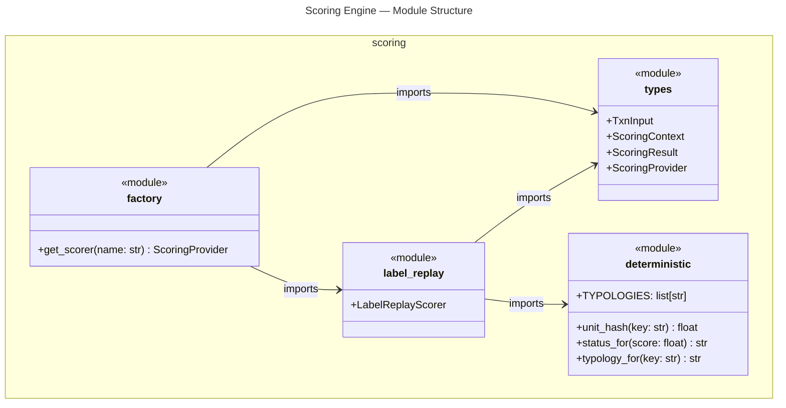
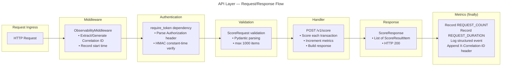
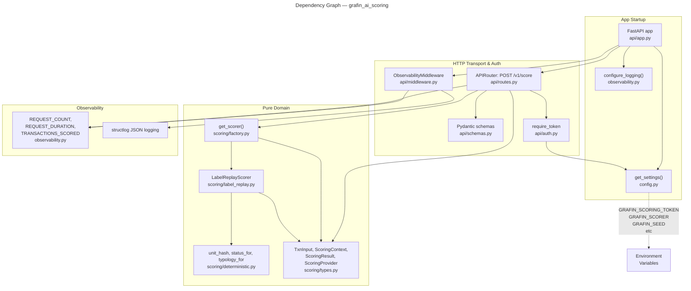

# C4 Code Level: grafin_ai_scoring

## Overview

- **Name**: Grafin AI Scoring — Python Package
- **Description**: Stateless, transaction-scoring microservice that receives fraud transaction batches via HMAC-authenticated HTTP, scores them using a pluggable `ScoringProvider`, and returns fraud scores, typologies, and dispositions. Implements Phase-1 label-replay scoring deterministically from ground-truth labels; Phase-2 ML-model scoring (via HTTP to an external service) is a planned expansion. Exports RED metrics (request count, duration, transactions scored) and structured JSON logs with correlation IDs.
- **Location**: [`grafin_ai_scoring/`](../../grafin_ai_scoring/)
- **Language**: Python 3.12+
- **Purpose**: Accept transaction batch-scoring requests over HTTPS, score transactions deterministically using pluggable scorers, and return results with fraud metrics for the label-replay phase of the Grafin AI AML platform.
- **Version**: `0.1.0` (declared in `pyproject.toml`)

---

## Module Index

| Module | File | Responsibility |
|---|---|---|
| `config` | `config.py` | Application settings via pydantic-settings; required `scoring_token`; scorer algorithm and seed configuration |
| `observability` | `observability.py` | Prometheus RED metrics (request count, duration, transactions scored); structured JSON logging configuration |
| `scoring.types` | `scoring/types.py` | Pure domain contracts: `TxnInput`, `ScoringContext`, `ScoringResult` dataclasses + `ScoringProvider` async Protocol |
| `scoring.deterministic` | `scoring/deterministic.py` | Stateless utilities: `unit_hash` (sha256-based), `status_for` thresholds (block≥0.8/flag≥0.5), `typology_for` (7 AML typologies) |
| `scoring.label_replay` | `scoring/label_replay.py` | Phase-1 `ScoringProvider` implementation; derives scores from `is_laundering` label with controlled FP/FN noise |
| `scoring.factory` | `scoring/factory.py` | `get_scorer(name)` — factory to instantiate scorers by configuration name (`"label_replay"` or future `"ml"`) |
| `scoring` | `scoring/__init__.py` | Public re-exports: `TxnInput`, `ScoringContext`, `ScoringResult`, `ScoringProvider`, `LabelReplayScorer`, `get_scorer` |
| `api.schemas` | `api/schemas.py` | Pydantic request/response models: `ScoreRequestItem`, `ScoreRequest` (max 1000 items), `ScoreResultItem`, `ScoreResponse`; `Status` and `RiskCategory` Literals |
| `api.auth` | `api/auth.py` | Bearer token validation: `_verify` (pure, unit-testable) + `require_token` FastAPI dependency; HMAC constant-time comparison |
| `api.middleware` | `api/middleware.py` | `ObservabilityMiddleware` — correlation ID extraction/propagation, RED metrics recording, structured logging; runs in `finally` to capture all outcomes |
| `api.routes` | `api/routes.py` | `POST /v1/score` endpoint; batches scoring logic; `_provider()` lru_cache singleton; transaction metrics labeled by result status |
| `api.app` | `api/app.py` | FastAPI application assembly, middleware registration, health/readiness/metrics endpoints, settings validation at startup |

---

## Module: `config`

- **File**: [`grafin_ai_scoring/config.py`](../../grafin_ai_scoring/config.py)
- **External dependencies**: `pydantic-settings`, `pydantic.Field`, `functools.lru_cache`

### Class: `Settings`

```python
class Settings(BaseSettings)
```

| Attribute | Type | Default | Description |
|---|---|---|---|
| `scoring_token` | `str` | required (min_length=1) | Bearer token for `/v1/score` authentication; read from `GRAFIN_SCORING_TOKEN` env var. Validates non-empty at startup (fail-closed). |
| `scorer` | `str` | `"label_replay"` | Scorer provider name; passed to `get_scorer()`. Accepted: `"label_replay"` (Phase 1); `"ml"` raises `ValueError`. |
| `seed` | `str` | `"grafin"` | Scorer seed for deterministic hash-based randomness; injected into every hash key. Change to produce statistically independent but equally deterministic scoring runs. |
| `fn_rate` | `float` | `0.05` | Fraction of truly laundering transactions scored low (false negatives). Passed to `LabelReplayScorer`. |
| `fp_rate` | `float` | `0.04` | Fraction of clean transactions scored high (false positives). Passed to `LabelReplayScorer`. |
| `log_level` | `str` | `"INFO"` | Python logging level string; passed to `configure_logging`. |

**Configuration**: reads environment variables with prefix `GRAFIN_`; optionally from `.env`. Extra variables are silently ignored (`extra="ignore"`). Requires `GRAFIN_SCORING_TOKEN` to be set at startup (non-empty string).

**Inherits from**: `pydantic_settings.BaseSettings`

### Function: `get_settings`

```python
@lru_cache(maxsize=1)
def get_settings() -> Settings
```

- **Description**: Returns the singleton `Settings` instance. `lru_cache(maxsize=1)` ensures construction happens exactly once per process and configuration is immutable thereafter.
- **Returns**: `Settings`
- **Dependencies**: `Settings`, `functools.lru_cache`

---

## Module: `observability`

- **File**: [`grafin_ai_scoring/observability.py`](../../grafin_ai_scoring/observability.py)
- **External dependencies**: `prometheus_client` (CollectorRegistry, Counter, Histogram), `structlog`, `logging`

### Module-level objects

| Name | Type | Description |
|---|---|---|
| `REGISTRY` | `prometheus_client.CollectorRegistry` | Isolated Prometheus registry; avoids polluting the global default registry |
| `REQUEST_COUNT` | `prometheus_client.Counter` | Counter `grafin_scoring_requests_total` with labels `endpoint`, `method`, `status_code`. Incremented by `ObservabilityMiddleware`. |
| `REQUEST_DURATION` | `prometheus_client.Histogram` | Histogram `grafin_scoring_request_duration_seconds` with labels `endpoint`, `method`; buckets: (0.001, 0.005, 0.01, 0.025, 0.05, 0.1, 0.25) seconds. Observed by `ObservabilityMiddleware`. |
| `TRANSACTIONS_SCORED` | `prometheus_client.Counter` | Counter `grafin_scoring_transactions_scored_total` with label `status` (bounded: `"approved"` \| `"flagged"` \| `"blocked"`). Incremented by `/v1/score` route handler per transaction result. |

### Function: `configure_logging`

```python
def configure_logging(level: str = "INFO") -> None
```

- **Description**: Configures Python's `logging` module and `structlog` for structured JSON output. Processors: `merge_contextvars` (propagate correlation ID), `add_log_level`, `TimeStamper(fmt="iso")`, `format_exc_info`, `JSONRenderer()`. Called once at app startup from `api/app.py`.
- **Parameters**: `level: str` — Python logging level name (default `"INFO"`)
- **Returns**: `None`

---

## Module: `scoring.types`

- **File**: [`grafin_ai_scoring/scoring/types.py`](../../grafin_ai_scoring/scoring/types.py)
- **External dependencies**: `dataclasses`, `typing.Protocol`, `typing.runtime_checkable`

The types module defines the shared data contracts for the scoring subsystem. Every scorer — present and future — consumes `TxnInput` + `ScoringContext` and produces `ScoringResult`. `ScoringProvider` is the `Protocol` that any scorer implementation must satisfy, enabling transport-agnostic seam between in-process (Phase 1) and remote (Phase 2) scorers.

### Dataclass: `TxnInput`

```python
@dataclass(frozen=True)
class TxnInput
```

- **Description**: Immutable input snapshot fed to every scorer. Carries transaction fields available at scoring time without database round-trip. `frozen=True` makes instances hashable and safe to pass across async boundaries.
- **Attributes**:
  - `transaction_id: int` — surrogate PK from the transactions table
  - `from_account: str` — originating account identifier
  - `to_account: str` — destination account identifier
  - `amount: Decimal` — transaction amount in source currency
  - `payment_format: str` — e.g. `"Reinvestment"`, `"Wire"`, etc.
  - `is_laundering: bool` — ground-truth label (used by label-replay scorer only; Phase-2 ML scorer must not read this field)
  - `event_time: datetime` — UTC timestamp of the transaction

### Dataclass: `ScoringContext`

```python
@dataclass(frozen=True)
class ScoringContext
```

- **Description**: Extensible carrier for precomputed ambient signals that supplement raw transaction. All fields are optional to allow incremental enrichment without breaking existing callers.
- **Attributes**:
  - `from_risk_category: str | None = None` — risk tier of originating entity: `"Low"`, `"Medium"`, or `"High"`; `None` when entity has no stored risk category

### Dataclass: `ScoringResult`

```python
@dataclass(frozen=True)
class ScoringResult
```

- **Description**: Immutable output produced by any `ScoringProvider`. The three fields are written by the HTTP response into `ScoreResultItem`.
- **Attributes**:
  - `fraud_score: float` — probability-like score in `[0, 1]`; `0` = clean, `1` = fraudulent
  - `typology: str | None` — AML typology label (e.g. `"Fan-Out"`, `"Smurfing"`); `None` when transaction is `"approved"` (not suspicious)
  - `status: str` — disposition string: `"approved"` (score < 0.5), `"flagged"` (0.5 ≤ score < 0.8), or `"blocked"` (score ≥ 0.8)

### Protocol: `ScoringProvider`

```python
@runtime_checkable
class ScoringProvider(Protocol)
```

- **Description**: Structural interface that every scorer must satisfy. Declared with `@runtime_checkable` so callers can use `isinstance(scorer, ScoringProvider)` for guard checks. The single method `score` is `async` — all scorers are I/O-compatible regardless of whether they perform I/O. This is the **transport-agnostic seam**: Phase-1 `LabelReplayScorer` is pure in-process computation, while Phase-2 `MLModelScorer` will make HTTP calls to a model service — but both satisfy the same interface and callers need never change.
- **Methods**:
  - `async def score(self, txn: TxnInput, ctx: ScoringContext) -> ScoringResult` — score a single transaction

---

## Module: `scoring.deterministic`

- **File**: [`grafin_ai_scoring/scoring/deterministic.py`](../../grafin_ai_scoring/scoring/deterministic.py)
- **External dependencies**: `hashlib`

The deterministic module provides pure, stateless utility functions that the label-replay scorer (and any future scorers) rely on for reproducible, hash-derived randomness. Nothing here is probabilistic or time-dependent; identical inputs always produce identical outputs.

### Module-level constants

| Name | Type | Description |
|---|---|---|
| `TYPOLOGIES` | `list[str]` | Seven supported AML typology labels: `"Fan-Out"`, `"Cycle"`, `"Gather-Scatter"`, `"Smurfing"`, `"Mule Account"`, `"Layering"`, `"Trade-Based"`. Order is significant: `typology_for` indexes by hash. |
| `_BLOCK_THRESHOLD` | `float` | `0.8` — score at or above which a transaction is `"blocked"`. |
| `_FLAG_THRESHOLD` | `float` | `0.5` — score at or above which (but below `_BLOCK_THRESHOLD`) a transaction is `"flagged"`. |

### Function: `unit_hash`

```python
def unit_hash(key: str) -> float
```

- **Description**: Derives a deterministic float in `[0, 1)` from an arbitrary string key using SHA-256. Takes the first 16 hex characters of the digest (64-bit prefix), converts to an integer, and divides by `16^16` (the maximum value of a 16-hex-digit number). This gives a stable, uniform pseudo-random value that is completely reproducible — no seed state, no RNG — making it safe to call concurrently and to replay identically across machines and Python versions.
- **Parameters**: `key: str` — any string (typically a composite of scorer seed + transaction fields + salt)
- **Returns**: `float` — value in `[0, 1)`
- **Dependencies**: `hashlib.sha256`

### Function: `status_for`

```python
def status_for(score: float, block: float = _BLOCK_THRESHOLD, flag: float = _FLAG_THRESHOLD) -> str
```

- **Description**: Maps a numeric fraud score to a disposition string. Thresholds are passed as keyword arguments so callers can override defaults in tests without monkey-patching module globals.
- **Parameters**:
  - `score: float` — fraud score in `[0, 1]`
  - `block: float` — threshold at or above which status is `"blocked"`. Default: `0.8`
  - `flag: float` — threshold at or above which (below `block`) status is `"flagged"`. Default: `0.5`
- **Returns**: `str` — one of `"blocked"`, `"flagged"`, `"approved"`

### Function: `typology_for`

```python
def typology_for(key: str) -> str
```

- **Description**: Deterministically picks one of the seven `TYPOLOGIES` from a string key. Calls `unit_hash(key)`, scales by `len(TYPOLOGIES)`, and truncates to an integer index. Same key always yields same typology; different keys are uniformly distributed.
- **Parameters**: `key: str` — composite key (same format used by `LabelReplayScorer._key`)
- **Returns**: `str` — a typology name from `TYPOLOGIES`
- **Dependencies**: `unit_hash`, `TYPOLOGIES`

---

## Module: `scoring.label_replay`

- **File**: [`grafin_ai_scoring/scoring/label_replay.py`](../../grafin_ai_scoring/scoring/label_replay.py)
- **External dependencies**: none (only internal scoring imports)
- **Internal dependencies**: `scoring.deterministic.{unit_hash, status_for, typology_for}`, `scoring.types.{TxnInput, ScoringContext, ScoringResult}`

The label-replay scorer is the Phase-1 implementation of `ScoringProvider`. It derives realistic fraud scores from the ground-truth `is_laundering` label with controlled false-positive (FP) and false-negative (FN) noise so that dashboard detection metrics are plausible but not trivial 1.0. Scoring logic is fully deterministic given the scorer's `seed` — the same transaction always produces the same `ScoringResult` regardless of execution order, concurrency, or environment.

### Class: `LabelReplayScorer`

```python
class LabelReplayScorer
```

- **Description**: Phase-1 `ScoringProvider` implementation. Satisfies the `ScoringProvider` Protocol structurally. Constructed once by the factory; intended to be a long-lived singleton within a worker process. All scoring decisions flow through `unit_hash`, making the scorer a pure, deterministic function of constructor arguments and input transaction.

#### Method: `__init__`

```python
def __init__(
    self, seed: str = "grafin", fn_rate: float = 0.05, fp_rate: float = 0.04
) -> None
```

- **Parameters**:
  - `seed: str` — namespace prefix injected into every hash key. Change to produce statistically independent but equally deterministic scoring. Default: `"grafin"`.
  - `fn_rate: float` — fraction of truly laundering transactions scored low (false negatives, score ∈ [0.10, 0.40)). Default: `0.05` (5%).
  - `fp_rate: float` — fraction of clean transactions scored high (false positives, score ∈ [0.55, 0.95)). Default: `0.04` (4%).

#### Private Method: `_key`

```python
def _key(self, txn: TxnInput, salt: str = "") -> str
```

- **Description**: Constructs the hash key for a given transaction and salt. Format: `"{seed}:{transaction_id}:{from_account}:{to_account}:{salt}"`. Salts separate independent draws from the same transaction (e.g. `""` for base score, `"noise"` for FP/FN coin flip, `"typ"` for typology assignment), ensuring three draws are statistically independent.
- **Parameters**: `txn: TxnInput`, `salt: str = ""`
- **Returns**: `str`

#### Method: `score`

```python
async def score(self, txn: TxnInput, ctx: ScoringContext) -> ScoringResult
```

- **Description**: Core scoring logic. Produces `ScoringResult` in three stages:
  1. **Score derivation**: draws `base` and `noise` floats from `unit_hash`. If `txn.is_laundering` is `True` and `noise >= fn_rate`: score ∈ [0.70, 0.99) + typology assigned. If `True` and `noise < fn_rate` (FN): score ∈ [0.10, 0.40) + `typology=None`. If `is_laundering` is `False` and `noise < fp_rate` (FP): score ∈ [0.55, 0.95) + typology assigned. Otherwise: score ∈ [0.01, 0.41) + `typology=None`.
  2. **Risk-category nudge**: if `ctx.from_risk_category == "High"`, score is bumped by `+0.05` (capped at 0.99); `"Medium"` bumps by `+0.02`. This ensures high-risk-entity transactions are statistically more likely to be flagged/blocked, matching expected AML behaviour.
  3. **Status resolution**: `status_for(score)` maps to `"approved"` / `"flagged"` / `"blocked"`. If `approved`, `typology` is forced to `None`. If `flagged`/`blocked` but `typology` is still `None` (can occur after nudge), a typology is assigned via `typology_for`.
- **Parameters**: `txn: TxnInput`, `ctx: ScoringContext`
- **Returns**: `ScoringResult` — `fraud_score` rounded to 4 decimal places
- **Dependencies**: `unit_hash`, `typology_for`, `status_for`, `ScoringResult`

---

## Module: `scoring.factory`

- **File**: [`grafin_ai_scoring/scoring/factory.py`](../../grafin_ai_scoring/scoring/factory.py)
- **External dependencies**: none
- **Internal dependencies**: `scoring.label_replay.LabelReplayScorer`, `scoring.types.ScoringProvider`

The factory module is the single resolution point where the string name from `Settings.scorer` is mapped to a concrete `ScoringProvider` instance. It decouples all callers from scorer implementation details — callers hold a `ScoringProvider` reference and never import scorer classes directly.

### Function: `get_scorer`

```python
def get_scorer(
    name: str, *, seed: str = "grafin", fn_rate: float = 0.05, fp_rate: float = 0.04
) -> ScoringProvider
```

- **Description**: Scorer factory. Resolves a configuration name to a ready-to-use `ScoringProvider` instance. Currently supports one live scorer and one planned scorer:
  - `"label_replay"` → returns `LabelReplayScorer(seed=seed, fn_rate=fn_rate, fp_rate=fp_rate)` (Phase 1, fully implemented)
  - `"ml"` → raises `ValueError("scorer 'ml' (MLModelScorer) is not yet implemented (Phase 2)")` — placeholder for Phase-2 HTTP client scorer that will call external model service
  - any other name → raises `ValueError(f"unknown scorer: {name!r}")`
  
  The `ScoringProvider` return type annotation (a `Protocol`) means the caller is typed against the interface, not concrete class. When Phase 2 arrives, `MLModelScorer` is added to this function and no call site changes.
- **Parameters**:
  - `name: str` — scorer name, typically read from `Settings.scorer`
  - `seed: str` — passed to scorer constructor (keyword-only)
  - `fn_rate: float` — passed to scorer constructor (keyword-only)
  - `fp_rate: float` — passed to scorer constructor (keyword-only)
- **Returns**: `ScoringProvider` — a `LabelReplayScorer` instance (Phase 1) or future scorer
- **Raises**: `ValueError` for `"ml"` (not yet implemented) or any unknown name
- **Dependencies**: `LabelReplayScorer`, `ScoringProvider`

---

## Module: `api.schemas`

- **File**: [`grafin_ai_scoring/api/schemas.py`](../../grafin_ai_scoring/api/schemas.py)
- **External dependencies**: `pydantic` (BaseModel, Field), `typing` (Literal, Annotated), `datetime`, `decimal`

### Type Aliases

| Name | Type | Description |
|---|---|---|
| `RiskCategory` | `Literal["Low", "Medium", "High"]` | Risk tier values for `from_risk_category` |
| `Status` | `Literal["approved", "flagged", "blocked"]` | Result status values |

### Class: `ScoreRequestItem`

```python
class ScoreRequestItem(BaseModel)
```

- **Description**: Single transaction within a batch request. Pydantic model for request parsing and validation.
- **Attributes**:
  - `transaction_id: int` — transaction surrogate PK
  - `from_account: str` — originating account
  - `to_account: str` — destination account
  - `amount: Decimal` — transaction amount
  - `payment_format: str` — payment method
  - `is_laundering: bool` — ground-truth label (for label-replay scoring)
  - `event_time: datetime` — transaction timestamp (UTC)
  - `from_risk_category: RiskCategory | None = None` — optional risk tier

### Class: `ScoreRequest`

```python
class ScoreRequest(BaseModel)
```

- **Description**: Batch request body. Limits batch size to prevent unbounded memory use.
- **Attributes**:
  - `transactions: Annotated[list[ScoreRequestItem], Field(max_length=1000)]` — batch of up to 1000 items

### Class: `ScoreResultItem`

```python
class ScoreResultItem(BaseModel)
```

- **Description**: Scoring result for a single transaction.
- **Attributes**:
  - `transaction_id: int` — echoed from request
  - `fraud_score: float` — computed fraud score
  - `typology: str | None` — assigned typology or `None`
  - `status: Status` — disposition (`"approved"` / `"flagged"` / `"blocked"`)

### Class: `ScoreResponse`

```python
class ScoreResponse(BaseModel)
```

- **Description**: Batch response body.
- **Attributes**:
  - `results: list[ScoreResultItem]` — one result per transaction in request

---

## Module: `api.auth`

- **File**: [`grafin_ai_scoring/api/auth.py`](../../grafin_ai_scoring/api/auth.py)
- **External dependencies**: `hmac`, `fastapi` (Header, HTTPException, status)
- **Internal dependencies**: `config.get_settings`

### Function: `_verify`

```python
def _verify(authorization: str | None, token: str) -> None
```

- **Description**: Pure bearer-token check (unit-testable without HTTP/env layer). Parses `Authorization` header as `"{scheme} {value}"`, verifies scheme is `"bearer"` (case-insensitive), and compares token via `hmac.compare_digest` for constant-time comparison (prevents timing attacks).
- **Parameters**:
  - `authorization: str | None` — `Authorization` header value (e.g. `"Bearer token_value"`)
  - `token: str` — expected token from settings
- **Raises**: `HTTPException(401)` with `WWW-Authenticate: Bearer` header on mismatch
- **Dependencies**: `hmac.compare_digest`, `fastapi.HTTPException`

### Function: `require_token`

```python
def require_token(authorization: str | None = Header(default=None)) -> None
```

- **Description**: FastAPI dependency that validates the bearer token against the configured secret. Reads token only from settings — nothing request-controllable can override it. Intended to be injected into route handlers via `Depends(require_token)`.
- **Parameters**: `authorization: str | None` — injected from `Authorization` header (FastAPI `Header` dependency)
- **Returns**: `None` (return value ignored; raises on failure)
- **Raises**: `HTTPException(401)` on invalid or missing token
- **Dependencies**: `_verify`, `get_settings`

---

## Module: `api.middleware`

- **File**: [`grafin_ai_scoring/api/middleware.py`](../../grafin_ai_scoring/api/middleware.py)
- **External dependencies**: `starlette.middleware.base.BaseHTTPMiddleware`, `starlette.requests.Request`, `starlette.responses.Response`, `starlette.types.ASGIApp`, `time`, `uuid`, `structlog`
- **Internal dependencies**: `observability.{REQUEST_COUNT, REQUEST_DURATION}`

### Class: `ObservabilityMiddleware`

```python
class ObservabilityMiddleware(BaseHTTPMiddleware)
```

- **Description**: Records correlation ID, RED metrics, and structured logs for every HTTP request. Runs in a `finally` block to capture outcomes of both successful and failed requests (including unhandled 500 errors). Extracts or generates correlation ID from headers (`x-correlation-id` or `x-request-id` or generated UUID), binds it to `structlog` context, increments `REQUEST_COUNT` and observes `REQUEST_DURATION`, and appends correlation ID to response headers.

#### Method: `__init__`

```python
def __init__(self, app: ASGIApp) -> None
```

- **Parameters**: `app: ASGIApp` — wrapped ASGI application

#### Method: `dispatch`

```python
async def dispatch(
    self, request: Request, call_next: Callable[[Request], Awaitable[Response]]
) -> Response
```

- **Description**: Middleware dispatch method. Executes the following on every request:
  1. **Correlation ID**: extract from `x-correlation-id` or `x-request-id` headers; generate UUID if absent; bind to `structlog.contextvars`
  2. **Timing start**: record `time.perf_counter()` start
  3. **Call handler**: invoke `call_next(request)`, catching both responses and unhandled exceptions
  4. **Metrics and logging** (in `finally` block, always executes):
     - Increment `REQUEST_COUNT` with labels `endpoint`, `method`, `status_code`
     - Observe `REQUEST_DURATION` with labels `endpoint`, `method`
     - Append `X-Correlation-ID` response header (if response exists)
     - Log structured event `"request"` with method, endpoint, status_code, duration_ms
     - Unbind correlation ID from context
  5. **Return**: response to client
- **Parameters**:
  - `request: Request` — Starlette request
  - `call_next: Callable[[Request], Awaitable[Response]]` — downstream handler
- **Returns**: `Response` or raises (exceptions propagate after metric recording)
- **Dependencies**: `REQUEST_COUNT`, `REQUEST_DURATION`, `structlog`

---

## Module: `api.routes`

- **File**: [`grafin_ai_scoring/api/routes.py`](../../grafin_ai_scoring/api/routes.py)
- **External dependencies**: `fastapi` (APIRouter, Depends), `functools.lru_cache`, `typing.cast`
- **Internal dependencies**: `api.auth.require_token`, `api.schemas.{ScoreRequest, ScoreResponse, ScoreResultItem, Status}`, `config.get_settings`, `observability.TRANSACTIONS_SCORED`, `scoring.factory.get_scorer`, `scoring.types.{TxnInput, ScoringContext, ScoringProvider}`

### Module-level object

| Name | Type | Description |
|---|---|---|
| `router` | `fastapi.APIRouter` | Router with prefix `/v1` and tags `["scoring"]`; assembled into the main app in `api/app.py` |

### Function: `_provider`

```python
@lru_cache(maxsize=1)
def _provider() -> ScoringProvider
```

- **Description**: Process-global singleton scorer instance. Calls `get_settings()`, reads scorer config (`scorer`, `seed`, `fn_rate`, `fp_rate`), invokes `get_scorer()`, and caches the result. The scorer is stateless and thread-safe, so one instance is shared across all concurrent requests. `lru_cache(maxsize=1)` ensures the scorer is constructed exactly once per process.
- **Returns**: `ScoringProvider`
- **Dependencies**: `get_settings`, `get_scorer`

### Route: `POST /v1/score`

```python
@router.post("/score", response_model=ScoreResponse, dependencies=[Depends(require_token)])
async def score(body: ScoreRequest) -> ScoreResponse
```

- **Description**: Main scoring endpoint. Accepts a batch of transactions (up to 1000 per `ScoreRequest.transactions`), scores each via the singleton `ScoringProvider`, records metrics, and returns results.
  
  **Algorithm**:
  1. Retrieve singleton scorer via `_provider()`
  2. For each item in `body.transactions`:
     - Construct `TxnInput` from request fields
     - Construct `ScoringContext` from optional `from_risk_category`
     - Call `await provider.score(txn, ctx)` to produce `ScoringResult`
     - Increment `TRANSACTIONS_SCORED` counter with label matching `result.status`
     - Build `ScoreResultItem` with result fields; cast `status` to `Status` Literal for response validation
  3. Return `ScoreResponse` with list of results
- **Parameters**: `body: ScoreRequest` — parsed and validated request body
- **Returns**: `ScoreResponse` with `results: list[ScoreResultItem]`
- **Authentication**: required via `Depends(require_token)` dependency; missing or invalid token returns HTTP 401
- **Dependencies**: `_provider`, `TRANSACTIONS_SCORED`, `TxnInput`, `ScoringContext`, `ScoringResult`, `ScoreResultItem`, `ScoreResponse`

---

## Module: `api.app`

- **File**: [`grafin_ai_scoring/api/app.py`](../../grafin_ai_scoring/api/app.py)
- **External dependencies**: `fastapi.FastAPI`, `fastapi.Response`, `prometheus_client.{CONTENT_TYPE_LATEST, generate_latest}`
- **Internal dependencies**: `api.middleware.ObservabilityMiddleware`, `api.routes.router`, `config.get_settings`, `observability.{REGISTRY, configure_logging}`

### Module-level initialization

**At import time, side effects execute**:

```python
settings = get_settings()  # validates config (fails fast if GRAFIN_SCORING_TOKEN unset)
configure_logging(settings.log_level)
```

- `get_settings()` is called once; if `GRAFIN_SCORING_TOKEN` is missing or empty, `pydantic` raises `ValidationError` and prevents app startup (fail-closed)
- `configure_logging()` is called to initialize `structlog` JSON output and Python logging level

### Object: `app`

```python
app = FastAPI(title="Grafin AI Scoring", version="0.1.0")
app.add_middleware(ObservabilityMiddleware)
app.include_router(scoring_router)
```

- **Description**: Root ASGI application instance. `ObservabilityMiddleware` is added to record correlation IDs and RED metrics for all requests. The scoring router is included with prefix `/v1`.

### Route: `GET /healthz`

```python
@app.get("/healthz")
async def healthz() -> dict[str, str]
```

- **Description**: Liveness probe. Returns `{"status": "ok"}` unconditionally.
- **Returns**: `dict[str, str]`

### Route: `GET /readyz`

```python
@app.get("/readyz")
async def readyz() -> Response
```

- **Description**: Readiness probe. Returns JSON `{"status":"ready"}` with HTTP 200. (This service has no external dependencies, so readiness = liveness.)
- **Returns**: `Response` with JSON body and `application/json` media type

### Route: `GET /metrics`

```python
@app.get("/metrics")
async def metrics() -> Response
```

- **Description**: Prometheus scrape endpoint. Serialises all metrics (REQUEST_COUNT, REQUEST_DURATION, TRANSACTIONS_SCORED) from the isolated `REGISTRY` in Prometheus text format.
- **Returns**: `Response` with Prometheus-formatted metric text and `application/openmetrics-text` media type
- **Dependencies**: `REGISTRY`, `prometheus_client.generate_latest`

---

## Dependencies

### Internal Dependencies (within `grafin_ai_scoring`)

| Importer | Imported From | Symbol |
|---|---|---|
| `api/routes.py` | `api.auth` | `require_token` |
| `api/routes.py` | `api.schemas` | `ScoreRequest`, `ScoreResponse`, `ScoreResultItem`, `Status` |
| `api/routes.py` | `config` | `get_settings` |
| `api/routes.py` | `observability` | `TRANSACTIONS_SCORED` |
| `api/routes.py` | `scoring.factory` | `get_scorer` |
| `api/routes.py` | `scoring.types` | `TxnInput`, `ScoringContext`, `ScoringProvider` |
| `api/app.py` | `api.middleware` | `ObservabilityMiddleware` |
| `api/app.py` | `api.routes` | `router` |
| `api/app.py` | `config` | `get_settings` |
| `api/app.py` | `observability` | `REGISTRY`, `configure_logging` |
| `api/auth.py` | `config` | `get_settings` |
| `api/middleware.py` | `observability` | `REQUEST_COUNT`, `REQUEST_DURATION` |
| `scoring/label_replay.py` | `scoring.deterministic` | `unit_hash`, `status_for`, `typology_for` |
| `scoring/label_replay.py` | `scoring.types` | `TxnInput`, `ScoringContext`, `ScoringResult` |
| `scoring/factory.py` | `scoring.label_replay` | `LabelReplayScorer` |
| `scoring/factory.py` | `scoring.types` | `ScoringProvider` |
| `scoring/__init__.py` | `scoring.factory` | `get_scorer` |
| `scoring/__init__.py` | `scoring.label_replay` | `LabelReplayScorer` |
| `scoring/__init__.py` | `scoring.types` | `TxnInput`, `ScoringContext`, `ScoringResult`, `ScoringProvider` |

### Domain-Transport Separation

**Pure domain** (no HTTP/environment dependencies): `scoring/types.py`, `scoring/deterministic.py`, `scoring/label_replay.py`, `scoring/factory.py`, `scoring/__init__.py`

**Transport** (HTTP, auth, logging): `api/schemas.py`, `api/auth.py`, `api/middleware.py`, `api/routes.py`, `api/app.py`

**Config/Observability**: `config.py`, `observability.py`

The API layer (`api/`) imports from the domain layer (`scoring/`) but **never the reverse** — domain is transport-agnostic. This design enables Phase-2 ML scorer to be swapped in without changing domain code, and allows domain functions to be tested in isolation without HTTP dependencies.

### External Dependencies

| Package | Version Constraint | Usage |
|---|---|---|
| `fastapi` | `>=0.115` | FastAPI application, routing, dependency injection |
| `uvicorn[standard]` | `>=0.32` | ASGI server (for development/deployment) |
| `pydantic` | `>=2.10` | Request/response validation (BaseModel, Field, Literal) |
| `pydantic-settings` | `>=2.7` | `BaseSettings` for configuration from environment |
| `structlog` | `>=24.4` | Structured JSON logging with context propagation |
| `prometheus-client` | `>=0.21` | Prometheus metrics (CollectorRegistry, Counter, Histogram) |

### Standard Library

`dataclasses`, `datetime`, `decimal`, `functools`, `hashlib`, `hmac`, `logging`, `time`, `typing`, `uuid`

---

## Relationships

### Scoring Engine Module Structure



### API and Middleware Stack



### Complete Dependency Diagram



---

## Notes

- **Date**: Updated 2026-06-25
- **Pure domain isolation**: The `scoring/` package is transport-agnostic and imports nothing from `api/`. This enables Phase-2 scorer implementations to be swapped in without touching domain code.
- **Statelessness**: The service has no persistent state (no database or Redis). Scoring is deterministic and re-runnable.
- **Bounded cardinality**: Prometheus label cardinality is strictly controlled — `TRANSACTIONS_SCORED.labels(status)` only uses three values (`"approved"`, `"flagged"`, `"blocked"`).
- **Bearer token security**: Token validation uses `hmac.compare_digest` for constant-time comparison, preventing timing attacks.
- **Correlation IDs**: Every request is assigned a correlation ID (from headers or auto-generated) for end-to-end tracing and log aggregation.
- **Single scorer instance**: The scorer is cached with `lru_cache(maxsize=1)`, so all concurrent requests share one stateless instance.
- **Batch size limit**: The `/v1/score` endpoint enforces a maximum batch size of 1000 items per request to prevent unbounded memory use.
